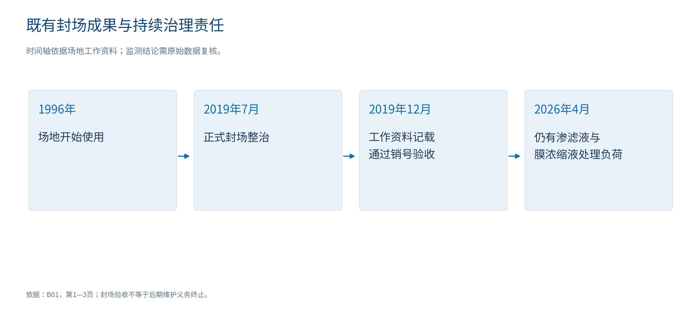
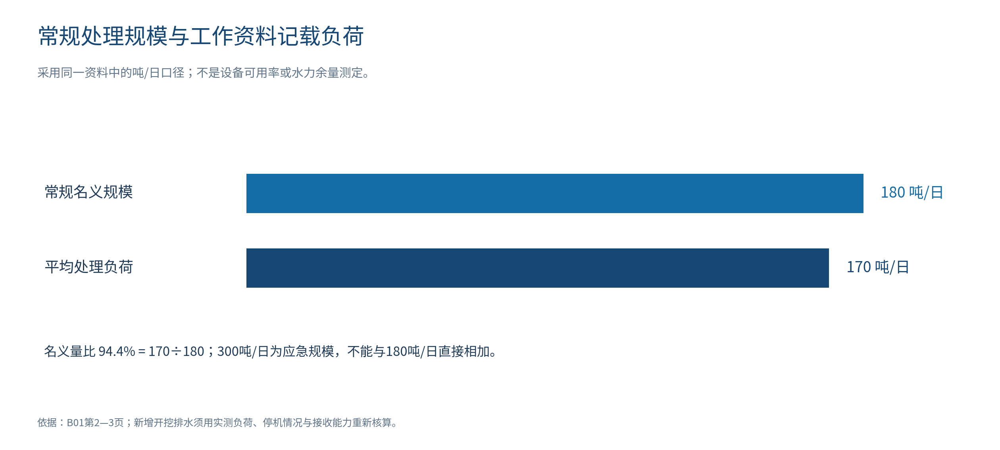
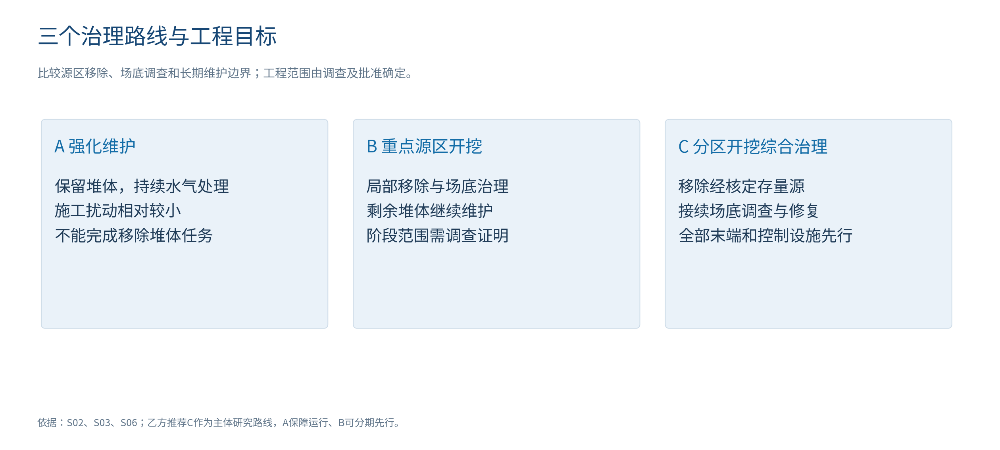
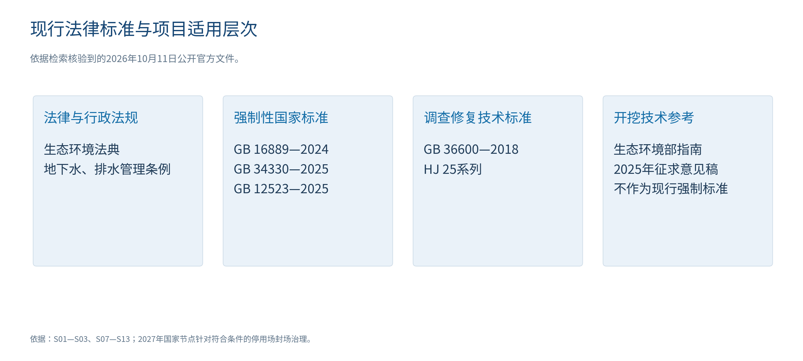
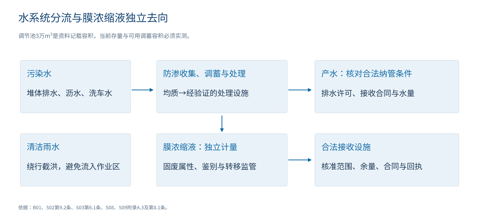
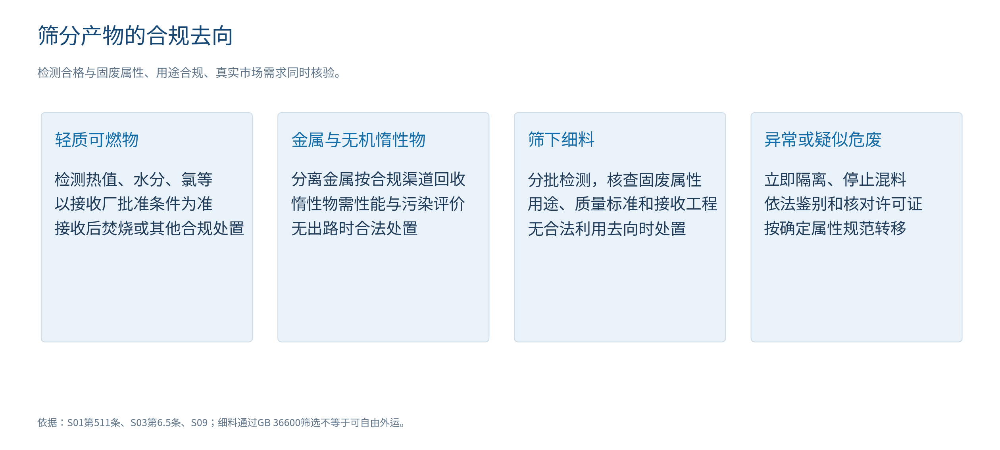
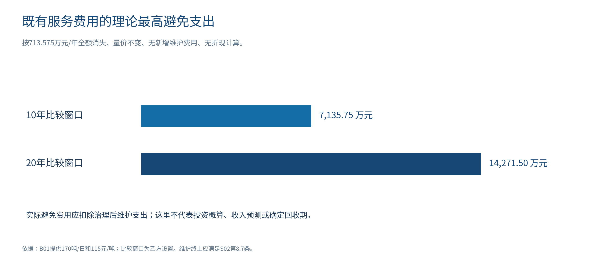
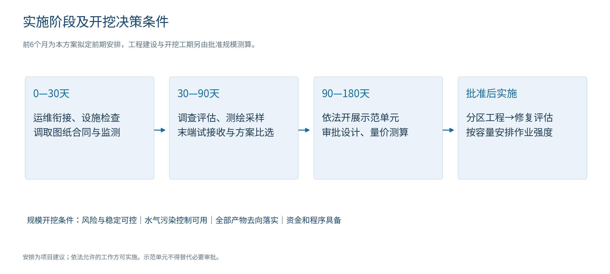

# 大岭山镇旧飞鹅生活垃圾填埋场综合治理可行性研究报告与实施方案

乙方技术研究报告 · 前期研究阶段

编制日期：2026年10月11日

本报告围绕旧飞鹅填埋场存量垃圾、渗滤液及膜浓缩液、填埋气体，以及经调查确认受影响的土壤和地下水提出治理建议。乙方承担本报告的技术论证和方案编制；甲方依法确定项目业主、审批路径、资金安排与实施范围。工程勘察、专项评估及设计批准后形成最终实施参数。

## 可研结论摘要

乙方建议启动以分区开挖为主的综合治理前期，按“污染诊断—风险与稳定评估—末端落实—示范验证—分区开挖修复—效果评估和后期管理”推进。移除堆体、暴露并修复原场底的治理目标需要开挖工程；单纯维护仍是近期保障和方案比较基准，具体开挖范围由调查、示范与审批核定。[B01；S02；S03]

近期首先保障现有水气治理和接收连续，开展污染现状及环境风险调查。资料记载处理渗滤液170吨/日、浓缩液外运20吨/日，合同至2026年12月31日，距本报告日期81天。全国官方记录确认海南、江西开挖筛分实践和阿苏卫成套设施配置，支持有条件的技术可行性，不替代本场验证。[B01；C01—C02]

现有量价折算服务费约713.6万元/年。10年、20年无折现理论最高避免支出为7135.8万元、14271.5万元，实际需扣除治理后维护。主体投资尚需实测工程量、全部合法去向和报价；本报告不承诺投资总额、回收期或未经证实的土地产业收入。[B01；乙方计算；S02；S04]

|可研判断|乙方建议与实施条件|
|---|---|
|急迫性|立即衔接运维，开展污染现状、风险和稳定调查；异常问题按预案优先处置|
|必要性|在移除堆体、核查修复场底的目标下采用分区开挖；具体范围按调查和比选核定|
|技术可行性|已有工程实践；本场示范取得组分、产水、气体、持续能力和真实接收结果后放大|
|科学性|以基线、物料与水量平衡、稳定验算、批次检测和效果评估控制方案，不套用假设密度和产率|
|经济可行性|既有费用可折算，主体投资按工程量、设施及合法末端报价核定；资金落实后批准规模施工|
|实施顺序|甲方组织审批资金；乙方按委托开展调查、可研设计接口、示范与工程实施；污染控制设施先行|

## 1 基本情况概述

### 1.1 既有建设及运行情况

场地位于大岭山镇旧飞鹅村，场地工作资料记载1996年开始使用、2019年7月1日正式封场，封场整治占地106845平方米。项目保留已形成的堆体整形、覆盖、导排、绿化和监测设施，并把其运行状态纳入治理前调查。[B01第1—2页]

图1　场地历史与持续管理责任。资料所引销号验收函尚需调取原件，历史验收不替代现状风险评估。

|基础项目|资料记载及口径|本项目处理方式|
|---|---|---|
|场地封场|2019年7月1日正式封场整治；资料记载2019年12月16日通过销号验收|调取东城综函〔2019〕1688号及竣工图；保留有效封场成果|
|封场占地|106845平方米，折合约10.68公顷、160.27亩|仅为既有整治面积；新增临时用地和最终可利用面积另行核定|
|垃圾存量|B01为250万立方米；B02为170万立方米|两种资料口径未统一；以现状测绘和历史基底恢复确定工程量|
|历史整治投入|B01记载约1261万元，含前期|属于2019年封场整治，不是当前开挖投资基准|
|堆体监测|16个监测点，资料记载每月形成报告|核对布点、位移序列、设备状态和警戒值，按开挖工况补充|
|环境监测|资料记载地下水、地表水、气体季度监测|取得原始报告、采样位置及指标，建立现状基线|
|处理站场地|占地6175平方米，建构筑物面积2100平方米|核查实际设施布局、承载、管线和可改造空间|
|渗滤液设施|常规规模180吨/日，应急规模300吨/日；预处理＋集装箱式两级DTRO|不把两种规模直接相加；以可持续达标能力确定新增负荷|
|现有负荷|平均渗滤液170吨/日；膜浓缩液外运20吨/日|属于工作资料记载负荷；不得作为全年实绩或开挖产率|
|累计处理量|2018年10月至2026年4月30日累计68.81万吨|保留统计截止日，核对计量及结算台账|
|调节池|记载1座约30000立方米，无收集井、环场导排收集|池容不等于存量或可用容量；堆体降液位措施另行设计|
|运维合同|资料记载2024年12月31日至2026年12月31日，处理单价115元/吨|核对合同原件、服务范围、调价和结算条款；及时衔接|

基础数据来源：B01第1—6页，B02存量信息；公顷、亩数按面积换算。上述运行负荷沿用场地资料的吨/日口径，水系统设计时按实测密度、流量和污染负荷核算，不能未经换算直接等同立方米/日。

### 1.2 场地与设施边界

本项目的调查边界覆盖实际垃圾堆体、渗滤液收集和处理设施、历史排水路径、场底及侧向可能受影响区域，以及经水文地质调查识别的地下水下游受体。治理边界根据调查结果确定，不以既有围栏或封场面积机械替代污染边界。土地权属、库区基底、堆体高度、原防渗结构、邻近居民和水体距离等，须以档案及现场成果补齐。[S02第8.8—8.9条；S07第41、45条；S12]

场地资料记载处理产水经尾水专管进入市政污水管网，再进入连马污水处理厂；膜浓缩液由外部单位运输并接收。本项目核查既有环评、排污许可、排水许可、接收合同和接收设施批准范围，新增开挖负荷按现行标准及许可条件办理相应手续。接收单位过去承接过浓缩液，不等于未来已承诺开挖期间全部新增量。[B01第3—6页；S02第9.2条；S08；S09]

### 1.3 场地资料的适用口径

本报告以场地整治工作资料[B01]记录的封场、设施及运维情况为基础。其他背景资料[B02]中垃圾存量等存在差异，作为测绘需统一的输入，不将其风险等级、产业收益或未经提供原件的判断作为现状结论。原始监测、衬层结构、堆体基底、排水许可及接收合同仍需调取核对。资料缺项反映本次研究需要补充的证据，不表示场地运营单位从未实施相应工作。

## 2 现状、存在问题与急迫任务

### 2.1 已有治理成果与持续负荷

场地已完成封场覆盖、整形、导排和处理设施建设，工作资料记载2019年通过销号验收，应保留其有效成果。持续渗滤液和浓缩液处理说明封场后仍存在长期治理负荷。GB 16889—2024第8.7条规定的维护终止条件针对填埋场产生的渗滤液，不是处理站产水；本场目前没有提供满足该终止条件的完整连续数据。[B01；S02]

图2　工作资料记载负荷与名义规模。170÷180＝94.4%为算术量比，不是实测剩余能力。吨与立方米在工程设计中按实测密度和流量换算。

### 2.2 需针对性解决的问题

|现状或资料条件|工程及管理问题|拟采取措施与证据成果|
|---|---|---|
|封场后仍有渗滤液与浓缩液负荷|存量源未移除，持续费用和处理责任仍存在|污染诊断、源区削减与长期维护路线比较，保留现有处理能力|
|常规180吨/日、平均170吨/日|新增抽排、沥水与洗车水不能按名义规模默认接入|实测峰值、停机、污染负荷与稳定处理能力，形成新增承载方案|
|原资料记载环场导排、无收集井|是否存在内部积液、环场导排能否降低单元水位需查明|堆体液位调查及分区抽提设计，不能仅抽调节池替代降堆体水位|
|膜浓缩液约20吨/日外运|接收批准范围、余量、属性管理和中断应急决定连续运行|独立计量、属性核查、接收及备用合同、储存液位控制|
|垃圾量250万与170万立方米差异|直接影响工程量、运输、暂存、预算及工期|测绘基底、分区体积、实测湿密度和组分，不任选数据核定总投资|
|监测结论主要为资料叙述|不能据此定位现状污染、背景变化和地下水受体风险|调取2026年4月后运行及监测，补充基线和风险评估|
|原衬层、场底及开挖岩土条件未明|决定场底清挖、支护、深度和地下水控制方式|档案与勘探联动，分工况稳定验算、污染边界调查|
|未落实未来全部筛分产物的接收|有筛分设施不等于能够完成最终处置|分类试验、试接收与承诺日量，细料无去向时停止新增物料|

依据：B01—B02；S02第7.8—7.10、8.7—8.9及9.2条；S03第4—8章；S09。表中“需查明”项目为研究缺口，未被写成已经发生的污染或违法事实。

### 2.3 当前急迫任务与处置优先级

从2026年10月11日至现有合同记载到期日2026年12月31日为81天。乙方建议甲方将下一服务周期、设施交接、在线监测及合法接收衔接列为近期管理节点。在资料量价和负荷不变的计算边界下，81天渗滤液处理量折算13770吨、对应服务费158.4万元；实际费用按合同服务范围和计量结算，不能以该折算替代采购预算。[B01；本报告计算]

优先顺序为：首先排查气体安全、异常位移、液体外溢及地下水加重等需即时响应事项；其次保持或补齐覆膜、排洪、导排、水气处理和监测；同步完成污染现状及风险诊断，再确定开挖单元和工程量。已确认的风险问题立即针对性处置，主体工程准备不能延误应急措施。[S02第7.10条；S03第8.2条]

国家要求系统建立填埋场隐患台账并“一场一策”治理。“十五五”规划特别要求积存渗滤液和渗漏治理、防止地下水污染扩散或加重。国家2027年节点针对符合条件的停用场封场治理，本场已记载封场验收，不将其解释为全量开挖的统一时限。[S04（十三）；S05二（四）]

## 3 针对性举措、方案优缺点与开挖必要性

### 3.1 治理目标与比选边界

乙方提出两层治理目标：近期保障水气治理连续、识别并控制实际风险；工程阶段有序移除经核定的存量垃圾堆体，暴露并调查原场底，对确认污染的土壤、地下水开展修复或管控，为后续安全利用创造条件。后续用途、净利用面积和开发强度由依法批准的规划、污染与岩土安全条件确定。[S02第8.7—8.8条；S06；S12—S13]

三个方案按污染控制、源区去除、场底可核查性、施工风险、长期维护及费用边界比较，不以历史验收或未取得的风险等级决定路线。后续安全利用并非只有开挖一种方式；但本项目拟定的“移除堆体并核查修复原场底”目标不能由单纯封场实现。

|治理路线|针对措施与优点|局限与代价|本场适用判断|
|---|---|---|---|
|A 强化维护与风险管控|保留封场；修复膜、导排和处理设施；必要地下水控制。施工扰动小，可迅速保障持续运行|存量垃圾保留，处理和监测延续；难直接接近场底；用途受稳定、气体及风险条件约束|作为即刻保障措施及费用比较基准；不能完成移除堆体任务|
|B 重点源区开挖＋剩余区维护|针对局部渗漏、高液位或其他调查确认问题开挖；较小工程范围，阶段削减源区|污染边界和剩余堆体风险需证明；剩余区长期费用继续，不能自动具备全场利用条件|调查证明问题集中时可先实施；可与分期总体开挖衔接|
|C 分区开挖综合治理|有序清除经核定垃圾，分选合法处置；场底可直接调查和修复；逐区完成效果评估|暴露、排水、边坡与运输风险增加，设施、全部末端和资金须先落实；地下水恢复可能更长|乙方推荐的主体研究路线；实际范围、时序和规模经调查、示范与批准确定|

依据：S02第7—8章、S03第4—8章、S06；全国实践C01—C02。优缺点为基于工程机制的乙方比较结论，未赋予未经数据支持的评分或费用差额。

图3　三个路线对应的源区和场底治理范围示意。施工是否达到全量垃圾移除目标，按批准边界及实际工程量核验。

### 3.2 开挖治理必要性的具体落点

第一，现有覆盖和处理主要管理填埋堆体持续产生的水气，存量源本身仍在场内。移除经确定的垃圾源必须通过开挖、分选及合法利用处置实施，覆膜和达标出水不能替代该实物任务。[B01；S02第8.7条；S03第1、5—6章]

第二，拟开展原场底污染调查与修复的区域，需要形成可采样、可施工和可验证的工作面。若仍被垃圾堆体覆盖，则需采取开挖暴露或其他经论证可达到相同目标的方法；乙方推荐分区开挖，使场底调查、源区移除与修复验收衔接。[S03第6.3.8条；S12—S13]

第三，后续场地安全利用必须解决土壤、地下水、沉降和残余气体条件，不能以平整地表替代。对决定移除堆体的地块，开挖是治理与安全利用衔接的必要工程环节；具体后续用途仍须依法审查。[S02第8.8条；S06]

因此，乙方建议启动以分区开挖为主的综合治理工程前期。该建议针对项目目标和实际长期负荷，不属于“法律一律要求所有已封场填埋场全量开挖”的判断。调查如证明局部先行即可实现阶段目标，可先实施B；继续保留区按A维护，最终范围由设计和审批核定。

### 3.3 技术子方案比较与选取原则

|子系统|可选办法与优势|限制及风险|乙方拟采用路径|
|---|---|---|---|
|开挖臭气控制|整体罩棚有利集中收集；移动式密闭单元有利分区；膜下抽气能结合既有覆盖|整体结构需论证用地、风荷载、消防及投资；移动单元接口可能泄漏；单独喷药不能替代集气与安全控制|以可控制的小单元、密闭作业和集中处理为设计目标；覆盖结构经气象、空间及安全专项确定|
|渗滤液处理|利用现有预处理＋DTRO有运行基础；新增临时或扩建设施应对抽排；合法外部接收提供备用|实际可用能力未核定；膜浓缩液增加；外部接收须符合水质、水量、许可和合同|现有系统连续运行，先核能力与浓缩液去向，按新增负荷试验后决定扩建或接收|
|膜浓缩液|合规外部接收可衔接现有模式；物化、生化及高级氧化组合可作为技术候选|运输和接收中断影响全系统；科研中试不能代替本场全规模达标、单价与属性核查|先落实合法接收与备用；本场水质中试比较，未经验证不改变既有基线工艺|
|垃圾分选|沥水后筛分、金属分离及适配轻重分选可减少不必要处理环节|含水、黏结、细料比例影响产能；盲目新增破碎或湿洗可能增加气液负担|以代表性试验确定流程、筛孔和持续能力，所有产物落实最终去向|
|地下水控制|查漏、降堆体液位、防渗修补、抽提或阻隔可针对不同污染机制|需明确流场、污染范围、抽提水处理和长期有效性，不能机械选取同一措施|按诊断与风险评估设计，地下水与堆体排水分系统计量和管理|

技术方向依据S02第7.10、9.2条，S03第6章及C03。表内方案为乙方拟定比选，具体设备、尺寸、能力和单价通过专项设计与示范核定。

## 4 开挖综合治理政策导向与全国案例

### 4.1 2026年现行体系

《中华人民共和国生态环境法典》自2026年8月15日起施行，原环境保护法、环境影响评价法、固体废物污染环境防治法、土壤污染防治法等法律同时废止。项目法律依据采用法典；旧文件中对原法律的引用按其发布背景理解，具体实施服从现行法律、行政法规、标准和许可要求。[S01第1242条]

图4　项目文件适用层次。征求意见稿及外地地方实践用于技术论证，不能替代广东、东莞项目审批要求。

|文件|对本项目的约束或指导|具体适用位置|
|---|---|---|
|生态环境法典|回收物质按规定用途标准使用；处理设施不得擅自关闭、闲置或拆除；监测依法实施|S01第511—513条；建设、排放及修复遵守对应章节|
|GB 16889—2024|封场后继续处理渗滤液和气体；衬层检测、地下水风险评估、异常应急；开发前调查评估|S02第7.8—7.10、8.7—8.9、9.2条|
|地下水管理条例，2026年修订|填埋场防渗漏、地下水监测井、风险评估和修复纳入地下水防治内容|S07第40、41、45条|
|城镇排水与污水处理条例，2026年修订|依法取得适用排水许可、执行水质要求，接受接管监管|S08排水许可及排水管理条款|
|GB 34330—2025|确定固废属性，核查利用产物和膜浓缩液管理条件|S09第6—8章、附录A.3 b）2）|
|GB 12523—2025|施工噪声限值、测点及评价；2026年1月1日替代2011版|S10第4章及表1|
|GB 36600—2018，HJ 25.1—2019至HJ 25.4—2019及HJ 25.5—2018|建设用地土壤调查、风险评估、修复与效果评估；不替代固废属性判断|S11—S13|
|固体废物综合治理行动计划，国发〔2025〕14号|隐患排查、“一场一策”、持续治理、合规资金支持及责任落实|S04（十三）、（二十三）、（二十五）|
|固体废物污染防治“十五五”规划，2026年|建立隐患台账、高风险场地综合治理，处理积存渗滤液、防止地下水扩散或加重|S05二（四）|
|污染地块修复与开发建设衔接指导意见，2026年|分区调查、程序衔接、修复方案与开发参数协调，严格限制重大安全隐患修复方式|S06二至五|
|开挖治理污染防治技术指南，2025年征求意见稿|调查、预处理、开挖、分选、产物去向、监测与应急技术参考|S03第4—8章；检索取得版本为征求意见稿|

HJ 25标准组在本表中分别为HJ 25.1—2019、HJ 25.2—2019、HJ 25.3—2019、HJ 25.4—2019；HJ 25.5为2018版。其他工程设计、恶臭、颗粒物、焚烧和安全标准，在专项设计中按主管部门最新有效文本及相应许可要求落实。征求意见稿中的数值若被本方案采用，均作为拟采用的技术控制参考，不能表述为已生效的国家开挖强制条款。

### 4.2 三项直接影响项目决策的要求

第一，封场后管理存在明确延续条件。GB 16889—2024第8.7条要求继续运行维护渗滤液收集和导排系统，继续处理填埋场产生的渗滤液和气体并定期监测，直到填埋场产生的渗滤液中水污染物浓度连续两年低于表2、表3限值。处理站产水达标不等于未经处理的填埋场渗滤液达到该终止条件，现有资料不足以支持停止后期治理。[S02]

第二，国家2027年节点要求符合条件的停用填埋场完成封场治理。《行动计划》规定，2024年底前停用且无后续使用计划的填埋场，原则上到2027年全部完成封场治理。本场资料已经记载封场验收，当前重点是核实后期维护与隐患治理，不将该政策误读为全量开挖的统一截止日。“十五五”规划要求完成高风险生活垃圾填埋场综合治理，但本场是否属高风险须依据专项调查认定。[S04（十三）；S05二（四）]

第三，垃圾清运、场地环境修复与开发利用是相互关联的不同任务。垃圾挖除以后仍需确认场底土壤和地下水风险；场地后续利用必须履行相应调查、评估、修复、效果评估与规划程序。大面积深基坑方案应特别核查安全风险，不能以尽快开发为由跳过污染诊断和修复效果评估。[S02第8.8条；S06；S12—S13]

### 4.3 跨地区开挖治理实践

深圳市城市管理和综合执法局2023年5月24日发布的现场调研记录，明确调研组赴海南三亚、海口颜春岭和江西吉安泰和等填埋场，实地考察库区维护、配套设施运营及开挖作业现场，了解开挖筛分处置、工期管理、搬迁和生态修复问题。该记录证明跨地区存在实际开挖和筛分实践，但未公布各项目总投资、工程量、完成率和利润。[C01正文]

|地区与案例|官方资料直接确认的事实|本项目采用的经验|证据适用边界|
|---|---|---|---|
|海南三亚填埋场调研对象|官方记录包括三亚现场开挖、配套设施和筛分处置流程考察|把原场维护、处理设施与开挖同时纳入组织计划|记录未列具体场名、规模和治理完成情况，不扩展为特定未核实项目|
|海南海口颜春岭|官方现场调研明确点名；考察开挖作业及搬迁修复相关问题|开挖前落实接收设施和工期衔接，保留处理能力|未披露投资、工程量和经济回收数据，不作为单价标杆|
|江西吉安泰和|官方调研明确地点，涉及开挖筛分及生态修复问题|按地形、场底和末端条件分区，记录作业问题和纠偏|不据调研记录声称已竣工或达到某种收益|
|北京阿苏卫园区|官方开放资料列陈腐筛分3000吨/日、焚烧3000吨/日、渗滤液850吨/日的设施配置|固体去向与水处理配套，不能只有筛分线而无最终接收能力|数据属于配置规模，不是实际年处理量、垃圾清除完成量或本场处理率|

案例来源：前三项C01，第四项C02。不同设施的设计规模不构成物料收支比例，不能用850÷3000作为本场产水系数。

### 4.4 广东浓缩液技术与地方监管实践

深圳市城管部门2026年3月19日公开信息确认，广东省住建厅科技项目《垃圾填埋场渗滤液膜浓液处理技术研究》于3月12日通过科研验收，组合技术为“高效物化沉淀＋强化生化处理＋PS高级氧化”。本项目可将该技术作为浓缩液处理比选和针对本场水质的中试候选；科研中试验收不等于在本场全规模连续达标、成本确定或可直接替换DTRO。[C03]

深圳2024年鸭湖填埋场地下水检查信息同时开展地方维护、搬迁规范宣贯，确认当地《已封场生活垃圾填埋场维护规范》《生活垃圾填埋场搬迁技术规范》于2024年7月1日生效。这说明封场维护、地下水监测与搬迁监管具有衔接实践。本项目依法执行广东、东莞实际适用文件，不直接将深圳地方规范作为本镇强制性规定。[C04]

### 4.5 末端出口不足导致治理失效的监管案例

生态环境部2019年5月15日公开营口市生活垃圾污染问题督察信息，指出最终无害化处置“出口”不足，所依托筛分—发酵设施长期无法正常运行，生活垃圾多处周转。该案例属于监管反面案例，不能作为成功清挖竣工或成本标杆；其直接启示是筛分和转运本身不能完成污染治理，必须具备真实、持续、合规的最终接收能力。[C05存在问题部分]

乙方将接收厂质量要求、批准范围、可接收日量、计划停机、拒收和备用路线作为工程放大条件。案例资料中未公布且未取得原件的投资、利润与竣工效果不进入本场投资或收益测算。北京配置规模不作为本场产水系数、筛分产能或固定工期。[C01—C02；C05；S03第6.3.1条]

## 5 开挖综合治理具体实施方案

### 5.1 工程范围、控制目标与甲乙方接口

拟实施范围为经调查确定的垃圾堆体、现有及新增水气处理设施、分选与暂存、场内及外部运输，以及需修复的场底土壤和地下水。工程边界、临时用地和可利用面积由权属、测绘、调查及依法批准的文件共同确定。所有分区按“控制设施可用、稳定气液条件具备、产物去向落实、资金和必要程序齐备”进入开挖，实行单元检查、停工纠偏与复核制度。[S01—S03；S06]

|管理接口|甲方或项目业主|乙方技术及实施团队|形成的交付成果|
|---|---|---|---|
|目标与范围|确定委托范围、权属和项目目标|调查、风险及工程边界论证|现状总图、治理分区、目标与范围建议|
|审批与资金|依法组织审批、资金安排和对外合同|提供技术资料、设计接口、工程量及测算|适用程序清单、可研与专项、概算输入|
|处理和末端|落实原设施管理、合法接收协调|验证设施能力、样品与试接收、日量约束|水气方案、物料平衡、接收技术条件|
|施工与监管|组织相应招标、监理和监管接口|按合同及批准方案实施，记录环境安全和去向|单元记录、监测、计量、异常闭合|
|效果与移交|组织适用验收、后期主体和资金|提交竣工、去向、效果及维护资料|成果档案、剩余风险与移交清单|

甲乙方具体职责以法定责任和最终合同明确；乙方技术建议不替代主管部门审批，也不默认乙方兼有独立监理、检测或效果评估职能。

### 5.2 调查工作与成果

|调查内容|具体工作|形成成果与用途|
|---|---|---|
|档案与权属|调取征地、历次设计竣工图、封场验收、底部防渗、环评许可、运维和接收合同|确定责任及合法边界，识别原设施可保留部分|
|垃圾量及基底|地形测绘；结合历史地形、勘探恢复基底，分区计算体积；测定湿密度|统一170万、250万立方米差异；体积和质量不混用|
|垃圾组分与筛分|按历史填埋分区、深度和差异采样，开展含水、组分、筛分试验及必要污染特征分析|得到各产物质量比例、沥水量和适配工艺；无固定套用比例|
|堆体及结构|复核16个点位和位移序列，查明坝体、侧坡、支护、防渗结构与收集管|不同液位、开挖深度和机械荷载下稳定验算|
|水文地质与污染|识别含水层、流向、上下游和敏感受体；核对监测井和历史水质，开展土壤调查|确定背景与异常变化、污染范围和修复目标|
|气体与稳定化|调查甲烷、硫化氢等及堆体稳定化状态，识别需要预处理的区域|确定气体抽排、好氧预处理、防火与安全方案|
|液体和处理设施|测量堆体及调节池液位、存量、雨天变化；核实实际处理能力、浓缩液产量和外运|形成水量水质平衡和新增设施设计输入|
|末端能力|核对接收厂批复、许可、现有负荷和可承接日量；样品试验与试接收|明确所有产物去向、质量条件、价格和备用渠道|

调查按S02、S03第4章、S07及S12适用要求执行。布点、数量和深度由现场条件和规范设计确定，不以固定少量样品替代代表性调查。涉及井、池或封闭空间的工作执行独立安全程序。

### 5.3 示范单元

本项目在调查明确、依法完成所需程序、处理设施可用和接收条件已落实的区域设置示范单元。示范单元覆盖代表性垃圾层位和不同含水情况，记录“开挖输入—沥水—各产物—外运—库存”的质量收支及完整工作日运行数据，形成量价、能耗、气液负荷和接收适应性成果。

示范单元设备包括适配的筛分、金属分离和必要轻重分选，具体筛孔、流程和能力通过试验确定，不预先认定所有垃圾必须破碎或所有细料可以利用。需破碎时先隔离异常废物并完成气体安全评估，避免含气物料及异常物混入高速设备。[S03第5.3、6.4—6.5条]

|示范记录|用于放大设计的结果|停止或调整条件|
|---|---|---|
|每日各类产物量、含水和质量|实际筛分比例、稳定产能、合法去向与接收率|出现未识别物、超接收条件或大量滞留时调整|
|进出水量及原水特征|处理设施可承载水量和污染负荷，浓缩液独立量|不能达标或合法接收不足时停止新增物料|
|甲烷、硫化氢、温度和臭气|预处理、密闭抽气及安全设计参数|安全报警、局部自热或臭气控制失效时停工查因|
|位移、液位与开挖稳定|层厚、作业面、抽排和边坡条件|位移异常、积水或稳定不足时停止危险区作业|
|计量、人工、设备与转运|工作包实际用量和可核验单价|质量收支不闭合、去向回执缺失时纠偏|

### 5.4 总体流程与分区组织

本项目采用分区、分层和小范围暴露的作业方式，按照末端接收能力组织开挖。保留有效覆盖和原有水气控制设施，对正在开挖的单元设置临时截洪、防渗导排、抽气及安全监测；未开挖区维持原覆膜和维护，完成区尽快进入场底调查或覆盖管理。作业道路与临时设施避开未经核查的薄弱坝体和边坡。[S03第6.3.1—6.3.3条]

图5　拟采用治理流程。调查确认稳定化程度后确定是否需要好氧预处理及其工艺，不对全场机械套用统一预处理期限。

### 5.5 渗滤液与浓缩液控制

抽排或预处理之前，本项目查清堆体积存液、调节池积存液、持续产液，以及施工新增沥水和冲洗水。原收集系统资料记载无收集井，环场导排是否能降低内部液位须经调查；必要时设置分区抽提设施，避免仅抽空调节池而堆体高液位仍未下降。[B01；S03第6.1.1条]

开挖前将水位降低至安全工况。参照征求意见稿第6.3.5条，单元渗滤液水位控制在开挖单元底部以下1—2米，并以稳定验算复核抽排和开挖进度。地下水抽提和堆体渗滤液抽排采用可识别的独立系统，防止不同污染程度水体无序混合。[S03；S07]

图6　拟建水系统关系。浓缩液不是已经达标的产水，禁止把其独立去向省略。

|液体环节|本项目措施|核验与运行条件|
|---|---|---|
|清污分流|库区外截洪绕行；作业区降雨、沥水、洗车及设备冲洗水进入污染水收集系统|每日巡查连通、堵塞、围堰及膜破损；雨前复核|
|调节和应急|核定实有液量、可用调蓄及应急余量，设置液位监控、备用泵和供电|不能以30000立方米设计容积直接当作可用应急池容|
|现有DTRO|评价预处理、膜污染、供电、停机、产水水质和浓缩液负荷|180、300吨/日名义规模经实际连续运行核定，避免未经试验扩载|
|新增处理|根据新增污染负荷比选扩建、临时设施及合法外部接收；按本场原水中试|接收厂正常运行和处理效果不得受影响；设施和程序先于新增开挖|
|纳管产水|核对排水许可、污水厂接收条件、合法合同及适用排放限值|按GB 16889第9.2条执行间接排放要求及更严格许可条件；资料中的表2口径不自动替代现行纳管要求|
|膜浓缩液|独立储存、计量、运输和接收回执；核查固废及危险废物属性|GB 34330附录A.3明确列出膜浓缩液；结合第8.1条等适用条件核定管理方式，不一概认定危废|
|处理残渣和污泥|按来源、属性分类，防渗、防雨、规范台账和转移|接收许可覆盖对应类别；禁止混入普通土料和细料|

依据：S02第9.2条；S03第6.1、6.4条；S08；S09。原资料记载过去有浓缩液回灌，本项目不以回灌作为减少外运的默认措施。任何变更均须满足现行标准、许可和污染风险控制要求。

### 5.6 气体、恶臭、颗粒物与安全控制

先调查填埋气体、垃圾稳定化和水位，针对尚不符合开挖条件的区域实施抽气或经验证的好氧预处理。注气前识别自热、火灾和边坡风险；设置温度、气体与系统运行监控，异常时停止注气、隔离并采用专项措施，防止把环境治理变为火灾风险。[S03第5.2、6.2条；本项目风险控制设计]

开挖区采取膜下抽气、缩小作业面、及时覆盖和适配除臭；筛分车间采用密闭、防渗、局部集气及集中处理，物料传输和装卸控制散逸。通风除臭系统同时开展防爆和职业健康评估，不以增加抽风代替人员保护。治理车间按垃圾性质选择除尘和臭气处理工艺，避免高尘负荷、湿气和腐蚀性气体造成设施失效。[S03第6.1.3、6.2.4、6.3.6、6.4.4—6.4.5条]

|技术参数或措施|官方参考内容|本项目适用说明|
|---|---|---|
|预处理气体核验|停止抽注气24小时后检测注气井和抽气井甲烷，预处理要求低于5%|S03第6.2.1条；仅为稿件中的堆体预处理指标，不能作为人员进入或机械安全阈值|
|预处理期限|根据甲烷和含水情况确定，不低于12天|S03第6.2.6条；达到天数不自动具备开挖许可|
|预处理层深|宜分层，深度宜5—6米|S03第6.2.3条；结合场地液位、结构和工艺试验采用|
|作业面气体监测|作业面上2米范围1—3点，至少每日1次，甲烷超过1%加密|S03第7.3条；环境监测最低技术参考，独立安全监测按安全设计连续或更严格执行|
|工艺密闭|沥水、筛分、暂存设施防雨、防渗、集气；输送和装卸防散逸|S03第6.4条；除臭故障、明显散逸时暂停新增物料|

人员作业采用独立的可燃气体、氧气及有毒气体检测报警和安全作业制度，由专项设计明确职业接触限值、报警设定、受限空间许可、机械防爆和应急疏散条件。任何井池进入作业不得用征求意见稿的5%或1%甲烷指标替代安全许可判断。[S03第6.1.6、6.3.6（3）条]

### 5.7 开挖层厚、场底保护与稳定

开挖按从上到下、从高到低、分区分层作业，依据岩土调查和专项验算确定边坡、作业面、机械荷载和层厚。参照征求意见稿第6.3.5条，一般分层厚度不超过5米；本项目不预设整场一次挖到底，深度与地形不明确前不设计大面积深基坑。每次改变液位或开挖形态，复核相邻堆体、坝体和临时支护的稳定。[S03；S06三（五）]

每日结束作业及时覆膜并完善临时截排水。剥离的未污染覆土与垃圾分开暂存；污染覆土不得冒充干净土。对有人工防渗衬层的区域，接近场底1米时加强监控、降低机械破坏风险，垃圾清除后再按方案处理衬层；对无人工衬层的区域，清查明显污染土，并根据调查、风险和修复目标治理。[S03第6.3.3—6.3.4、6.3.8条；S12]

### 5.8 沥水、筛分与固体去向

当含水率大于40%时，参照稿件第6.4.3条先沥水后筛分；沥水全部收集处理。筛分设施设防渗地面、收集沟、防雨和集气，按来源单元批次处理和计量。产物设置明确分区、标识和库存上限，库存上限由可用设施、合法接收日量和经审批的贮存条件核定；末端拒收或库存达到控制值，减少或停止新增开挖，不依赖露天扩大堆场。[S03第6.3.1、6.4条]

图7　拟采用分类去向。GB 36600风险筛选、固废属性和实际使用条件分别核验。

|产物|检测及核验|去向与失败时处理|
|---|---|---|
|轻质可燃物|批次含水、热值及接收设施规定的氯等指标，确认许可和余量|接收厂满足要求后焚烧等合法处置；不满足条件时调整预处理或其他合规路径|
|金属|分离纯度、附着污染及渠道合规|按合规回收渠道利用，合同和计量留痕|
|无机惰性物|粒径、工程性能、污染特征、用途和属性|满足实际工程及管理条件方可利用；否则合法处置|
|筛下细料|按批次评估有机物、污染特征及拟利用性能；核查固废属性和用途标准|不得只凭GB 36600第二类筛选值外运回填；无合法利用出路时按核准路径处置|
|疑似飞灰、医疗残渣或其他异常废物|单独隔离，识别来源并依法鉴别；禁止再混合稀释|依据最终属性与适用要求选择有相应能力、许可的设施，履行转移监管|
|废膜、废管及处理残渣|来源记录、污染和属性判断|相应回收、利用或处置，不混入“清洁覆土”|

依据：S01第511条；S03第6.3.10、6.5条；S09。项目合同预先规定拒收、退运和异常鉴别责任，任何未检验或未获实际去向的物料不得按产品出售。

### 5.9 土壤与地下水治理

地下水调查以水文地质关系和背景值为基础，区分历史污染、施工影响和本地背景。若发现污染或进一步扩散迹象，及时查找渗漏、地下水通道及高液位问题，可经论证采取抽提处理、堆体排水、防渗修补或垂直阻隔等措施，措施须与水量处置能力和地下水流场评估衔接。[S02第7.10条；S03第6.1.5条；S07]

场底污染土按调查及风险评估确定治理范围、目标和修复技术，不把所有场底土直接外运，也不因垃圾已经移走即认定土壤无风险。修复后由规定的效果评估程序验证。地下水恢复可能晚于垃圾清运，项目保留后续监测、抽提或管控预算和责任，按评估结果调整维护期限。[S06；S12—S13]

### 5.10 噪声、运输及天气防护

建筑施工噪声按GB 12523—2025第4章执行，一般场界昼间70、夜间55分贝，夜间最大声级超限幅度不高于15分贝；测点无法在场界测量或需在敏感建筑室内测量时，按相应条款确定位置及修正评价，不机械套用普通场界限值。[S10第4.1—4.4条]

场内运输与外运采用密闭、防遗撒车辆，出入口设底盘车轮冲洗和除臭，冲洗水进入污染水系统。路线核查居民点、学校、交通承载及敏感时段，减少集中排队和夜间扰民；异常投诉、道路遗撒与异味记录联动作业管理。[S03第6.3.6、6.5.4条；本项目运输管理安排]

台风、暴雨前检查截洪、膜锚固、边坡、液位、备用电源及调蓄。天气达到专项方案停工条件时停止开挖和高风险设备作业，保留必要安全运维；雨后复核位移、积水、收集系统和气体再恢复作业。设计降雨与警戒值由专项设计采用实际气象和工程资料确定，不凭经验虚设。

### 5.11 分阶段监测

治理前取得连续历史资料与现状基线；施工期间同时监测排放、地下水、气体、位移和液位；完成单元及竣工后按效果评估和后期维护要求开展监测。监测记录与作业单元、开挖量、天气、设施工况对应，使异常变化能够溯源。[S02；S03第7—8章；S12]

|对象|施工期拟采用安排|依据及控制动作|
|---|---|---|
|地下水|利用合格既有井，必要时补井；按稿件至少每周1次，异常加密|S03第7.2条；指标遵守GB 16889；结合背景及流向判别，查因并阻止扩散|
|甲烷及安全气体|环境监测采用稿件1—3点、至少每日1次及超过1%加密；安全报警按专项方案更严格实施|S03第7.3及6.3.6（3）条；安全异常立即停工隔离|
|有组织恶臭及无组织排放|按稿件至少每月1次，敏感点或扰民情况增设在线监测，许可有更严规定的执行更严要求|S03第7.4条；异常暂停相关新增作业并复核除臭|
|处理水与浓缩液|保持既有在线及自行监测，按实际新增工况、许可和接收条件调整；分别计量|S02第9.2条；接收能力、产水指标与库存联动控制|
|位移及水位|维持原监测，开挖变化和暴雨工况加密；频次与警戒按专项设计|S02第7.8条、S03第6.3.2条；异常停止危险单元|
|噪声及运输|按GB 12523—2025规定测点和方法，重点关注敏感时段、投诉和工况变化|S10；采取隔声、维修、错峰和路线调整|

上述稿件频次作为本项目拟采用技术参考，并不意味着该稿件已生效；环境监测不能替代职业健康、安全生产监测。项目按实际许可和主管部门要求确定最终方案。

### 5.12 具体风险点和应对

图8　发现异常后的项目控制程序。恢复作业须满足纠偏、复核和记录要求，不能只凭进度需要恢复。

|风险点与触发迹象|处置措施|责任安排与复核成果|
|---|---|---|
|内部积液或外溢，液位升高、收集堵塞|停止新开挖和新增污染负荷；启用抽排、备用设施和合法应急接收，检修防渗导排|施工及运维单位处置，监理核查；形成液位、水量和去向记录|
|甲烷、有毒气体或低氧报警|停止危险区作业、疏散和隔离；核查通风抽气及气体来源，按专项安全条件复测|安全负责人组织，专业单位复核；保留报警、人员清点和复工记录|
|注气造成自热或火情|停止相关注气和物料作业，实施专项防火处置，防止消防污水外排|施工安全组及应急体系响应；气体温度和污水去向复核|
|边坡位移、局部坍塌或机械超载|撤离危险区，停止坡脚扰动；降液位、卸载、支护或坝体加固经专业论证|岩土技术负责人、监理；稳定复核与重新划定作业区|
|浓缩液渠道中断、储罐液位接近控制值|提前减载，不新增开挖排水；启用已核验备用渠道，核查罐体和转运能力|运维单位与业主协调；合法接收及库存回执|
|末端拒收、筛下物滞留|按未落实去向物料管理，停止新增开挖或对应筛分，重新试验及合同确认|项目处置负责人；真实接收能力和复核质量资料|
|飞灰、医疗残渣、油桶等异常物|隔离单独贮存，禁止混料和稀释；依法鉴别并转移至适配设施|施工、环保管理人员；鉴别报告、许可证和转移记录|
|地下水指标异常或污染加重|核查采样和背景，同时查漏；实施防渗修补、抽提或阻隔等论证措施|环保技术负责人及业主；趋势、流场和措施有效性核验|
|恶臭投诉或处理系统失效|缩小并覆盖作业面、停止新增物料，修复集气除臭；敏感点加密监测与反馈|施工及环保组；投诉闭合和复测结果|
|台风暴雨、停电或交通中断|按预案停工，保障覆膜排洪、抽排和备用供电，预留合法转运条件|业主应急协调、施工运维响应；雨后巡查和安全复核|
|工程量与价格明显偏离|核查测绘、称重、组分、合同边界和变更；保留原始记录，依程序调整|业主、监理、造价审核；避免无依据追加费用|

本项目业主统筹突发环境事件和安全应急衔接，施工单位负责作业面处置，运维单位负责水气设施，监理核查控制条件。严重事件按法定职责及时报告并启动相应预案。[S03第8.2条；S02第7.10条]

### 5.13 单元实施、物料水量平衡及放行条件

每一单元建立同一计量边界：开挖输入质量＝分选产物质量＋沥出液体质量＋同边界库存增加量＋其他经核实的质量变化。覆土、设施残材和异常废物单列；沥水、干燥与检测采样等变化明确记录，不能把湿质量与干质量直接相比。量质不闭合时核对称重、含水和转移环节，不以无依据损耗率强行闭合。[S03第5.3、8.1条；乙方量质管理方案]

水量按堆体抽排、区内降雨、沥水、冲洗、工艺加入水、处理产水、膜浓缩液、外运和池容变化独立核算。流量、液位与降雨对应，污染负荷按水质与流量共同计算，不用170÷180的名义量比替代实际水量水质承载。抽提地下水另列，防止污染水与背景地下水混算。[S03第4.3、6.1.1条；S02第9.2条]

|检查环节|单元进入或继续作业条件|未满足时的措施|
|---|---|---|
|程序和设计|必要手续、分区作业和安全环保方案具备|不以示范或清理名义先行违规开挖|
|气体和稳定|专项安全、液位及稳定条件满足；预处理按实际检测确认|停止危险区作业，抽排或专项纠偏并复核|
|水气控制|收集、调蓄、处理、备用和集气系统有效运行|停止新增物料或负荷，不允许无设施暴露开挖|
|暂存与最终去向|批次质量、接收日量、库存控制与合法运输落实|减载、覆盖、停止新开挖；不以扩露天堆场替代去向|
|场底与残留|达到调查要求，污染土及原衬层依方案处理|增加调查和修复，保留未完成区控制设施|
|评估与移交|清挖、去向、土壤地下水及必要后期管理资料完整|形成剩余任务清单和资金，不提前停止必要设施|

库存控制值由可用贮存空间、物料特性、接收合同和适用管理条件核定，不能凭未核实的固定“储存天数”放大露天堆存。甲方、乙方、运维和监理按职责核查，异常有记录、措施、复测和恢复条件。

### 5.14 效果评估与治理后措施

施工完成按测绘边界及高程、分选和外运计量、所有产物去向、场底残留、土壤地下水效果及工程稳定分别核验。污染地块调查、修复及效果评估依HJ 25系列及适用程序执行；地下水恢复晚于清挖时保留管控、监测、处理设施和运行资金。建设项目适用环保手续与后续用地程序分别完成，垃圾已清运或地表已平整不能作为结束全部治理的依据。[S02第8.7—8.9条；S06；S12—S13]

乙方提交剩余风险和用途限制、保留设施、监测点位、维护周期判定条件、运行经费边界和操作资料。甲方落实后期管理主体及资金后进行移交。除依法达到管理终止条件外，现有必要渗滤液和气体治理不中断。

## 6 投入产出核算、资金与综合效益

### 6.1 核算边界与可确认的现有费用

项目投资包括前期调查及设计、临时水气和交通设施、开挖分选设备与施工、各类物料运输及合法利用处置、污染土壤地下水治理、监测效果评估、必要后期管理及按适用规定计列的其他费用。历史封场投入属于既有投入，不能作为新工程预算，也不能因已支付而取消持续维护。乙方对既有量价进行算术折算，对新工程按可审核的量价核定。[B01；乙方投资边界]

|核算项|原始口径及计算|结果与适用边界|
|---|---|---|
|现有年度处理量|170吨/日×365日|62050吨/年；资料平均量折算，非实测年度总量|
|现有年度处理服务费用|62050吨×115元/吨|7135750元＝713.575万元，约713.6万元/年；非决算及开挖单价|
|合同记载剩余时间|2026-10-11至2026-12-31的日期差|81天；报告日与到期日采用日期差，不等同剩余可结算天数|
|81天量价折算|170×81＝13770吨；13770×115|1583550元＝158.355万元，约158.4万元；实际按计量与合同结算|
|膜浓缩液年度量级|20吨/日×365日|7300吨/年；单列，不与原水进水量相加作为新增液体|
|历史封场费用|场地工作资料记载约1261万元，含前期|历史建设费用，不能作为开挖预算或今后节省额|

来源：B01第1—3页；日期与算术为乙方计算。115元/吨包含哪些维护、浓缩液外运和监测服务，先核合同原件；未核实前不得把这些费用另行叠加造成重复计价。运行数据截至2026年4月，实施预算应更新实测量及下一周期价格。

### 6.2 主体工程预算工作包与计价要求

|工作包|计量与费用构成|核价和支付依据|
|---|---|---|
|A 调查、测绘与评估|测绘面积、钻孔米数、采样检测批次、岩土与环境专项|经批准调查方案、检测清单和成果范围；合格成果验收|
|B 设计、手续及专项|设计阶段、工程范围、安全环保与后续利用接口|实际委托范围及适用计费依据，防止重复委托|
|C 临建与环保设施|防渗暂存及分选场面积、截排长度、集气处理风量、调蓄及应急设施|设计工程量、设备报价与现场条件；设施试运行合格|
|D 堆体预处理|抽排水量、井/管工程量、气体系统及运行期|实测液位和气体、抽排设计；与现有设施共用费用分清|
|E 开挖与分选|开挖立方米、实测湿质量、筛分持续能力、设备台班/租期|统一测绘与示范结果；报价说明按m³或吨结算，不混用|
|F 可燃物处理|分类质量、运输里程、焚烧或其他合规接收价|实际批次质量、核准接收与日量、称重及回执|
|G 金属和惰性物|回收质量及收入，惰性物合法利用或处置量|产品/物料质量、属性和真实接收合同；收入与成本分别记账|
|H 筛下细料|细料湿/干口径、检测、处理、运输及利用或处置量|示范产率、质量、合法用途和市场；无出路时按处置核价|
|I 异常与危险废物|隔离贮存、鉴别批次、确定属性后处理运输量|依法鉴别、接收资质和实际计量，不预设全部为危废|
|J 原水和膜浓缩液|分系统吨或m³、原水污染负荷、浓缩液量和合法转移|试验、设施负荷、服务边界及接收报价；禁止重复计入进水和浓液|
|K 场底土壤地下水|污染土量、修复工艺、水量、管控设施及实际运行期|调查、风险评估、试验和修复设计；不得预设全场污染|
|L 监测、评估及后期|点位频次、检测项目、效果评估、保留设施运行期|适用标准及批准方案，维护终止条件和移交边界|
|M 其他及预备费用|依法适用的工程其他费、预备费及建设期费用|按批准项目类别、计价规定和资金安排核定，不任取比例|

上述工作包是乙方工程计价边界，不是已获批准的概算。现有公开案例未取得可比的完整竣工成本、分项工程量及真实结算单价，不据其技术记录推算本场“每吨成本”。主体投资在体积、湿密度、产物比例、水量、距离、工期、最终去向和价格核实后编制。

投资核算为I＝各计量工作包工程量×对应含税合同单价之和＋依法适用其他费用。回收收入另列，不冲减未确认成本；必要后期维护单独列现金流。筛分、开挖、设施、处置和运输若使用综合报价，明确已包含项后再汇总。调查和示范成果应能追溯每项工程量与价格依据。

图9　投资从工程量、真实接收和报价核定，不从假设总量直接套算。

### 6.3 工程量与价格变化的可计算影响

垃圾体积存在170万、250万m³两种资料口径，尚不选其一作为概算量。对按开挖体积计价的同一工作项，若单价仅变化10元/m³，两个体积条件下费用变化分别为1700万元、2500万元。10元/m³是乙方设定的敏感度步长，不是实际报价，也不是综合处理单价；按吨计价的分选、运输及处置费用不能直接使用该公式。[B01—B02；乙方算术计算]

|变化因素|计算关系|应采取的投资控制措施|
|---|---|---|
|体积口径|体积误差×按体积计价单价|测绘地形、基底、边界及分区，核实原覆土等是否进入计价量|
|分选产率|开挖湿质量×产率变化×对应运输处置单价|代表性试验及试接收，统计含水；不预设细料全部免费利用|
|水量与水质|新增需处理量×实际边际处理成本，另核浓缩液|抽排与峰值平衡、水质试验、合同服务边界统一|
|接收及物流|日量、距离、拒收与库存变化影响车辆和设施工期|锁定全部产物合法去向与备用，对持续而非瞬时能力定规模|
|工程周期|实际运行期×设备、临建和监测期间费用|示范取得持续能力，分区验收，避免开挖快于合法处置|

### 6.4 运维费用避免支出的边界测算

为检验财务回收的可能范围，乙方选取10年、20年为比较窗口，不代表法定期限、预测年限或保证清挖后即可停止处理。按713.575万元/年、量价不变、全额既有服务费用消失、无新增维护费用、无折现这一理想条件，理论最高避免支出为7135.75万元和14271.5万元。实际治理仍可能产生残余渗滤液、地下水抽提和监测费用，应逐年扣除；原水达到S02第8.7条终止条件前不能停运，因此真实可节省额通常低于该上限。

|比较窗口|理论最高避免支出，未折现|财务判断|
|---|---|---|
|10年|713.575×10＝7135.75万元，约7135.8万元|若主体净投入高于该数，即使理想全额避费，亦不能仅靠该费用在10年内回收|
|20年|713.575×20＝14271.5万元|同理，超过该数不能仅靠理想避费在20年内回收|

图10　仅针对现有处理服务费用的理想上限测算，不是项目收益预测或投资估算。

实际年度费用避免额＝不治理路线对应维护支出－治理后仍需维护支出；发生时间、数量、价格、处理范围和维护终止需专项预测。财务净现金流再计入投资、运行、真实回收收入和实际取得资金，并按审定评价参数测算。因主体投资和治理后费用未定，本报告不报告净现值、内部收益率及确定回收期。

### 6.5 收入、资金与公共支出安排

合规金属或其他物料回收以可用质量、真实销售合同和含税价确认；未取得质量和购买承诺的细料及可燃物，不作为已确认收入。土地面积不等于净开发面积，产业租金、土地溢价和碳收益尚缺规划、权属、项目和交易条件，本次不列入已确认财务收入。材料回收尚未计入，反映证据缺口，不是认定物料没有市场价值。[S01第511条；S09；S06]

乙方建议将污染治理作为独立工程范围和独立成本账，依法核查污染责任与费用承担，政府承担公共治理部分时由甲方落实合规资金路径。前期调查、示范与设计先形成可采购的成果清单和报价；规模工程另按批准范围、概算及合法末端实施。国家政策列有符合条件的财政金融支持方式，但本场尚未取得资金入库、补助或融资批复，不能据政策自动计入资金来源。[S04（二十三）（二十五）]

优先落实现有运行衔接和前期实证工作经费；确定年度现金支出、分区合同界面、资金支付与环保计量验收条件。治理费用和产业开发投资分别核算，产业前景不能替代主体治理资金到位。

### 6.6 环境、社会、经济及公共治理效益

图11　效益机制与结果核验。所有结果以基线、施工记录和效果评估确认。

综合治理通过污染水收集处理、衬层修补或源区开挖减少持续排放和渗漏风险，采取防扩散措施改善地下水风险控制；分区密闭施工降低暴露造成的臭气与飞散。达到何种污染削减量、地下水恢复程度及维护负荷变化，须以治理前后同口径监测和实际处置量确认。拟核验指标包括合法处置垃圾质量、未处理污染水外逸事件、地下水趋势、处理产水符合许可情况、异常整改结果。[S02—S03；S05]

以明确作业边界、密闭转运、噪声和臭气控制、投诉反馈降低邻近社区施工影响；将工人气体、边坡和车辆风险纳入安全专项。公共设施后期维护、治理过程和结果依法公开，使周边居民能够了解项目影响和异常处置。没有健康调查数据时，不量化疾病减少或健康收益。[S01第513条；S03；S10]

通过源区治理与维护路线比较，优化财政长期支出；统一工程量和真实去向降低重复设计、盲目扩容和拒收退运成本。合规材料回收收入以真实交易确认，后续土地利用价值以权属、规划、污染与工程安全条件满足后的实际安排确认，不能作为本阶段既得收益。工程招标和合同结算围绕质量、环境与计量成果设支付条件，降低治理投入失效风险。

“一场一策”把业主、施工、运维、接收、监理与监管责任对应到具体台账和成果，落实国家填埋场隐患治理部署与公共环境设施持续运行责任。治理资金、开挖量、去向和监测可追溯，支持财政审计、依法监管和社会监督。政治与治理效益体现为依法履责、风险问题实际解决和公共服务可靠，不能用无依据的荣誉、排名或政绩数字代替。[S01；S04—S05]

|效益维度|项目核验指标|证据来源|
|---|---|---|
|污染源削减|分区清除质量、合规去向及场底残留|测绘、称重、接收回执、效果评估|
|环境风险控制|地下水趋势、水气处理符合情况、异常闭合|监测、设施工况、修复及纠偏记录|
|群众与人员保障|投诉反馈、运输遗撒整改、安全报警及处置|投诉台账、巡查、安全和应急记录|
|财政与工程效率|批准预算执行、实物量结算、变更及后期费用|合同、造价审核、支付和运维台账|
|后续利用条件|调查评估合规、用途及安全限制明确|评审及管理文件、规划和工程成果|

|效益类别|可核验成果|核验依据和边界|
|---|---|---|
|环境|合法移除垃圾质量、液体不外逸、地下水趋势及臭气控制|同口径基线和监测、称重去向；不预设污染削减或减排百分比|
|社会|作业安全、社区投诉处置、运输及施工影响受控|事件和整改台账、厂界及敏感点监测；不虚构健康改善数量|
|经济|实际全周期费用、合规材料销售、重复转运减少|审定合同、计量、结算和对比现金流；非土地或产业预期收入|
|公共治理|责任明确、隐患闭环、资金追溯及结果公开|审批、资金、监测、异常和移交记录；以依法治理成效体现政策落实|

本项目的公共治理与政策落实效益体现在责任和资金清晰、环境风险受控、监管和公众监督可追溯，不将政治效益写成不可验证的宏观承诺。各类成果在施工及效果评估后确认。

## 7 顶层设计、实施周期与近期建议

### 7.1 项目顶层设计与组织接口

乙方建议甲方明确一个项目业主统筹，建立城管、生态环境、自然资源、住建及排水等部门按职责协调机制。项目工程范围分为连续运维与风险应急、存量垃圾开挖及最终去向、场底和地下水治理、效果评估和后期管理四部分，调查和量价数据统一，施工、运维与接收界面分清。后续产业或用地另依法规划，在治理效果、稳定与用途限制查清后衔接，不预设批准开发规模。[S02；S06；S04]

乙方按照实际委托范围提交调查、比选、可研、设计接口与示范成果，实施中按批准方案控制水气、作业、运输及计量；未签署的工程合同不在本报告虚设。专业设计、施工、检测、监理和效果评估单位按资格及规定承担相应职责，检测与效果评估保持独立。甲方负责委托采购、行政协调、资金与项目程序，接收单位按资质和合同处理，运维单位保持现有服务不中断。

### 7.2 前期阶段安排与具体成果

下列时间为以报告日为起点的乙方建议组织计划，不构成审批承诺或竣工工期；遇调查季节、地质、水质试验及法定程序需要时顺延相应工作，持续运维和异常风险处置不中断。基线、季节变化和地下水长周期调查不能用30天阶段诊断替代。

图12　前期建议计划与规模施工进入条件。

|阶段|建议日期与优先任务|成果及进入条件|
|---|---|---|
|0—30天|2026-10-11至11-10：衔接运行与接收服务，排查气液稳定，调档和启动测绘、采样|运行衔接方案；现状设施和合同清单；阶段性污染/风险诊断及需立即整改事项|
|30—90天|2026-11-10至2027-01-09：深化环境岩土调查、统一存量、代表性组分及水质试验、末端询价试接收|风险和稳定阶段成果；工程量口径；去向、持续能力和价格资料；调查未闭合继续补充|
|90—180天|2027-01-09至04-09：具备程序后开展示范，编制设计与概算、落实资金和接收|示范量质水气及真实成本成果；环保安全、设施、资金与审批条件具备|
|规模工程|依法批准后，按实测量与持续能力核定|先建可用控制设施，再分区开挖与场底修复；按单元计量、验收和支付|
|后期管理|按效果评估及维护终止条件安排|残余风险、保留设施、监测、运行资金和用途限制明确后移交|

现有合同记载2026年12月31日到期，衔接工作应在该日前完成，不能等到90天阶段结束。任一阶段的时间届满不是开挖放行条件。[B01；S02第8.7条]

### 7.3 规模施工周期的测算

实测质量M＝分区测绘体积V×相应湿密度ρ；产物i的示范产率为fᵢ，合法接收承诺可持续日量为Rᵢ，则垃圾处理日能力不得高于Rᵢ/fᵢ，亦不得高于开挖、分选、水气及稳定控制允许能力。可持续Q取各瓶颈能力最小值，有效作业天数D至少为M/Q。按吨与m³分别统一量纲；水气约束需先折算为可承受垃圾日处理量，不把吨/日与m³/日直接比较。[S03第6.3.1条；乙方工程计算框架]

日历工期在有效作业天数基础上加入依法允许作业日、暴雨和停机、批次检测与接收停限、场底修复、效果评估及必要缓冲。土壤地下水治理可能晚于垃圾移除完成，另设后期节点。阿苏卫3000吨/日为设施设计配置，不是本场能力，不能据此直接推定本工程年限。[C02]

### 7.4 当前最急迫的准备工作与责任分工

|当前工作|甲方统筹事项|乙方或专业单位形成的具体成果|
|---|---|---|
|运维合同及接收连续|核原件、服务边界、衔接采购、备用接收和交接责任|日处理与库存、设备工况、停限应急及服务清单；到期前衔接|
|污染现状与环境风险调查|委托调查、开放档案和现场、协调上下游调查|渗滤液/浓缩液、土壤地下水和气体基线；源—途径—受体、异常与紧急措施|
|液位、衬层与岩土稳定|调取竣工图、最近衬层检测和稳定资料，保障钻探安全|液位分布、流场、衬层缺陷、开挖工况和稳定控制条件；按需滚动完善|
|统一垃圾存量与组分|确定边界和测绘委托，批准代表性调查计划|现状与基底模型、分区体积、实测密度/组分和误差，形成投资工期统一输入|
|所有最终去向|协调核准接收单位、备用渠道和审批范围|批次质量与试接收、持续日量、运输距离和含税报价；细料与浓液独立落实|
|前期方案及资金|明确业主、采购及资金路径，组织部门咨询|调查及示范具体清单、手续矩阵、初步比选和费用边界；主体概算待实证后核定|

污染调查优先识别场地外敏感受体和地下水上下游趋势；出现已证实渗漏、外溢、气体或稳定异常时优先控制，不能把完成全套可研作为处置前置条件。没有异常证据时按调查计划补齐信息，不预设本场发生同类案例的违法污染。[S02第7.10条；S05；S07]

### 7.5 乙方提交意见

建议甲方先明确项目业主和治理目标，立即保障下一周期运行及合法接收，委托污染现状、环境风险与稳定调查；同步统一存量和分类去向。以调查结果推进分区开挖可研、示范和设计，分阶段落实资金与工程手续，逐单元实施并核验去向、污染控制及场底治理成果。当前宜决策启动前期实证工作和运行衔接，主体全量范围、总投资和最终竣工日期在调查报价及方案审批后核定。

## 附录A 文件、案例与场地来源索引

本报告采用20项来源，其中18项为官方文件、标准或案例记录，2项为用户提供的场地基本资料。官方公开原文于2026年10月10—11日检索及核验。文内数值、技术参数、案例状态及判断对应编号和定位；未公开的费用、工程量与成效不推定。

### [B01] 《旧飞鹅垃圾填埋场场地整治情况》

发布/提供主体：用户提供场地工作资料；时间：数据截至2026-04-30。

定位与适用内容：附件第1—6页；历史封场、处理站规模、运维负荷与合同期限。

状态及边界：场地基础资料，原始合同、批复和监测报告待核对。

### [B02] 《大岭山旧飞鹅垃圾填埋场背景资料》

发布/提供主体：用户提供场地背景资料；时间：附件未明确统一数据基准日。

定位与适用内容：存量垃圾170万m³，与B01的250万m³口径存在差异。

状态及边界：仅用于识别场地基础数据差异。

### [S01] 中华人民共和国生态环境法典

发布/提供主体：全国人民代表大会；时间：2026-03-12通过；2026-08-15施行。

定位与适用内容：第511—513条、第1242条；环境影响评价、土壤污染风险管控和修复相关章节。

状态及边界：现行法律。

官方原文：[点击查看](https://www.mee.gov.cn/ywgz/fgbz/fl/202603/t20260313_1146496.shtml)。

### [S02] 生活垃圾填埋场污染控制标准（GB 16889—2024）

发布/提供主体：生态环境部、国家市场监督管理总局；时间：2024-09-01实施。

定位与适用内容：7.8—7.10、8.7—8.9、9.2。

状态及边界：现行强制性国家标准。

官方原文：[点击查看](https://www.mee.gov.cn/ywgz/fgbz/bz/bzwb/gthw/gtfwwrkzbz/202408/t20240809_1083681.shtml)。

### [S03] 生活垃圾填埋场开挖治理污染防治技术指南（征求意见稿）及编制说明

发布/提供主体：生态环境部；时间：2025-12-26公开征求意见。

定位与适用内容：4—8章；6.2.1、6.2.6、6.3.1、6.3.5、6.4.3、7.2—7.4。

状态及边界：检索取得版本为征求意见稿，作为技术参考。

官方原文：[点击查看](https://www.mee.gov.cn/xxgk2018/xxgk/xxgk06/202512/t20251226_1139029.html)。

### [S04] 国务院关于印发《固体废物综合治理行动计划》的通知（国发〔2025〕14号）

发布/提供主体：国务院；时间：2025-12-27印发。

定位与适用内容：（十三）、（二十三）、（二十五）；一场一策与停用填埋场封场治理。

状态及边界：国家政策文件；2027年节点不等于全量开挖要求。

官方原文：[点击查看](https://www.mee.gov.cn/zcwj/gwywj/202601/t20260105_1139840.shtml)。

### [S05] 固体废物污染防治“十五五”规划

发布/提供主体：生态环境部等六部门；时间：2026-07-08印发。

定位与适用内容：二（四）；生活垃圾填埋场隐患台账、高风险综合治理、积存渗滤液与渗漏治理。

状态及边界：国家专项规划。

官方原文：[点击查看](https://www.mee.gov.cn/xxgk2018/xxgk/xxgk03/202607/t20260714_1161736.html)。

### [S06] 关于做好污染地块环境修复与开发建设衔接的指导意见

发布/提供主体：生态环境部、自然资源部、住房城乡建设部；时间：2026-01-16印发。

定位与适用内容：二（一）（二）、三（四）（五）、四（六）（七）。

状态及边界：环境修复与开发建设程序衔接指导文件。

官方原文：[点击查看](https://www.mee.gov.cn/xxgk2018/xxgk/xxgk03/202601/t20260121_1142344.html)。

### [S07] 地下水管理条例（2026年修订）

发布/提供主体：国务院；时间：2026-08-08修订；2026-10-09官网发布。

定位与适用内容：第40、41、45条；防渗漏、监测井与风险评估。

状态及边界：现行行政法规。

官方原文：[点击查看](https://www.mee.gov.cn/zcwj/gwywj/202610/t20261009_1175922.shtml)。

### [S08] 城镇排水与污水处理条例（2026年修订）

发布/提供主体：国务院；时间：2026-08-08修订；2026-10-09官网发布。

定位与适用内容：排水许可、排水水质及接管监管相关条款。

状态及边界：现行行政法规。

官方原文：[点击查看](https://www.mee.gov.cn/zcwj/gwywj/202610/t20261009_1175944.shtml)。

### [S09] 固体废物鉴别标准 通则（GB 34330—2025）

发布/提供主体：生态环境部、国家市场监督管理总局；时间：2026-03-01实施。

定位与适用内容：第6、7章、8.1、8.4；附录A.3 b）2）；膜浓缩液及利用产物鉴别。

状态及边界：现行强制性国家标准；替代2017版。

官方原文：[点击查看](https://www.mee.gov.cn/ywgz/fgbz/bz/bzwb/gthw/gtfwwrkzbz/202512/t20251212_1137618.shtml)。

### [S10] 建筑施工噪声排放标准（GB 12523—2025）

发布/提供主体：生态环境部、国家市场监督管理总局；时间：2026-01-01实施。

定位与适用内容：4.1—4.4、表1；昼70、夜55 dB(A)，特殊测点评价按条款。

状态及边界：现行强制性国家标准；替代2011版。

官方原文：[点击查看](https://www.mee.gov.cn/ywgz/fgbz/bz/bzwb/wlhj/hjzspfbz/202512/t20251211_1137517.shtml)。

### [S11] 土壤环境质量 建设用地土壤污染风险管控标准（试行）（GB 36600—2018）

发布/提供主体：生态环境部、国家市场监督管理总局；时间：2018-08-01实施。

定位与适用内容：建设用地土壤风险筛选与管制；不等同固废产品合规判定。

状态及边界：建设用地土壤风险管控国家标准。

官方原文：[点击查看](https://www.mee.gov.cn/ywgz/fgbz/bz/bzwb/trhj/201807/t20180703_446027.shtml)。

### [S12] 关于发布《建设用地土壤污染状况调查技术导则》等5项国家环境保护标准的公告

发布/提供主体：生态环境部；时间：2019-12-05发布实施。

定位与适用内容：HJ 25.1—2019、HJ 25.2—2019、HJ 25.3—2019、HJ 25.4—2019；公告另含HJ 682—2019。

状态及边界：调查、风险评估、修复及监测技术标准。

官方原文：[点击查看](https://www.mee.gov.cn/xxgk2018/xxgk/xxgk01/201912/t20191209_748356.html)。

### [S13] 污染地块风险管控与土壤修复效果评估技术导则（HJ 25.5—2018）

发布/提供主体：生态环境部；时间：2018-12-29实施。

定位与适用内容：适用范围；污染地块风险管控与修复效果评估。

状态及边界：技术标准。

官方原文：[点击查看](https://www.mee.gov.cn/ywgz/fgbz/bz/bzwb/trhj/201901/t20190107_688646.shtml)。

### [C01] 深圳市下坪环境园调研组赴海南、江西已封场简易填埋场调研学习

发布/提供主体：深圳市城市管理和综合执法局；时间：2023-05-24发布。

定位与适用内容：三亚、海口颜春岭、江西吉安泰和；实地考察开挖作业现场、筛分处置流程和工期管理。

状态及边界：官方现场调研记录；未公布投资、工程量、完成率或收益。

官方原文：[点击查看](https://cgj.sz.gov.cn/zwgk/gzdt/content/post_10610768.html)。

### [C02] 北京华源惠众环保科技有限公司（环保设施向公众开放资料）

发布/提供主体：生态环境部公开平台；时间：2021-03-09发布。

定位与适用内容：阿苏卫园区陈腐垃圾筛分3000 t/d、焚烧3000 t/d、渗滤液850 t/d。

状态及边界：设施设计配置；不代表实际处理量或完成量。

官方原文：[点击查看](https://www.mee.gov.cn/home/ztbd/rdzl/sskf/kfss/bjs/dsipbj/202103/t20210309_823930.shtml)。

### [C03] 广东省住房和城乡建设厅科技创新计划项目《垃圾填埋场渗滤液膜浓液处理技术研究》顺利通过验收

发布/提供主体：深圳市城市管理和综合执法局；时间：2026-03-19发布。

定位与适用内容：2026-03-12科研验收；高效物化沉淀+强化生化处理+PS高级氧化组合中试。

状态及边界：科研中试通过验收；不是全规模工程绩效或报价。

官方原文：[点击查看](https://cgj.sz.gov.cn/zwgk/gzdt/content/post_12691232.html)。

### [C04] 开展鸭湖填埋场地下水监测检查及地方规范宣贯的工作信息

发布/提供主体：深圳市城市管理和综合执法局；时间：2024-07-29发布。

定位与适用内容：深圳《已封场生活垃圾填埋场维护规范》《生活垃圾填埋场搬迁技术规范》2024-07-01生效。

状态及边界：用于说明地方监管实践；未引用未取得全文的具体参数。

官方原文：[点击查看](https://cgj.sz.gov.cn/zwgk/gzdt/content/post_11472014.html)。

### [C05] 辽宁省营口市生活垃圾污染问题整改不力 浮于表面

发布/提供主体：生态环境部中央生态环境保护督察公开信息；时间：2019-05-15发布。

定位与适用内容：存在问题：最终处置出口不足、筛分发酵设施不能正常运行、垃圾多处周转。

状态及边界：监管反面案例；不属于成功竣工或成本标杆，避免异地迁移代替最终治理。

官方原文：[点击查看](https://www.mee.gov.cn/xxgk2018/xxgk/xxgk15/201905/t20190515_703047.html)。

本次按现有官方文件重新开展论证，其他用户提供的治理技术、融资、项目现状分析材料和模板未作为新增法规、案例量价或收益的证据。山东试行导则可作为工程比对资料，但本报告未将用户附件等同官方现行全文核验；深圳玉龙附件中的总投资、工程量和工期未取得匹配的官方完整出处，未作为本场预算标杆。以上范围不影响采用已核验的国家污染控制和调查修复依据。

## 附录B 实施计量及核算台账

|台账|必须关联的字段|核验关系|
|---|---|---|
|开挖与筛分|日期、单元、深度、体积、称重、含水、批次、筛分参数|输入质量与各产物、沥水和库存按同口径核对|
|产物运输|物料类别、批次检测、车牌、出场重量、接收单位及回执|出场与接收量、合法用途及拒收记录闭合|
|渗滤液及膜浓缩液|液位、抽排量、原水和产水质量、浓缩液量、设施工况、转运回执|独立统计产水与浓缩液，核查存量变化及合同余量|
|环境与安全|采样点、指标、时间、天气、作业量、报警与整改|异常与单元工况对应，复测后形成纠偏闭合|
|投资与支付|工作包、清单单价、实际量、服务边界、变更、审核及支付|实物成果、环保合规及金额三者对应|

按征求意见稿第8.1条建立完整作业和污染控制记录，并依现行档案与项目合同要求保存。表内字段为本项目管理安排，不等同另行增加的国家标准条款。

### 预算及收益假设登记

|字段|本次状态|核实或审批后用途|
|---|---|---|
|垃圾体积、湿密度及分类产率|体积资料有差异，其余待测|确定施工、运输、处置的真实工程量|
|170吨/日、115元/吨|B01资料值，尚需原合同和新周期计量|仅作现有服务费折算；不得替代开挖报价|
|10年、20年和10元/m³|乙方设置的比较窗口与敏感度步长|计算理论边界，非实际预测和市场价格|
|开挖后维护终止|未证实|按S02条件判断，不预设立刻停止费用|
|材料、土地、产业和碳收入|没有可核验的质量、批准和交易现金流|本次不列已确认收入；实际取得后单列|
|主体总投资与竣工日期|未核定|统一调查、示范、报价及审批后确定|

附件核算表同时记录已知计算、工作包未定量价和全部来源。任一必要成本缺少工程量或价格时，总投资显示“待核定”，不会把空白单价按零元汇总。
