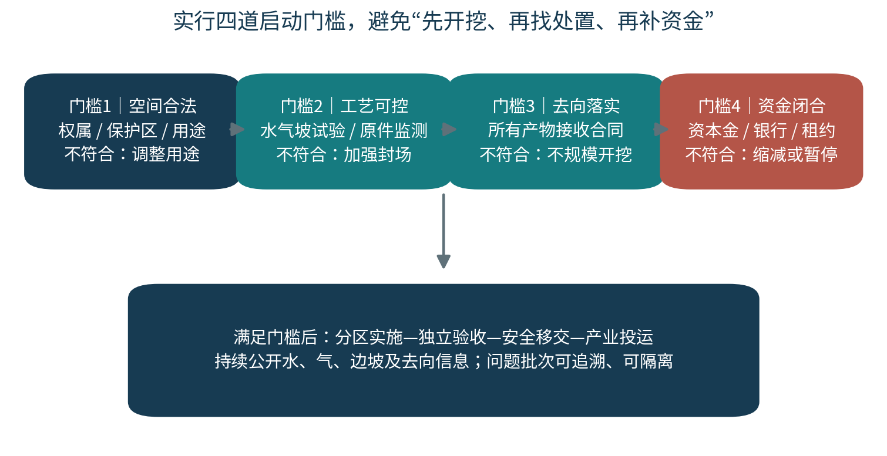
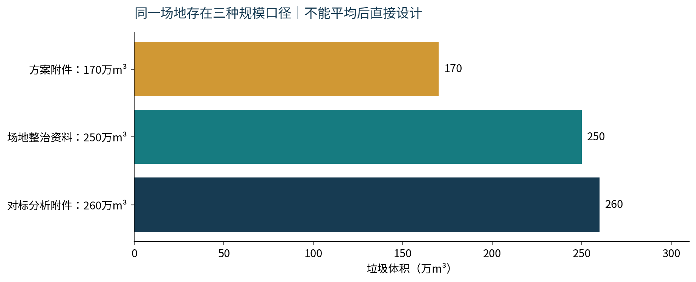
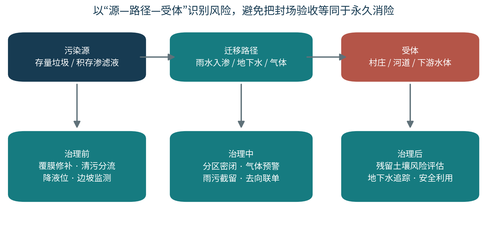
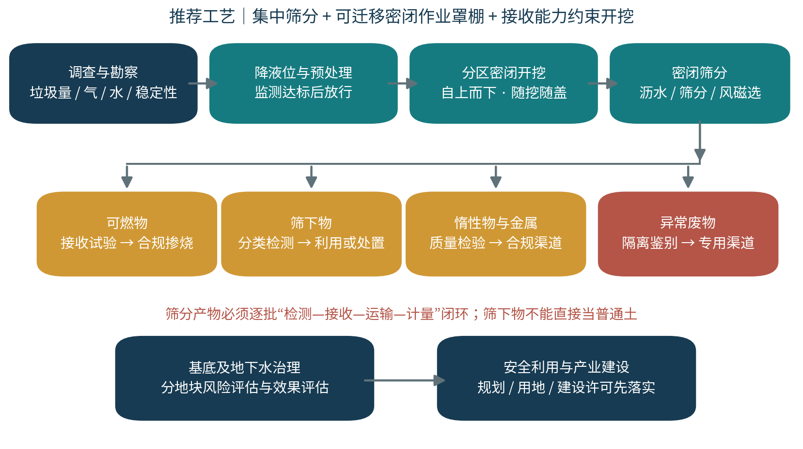
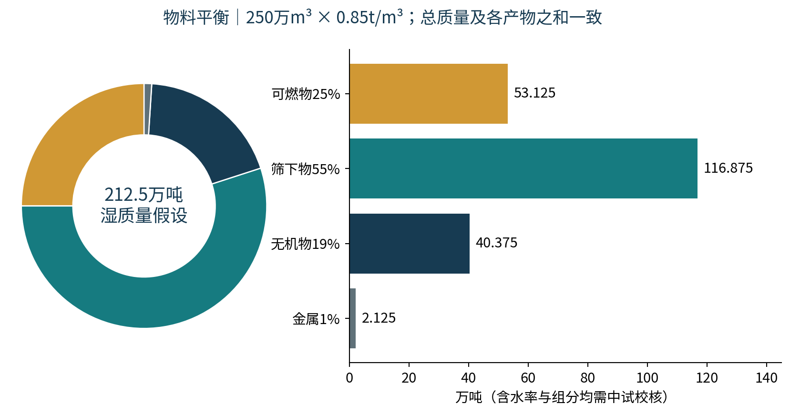
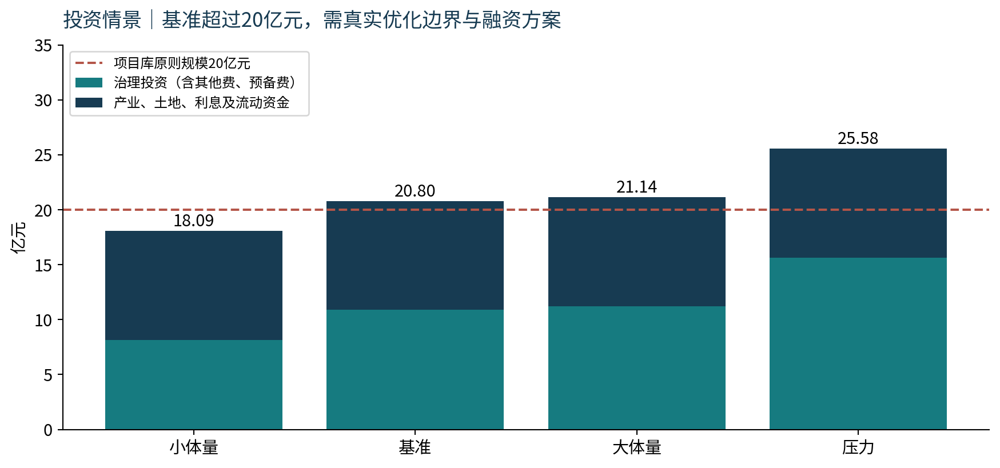
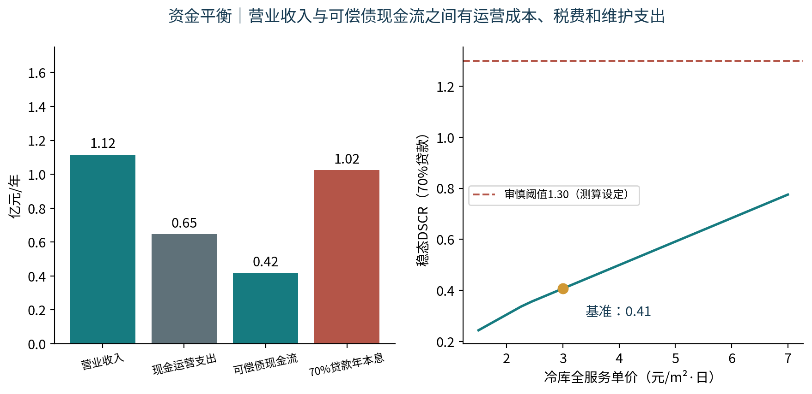
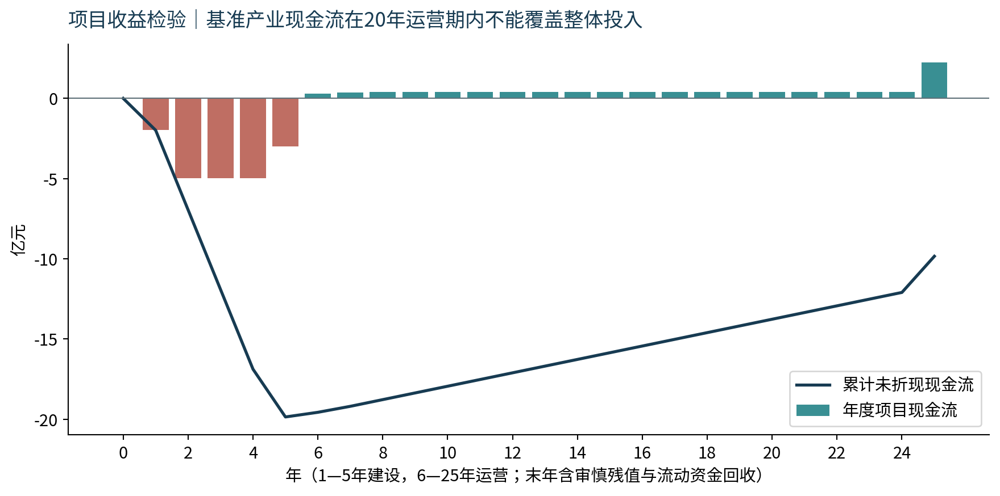
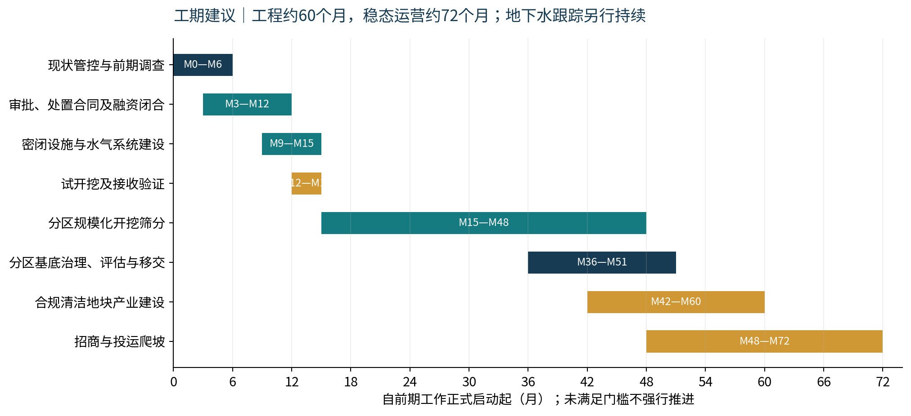
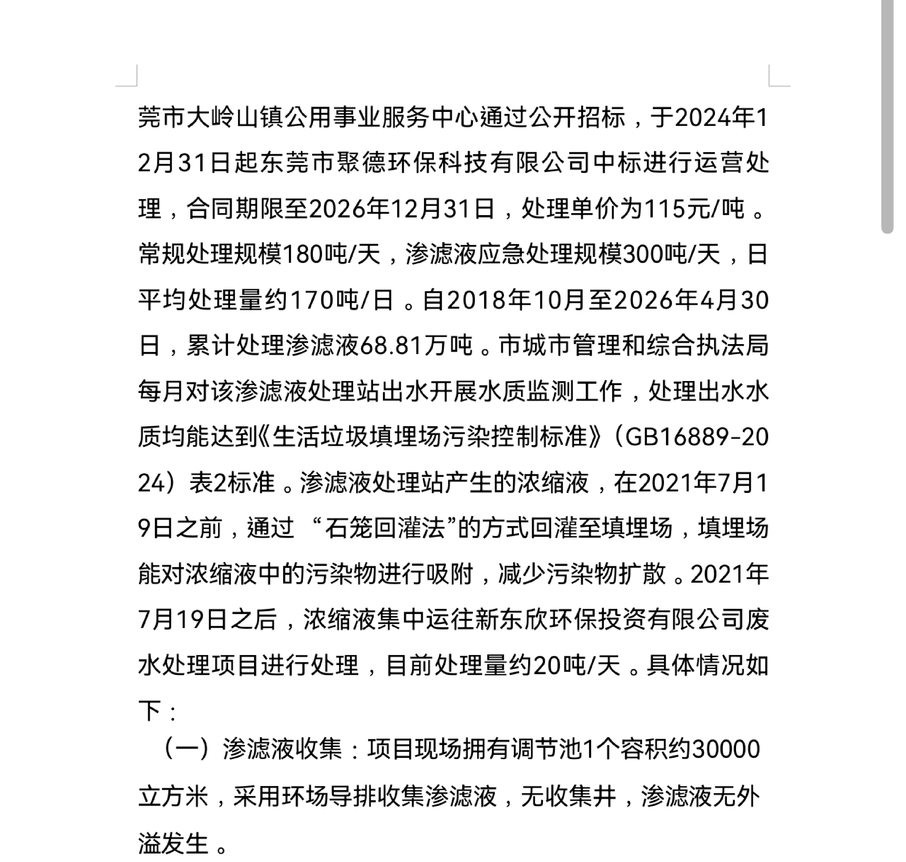

# 大岭山镇旧飞鹅垃圾填埋场开挖综合治理可行性研究报告

## 概念阶段 · 镇级决策咨询稿

编制日期：2026年10月10日　｜　研究范围：污染治理、场地安全利用与关联产业资金平衡

建议项目名称：大岭山镇旧飞鹅填埋场开挖治理与冷链、沉香产业协同发展项目。

本报告依据已读取的八份附件形成。资料涉及存量垃圾规模、土地边界、风险分级和处理能力的冲突已单独列示；工程价格、产业规模与收益属于透明的测算假设。本稿可用于组织现场调查、方案比选和领导决策，不能替代经法定程序报批的可研、环境影响评价、地质勘察、风险评估、用地审批或银行审贷。

深圳玉龙案例的技术及投资线索来自所附对标分析资料。本轮尝试访问互联网搜索引擎时，被云环境域名访问政策以403拒绝，尚未取得可独立核验的官方最新投资、招标和竣工资料；未把附件二次汇编当作官方事实。已保存必要检索域名的环境配置草稿，待设置生效后须补充案例核验。横岗EOD PPT超过32MiB单文件传输限制，本次未读取，其内容未用作论据。

图1　决策框架示意。本报告绘制；不代表现状测绘或已获批工程方案。

## 领导决策摘要

**核心判断：治理有必要，前期工作应尽快启动；全量开挖具有工程实现路径，但大规模开挖必须以空间合规、污染可控、末端接收和资金闭合为条件。现有资料不足以支持“两个产业园即可偿还全部治理投资”的结论。**

2019年封场已经取得阶段性治理成果，不能因拟开挖开发而否定既有验收；封场后仍需持续处理渗滤液、维护覆盖和监测堆体，说明长期管理责任尚存。场地整治扫描资料记载，日均处理渗滤液约170吨、浓缩液约20吨，日常封场维护和设施运行持续发生。开挖的价值在于移除污染源、改善场地安全利用条件、降低长期管理负担，而不是保证地下水污染立即消失。[S1]

本报告优先采用S1记载的250万m³为体积测算基准，同时设置170万、260万m³情景；湿堆积密度暂按0.85t/m³，得垃圾湿质量212.5万吨。约280亩属于产业谋划边界，原封场工程占地106845m²约160.27亩，两者必须通过权属与测绘叠合核实，不可直接视为全部可开发工业用地。

| 决策事项 | 本稿建议 | 关键依据或前提 |
|---|---|---|
| 近期应否启动 | 启动调查、维护补强、去向试验和市场核查 | 不要求先决定全量开挖，先把主要不确定性查清 |
| 推荐工程路线 | 分区密闭开挖＋集中密闭筛分＋分类合规处置＋基底与地下水治理 | 不照搬玉龙超大跨度天幕、固定工期或未核实价格 |
| 治理投资基准 | 约10.87亿元，含其他费和15%基本预备费 | 概念性估算，无询价；异常危险废物大规模发现另行调整 |
| 一体化筹资需求 | 约20.80亿元 | 含治理10.87、产业7.68、土地1.00、利息0.95、流动资金0.30亿元 |
| 项目库规模检验 | 基准高于原则20亿元约0.80亿元 | 必须真实优化规模，不以拆分或少列污染处置费用绕开要求 |
| 产业稳态营业收入 | 约1.116亿元/年 | 冷链、沉香及服务均为假设，未取得有约束力招商合同 |
| 稳态可偿债现金流 | 约4175万元/年 | 已扣现金成本、简化所得税及维护再投入 |
| 70%贷款方案 | 不成立；稳态DSCR约0.41，首个运营年约0.28 | 假设年利率3.5%、运营后20年等额年本息，无政府付费 |
| 实施周期 | 工程约60个月，稳态运营约72个月 | 规模开挖约M15—M48，地下水治理与跟踪可能跨越更长时间 |

建议镇领导本轮批准的是“调查论证和前期工作方案”，而不是批准20.80亿元总投资或作出兜底承诺。前期调查、勘察、试验及专题论证费用暂列800万元，分阶段按成果释放；若试开挖需建设永久密闭、水处理设施，应纳入经批准的工程包，不能用前期费概括全部试点建设。

融资工作须正视两点：其一，降低贷款比例可以改善偿债覆盖，不能改善项目本身的投资回报；其二，基准项目所得税后FIRR约−4.42%、6%折现率FNPV约−12.73亿元，20年运营期内不能收回整体投资。应先优化产业经营与合法资产安排，或研究依法预算安排的公益性治理路径，再决定是否适合整体市场化EOD申报。

## 1　研究依据、边界与证据等级

### 1.1　编制任务与范围

研究对象是东莞市大岭山镇旧飞鹅村历史生活垃圾填埋场，不以附件中的“给领导顶层谋划方案”作为替代本次可研报告的指令。治理范围分为垃圾堆体、积存渗滤液、筛分产物、基底污染土壤、地下水及受影响周边环境六部分；产业边界为资料提出的冷链物流和沉香产业方向，是否实施取决于独立的空间与市场论证。

工程清场、污染地块安全利用、用地性质调整和产业建筑交付是四种不同结果。完成开挖不代表完成土壤和地下水修复；达到风险控制目标不代表取得工业用地；取得土地不代表经营收益已落实。

### 1.2　来源清单

| 编号 | 来源 | 本次可用程度及用途 |
|---|---|---|
| S1 | 《旧飞鹅垃圾填埋场场地整治情况》PDF，7页 | 扫描工作资料；关键页经OCR并人工查看。作为较详细的场地事实线索，须补原文件及证明材料 |
| S2 | 《大岭山旧飞鹅垃圾填埋场背景资料》DOCX | 作为项目构想、170万m³、280亩和产业诉求来源；风险分级表述存在明显疑点 |
| S3 | 《东莞大岭山垃圾填埋场项目现状、初步治理方案暨与深圳玉龙垃圾填埋场处理技术的借鉴意义》PDF，29页 | 对标分析二次材料；用于260万m³情景、玉龙线索及方案比选，不当作官方投资批复 |
| S4 | 《旧飞鹅垃圾填埋场利用初步设计方案—环境治理部分》DOCX | 初步谋划材料；用于两产业园与申报构想，未附规划批复、授信或租约 |
| S5 | 《广东省生态环境厅……关于建立美丽广东金融项目库的通知》PDF，13页 | 扫描件；人工核对重要条款。文号粤环函〔2025〕147号，申报前核对完整原件及现行执行口径 |
| S6 | 《生活垃圾填埋场开挖治理污染防治技术指南（征求意见稿）》PDF，10页 | 技术参考，不能作为已生效强制标准；本稿明确区分建议值与法定义务 |
| S7 | 上述征求意见稿《编制说明》PDF，3页 | 对开挖二次污染、筛下物风险及指南编制背景提供依据 |
| S8 | 《生活垃圾填埋场开挖分选治理技术导则（试行）》山东省，2023年10月，19页 | 地方技术参考，适用范围为山东；不当作广东法定审批依据 |
| S9 | 横岗街道“花韵横岗·时尚数字”EOD项目V3 PPTX | 超过工具32MiB传输限制，未读取，不用于本稿事实和资金测算 |

证据按“原始批复、监测、台账＞场地工作资料＞分析方案＞本稿假设”顺序使用。附件提及但未随附的可研批复、环境监测报告、地质报告、风险等级文件和银行推荐函均属于待补证，而不是已核验文件。

### 1.3　重要纠偏

S2将突发环境事件风险写作“六级”，并列“三级、五级”等，不能直接使用。企业突发环境事件风险分级通行技术依据HJ 941—2018区分一般、较大、重大，不应与突发事件分级、填埋场隐患分级或颜色混用。是否适用该方法、实际风险等级与主管部门管理分类，应由专业机构按现行依据独立确认。

S2将LEC评价直接对应“R≥15”等阈值，缺少参数、计算表和依据，不足以认定重大事故隐患；“只有全清才可降为低风险”也不是适用于所有填埋场的通用法则。本报告不宣布场地现为橙色、中风险或存在即刻垮塌危险，也不预测开挖后自动降级。

S3描述玉龙“产业开发收益反哺已经成熟”，S4写“已有完备历史资料、融资已敲定”。本次未取得相应原件，只将其列为待核查工作事项。所有已签约、已验收、已授信和已获批表述必须能对应具体文件。

## 2　场地现状与控制性参数

### 2.1　运行与封场历史

S1记载填埋场1996年开始使用，2019年7月1日正式封场整治，2019年封场提升整治投入约1261万元（含前期），工程占地106845m²，2019年10月底完成整改，10月29日评分验收89分，12月16日取得东城综函〔2019〕1688号销号验收函线索。该函原件仍须补充。[S1，PDF第1页]

S1还记载一期综合整治纳入同沙水库综合整治项目，投入2173.2万元、2015年完成；两次历史投入发生于不同工程边界，不计入本次新增投资，也不重复累加为本项目治理已完成比例。[S1，PDF第2页]

封场工程包括堆体整形、覆土覆膜、导排盲沟、截排水和复绿；每月开展堆体稳定监测，监测点16个；地下水、地表水和填埋气开展季度监测。资料宣称有关水体达到Ⅳ类及废气达标，但未附原始CMA报告、井位与流向图，不能据此确认地下水未受影响，更不能把Ⅳ类水质认定为符合某饮用水水源保护区的法定目标。

### 2.2　渗滤液处理站与现有资源

S1记载处理站位于场地东南侧，占地6175m²，建构筑物约2100m²，工艺为预处理＋集装箱式两级DTRO；常规处理能力180t/d、应急300t/d，日均约170t/d。现行运行合同线索为2024年12月31日起至2026年12月31日，处理单价115元/t；2018年10月至2026年4月30日累计处理约68.81万吨。[S1，PDF第2—3页]

现有调节池名义容积约30000m³。DTRO浓缩液约20t/d，目前外运至资料所列合规处理渠道；历史上曾回灌，不得将历史做法直接延续为新工程许可。处理出水经专管接市政污水管网，再送连马污水处理厂；新工程应核对处理站许可、出水标准、污水厂接收协议与浓缩液最终处置文件。[S1，PDF第3—5页]

复用现有设施是降低投资的机会，但30000m³是名义容积，并非暴雨来临时的空闲库容；180t/d处理能力也并非可随时用于新增开挖渗滤液的净剩余能力。

### 2.3　参数冲突表

| 参数 | 资料口径 | 本稿处理 | 决策影响 |
|---|---|---|---|
| 垃圾体积 | S2/S4约170万m³；S1约250万m³；S3约260万m³ | 主情景250万，另测170/260万 | 直接影响设备、外运量、费用与工期；先测绘和钻探 |
| 场地面积 | S1封场工程106845m²；S2/S4拟谋划280亩 | 区分现有工程边界与拟产业边界 | 不把160.27亩工程直接扩大为280亩合法开发土地 |
| 处理能力 | S2/S4称500t/d；S1常规180、应急300t/d | 按180/300作为设施核查基准 | 不以500t/d为已有能力进行排水设计 |
| 封场时间 | S1为2019年7月1日；S3笼统写2019年底 | 采用S1具体时间线，验收另列 | 不混淆停止接收、工程完成与销号时间 |
| 风险等级 | S2多套颜色与级别；未附计算或批文 | 不认定具体官方等级 | 不凭汇编评级申报专项资金或证明可开发 |
| 年运维费用 | S3写1800—2000万元；S1给量价 | 用170t/d×115元/t测算水处理费 | 避免高估治理节省金额以形成虚假收益 |
| 土地、水源边界 | 附件称位于同沙上游或保护范围 | 上游水环境敏感性作为调查重点；保护区边界未确认 | 必须叠合法定图件，决定产业准入 |

图2　三种垃圾量口径对照。来源S1—S4；本稿未进行实测。

### 2.4　立即建立“一张底图、六本台账”

底图叠合地籍、堆体、现状道路、排水与水系、保护区、生态保护红线、永久基本农田、林地、国土空间用途和敏感受体。六本台账分别为垃圾与筛分产物、渗滤液及浓缩液、气体、边坡、土壤地下水、资金及合同；把已有16个监测点和旧井纳入核查，不为凑数量盲目新建。

## 3　必要性、急迫性与治理目标

### 3.1　治理必要性

第一，长期渗滤液处理和填埋气管理是实在的持续责任。S1给出的170t/d日均水处理量说明封场没有终止产污过程。治理应从维持表面覆盖，逐步转向减少污染源、阻断迁移路径和修复受影响介质。

第二，既有简易填埋历史与山谷地形要求持续掌握基底、防渗、液位和边坡情况。开挖可减少堆体存量和后续沉降，但同时会揭膜、释放气体并改变受力；必须通过勘察和试验确认“长期风险下降大于施工风险增加”。

第三，安全利用土地需要处理垃圾、残留污染和岩土适宜性三个问题。冷库、物流车辆和加工建筑荷载较大，不能直接建在残留垃圾堆体或未经压实检验的筛下物回填层上。

第四，项目有机会改善同沙上游汇水环境与周边生活条件。是否位于法定饮用水源保护区仍待核实，不能把“上游流域”直接写成“一级、二级保护区”。如果确在严格管控区，生态治理可以研究，关联产业开发则可能需要移出场地。

### 3.2　急迫性的合理表达

**急迫的是核查风险、保障现有运行、锁定合法去向和纠正资金假设；不是未经准备立刻揭膜全场开挖。**目前资料同时包含封场验收和运行达标表述，不能用未经证明的“数百吨直排”“随时垮塌”制造紧迫性。

本轮编制时点为2026年10月。资料所列运行合同到2026年12月31日止，若尚未续签，距到期不足三个月，应优先核对续运安排，避免在新治理准备期出现处理服务空档。接续采购与委托服务须按现行程序执行。[S1，第3页]

未来汛期前应完成膜面与截洪设施巡检、调节池有效库容测量、备用泵电源测试及应急演练。若监测发现边坡异常、污水外溢或下游污染扩散，启动现场应急处置和依法报告程序，不等待项目申报或产业招商。

### 3.3　分阶段目标与验收指标

| 阶段 | 建议目标 | 验证方式 |
|---|---|---|
| 前期调查 | 明确工程量区间、组分、液位、稳定性及保护区边界 | 测绘、钻探、CMA检测、原件审查和主管部门意见 |
| 现状保障 | 渗滤液运行不中断；覆盖破损与排水隐患闭环整改 | 每日巡查记录、处置单、在线数据与抽查 |
| 开挖施工 | 所有产物数量、分类、运输和接收可追溯；污染水不未经处理外排 | 双端地磅、联单、GPS与视频；水量平衡 |
| 清场治理 | 清除批准范围内垃圾；残留土壤按未来用途达到风险控制目标 | 分区清场测量、土壤风险评估、独立效果评估 |
| 地下水 | 控制污染羽扩散，按批准目标持续治理和跟踪 | 背景/上下游井趋势，水文地质与风险评价 |
| 安全利用 | 规划与用地合法、建筑地基合格、残留气体风险可控 | 用途许可、岩土检测、建筑与消防验收 |

“100%清除”仅指经批准治理范围内的垃圾清场核验，不代表环境污染物100%去除。不得以未测得的污染物总量、未评估的疾病负担或“零风险”作为验收承诺。

图3　治理前、中、后污染风险控制逻辑。受体位置须用现场调查替换示意。

## 4　深圳玉龙案例：可借鉴内容与核验边界

### 4.1　已取得的案例线索

S3第6—8页称玉龙填埋场位于罗湖清水河片区，1983年投用、2005年封场，垃圾255.15万m³；称总投资21.7亿元、建安费15.38亿元、计划工期894天，工艺为快速好氧预处理、天幕密闭开挖、复合除臭和筛分分类处置。这些数字尚未与官方批复、施工招标或结算原件核验，本报告不宣布项目已经竣工，也不据此认定已经实现盈利。

| 玉龙线索 | 来源与状态 | 可借鉴方式 | 旧飞鹅不能直接复制的部分 |
|---|---|---|---|
| 255.15万m³存量 | S3，PDF第6—7页；未独立核验 | 百万m³级工程组织有参考价值 | 不用其密度和组分替代本场实测 |
| 21.7亿元总投资 | S3，第5、7、19页；未独立核验 | 作为高规格治理投资压力参照 | 不是本场报价；不包含本稿两产业园投资的证明 |
| 建安费15.38亿元 | S3，第7页；未独立核验 | 显示建安与总投资不同口径 | 不将中标金额、建安金额和总投资混为一谈 |
| 894天计划工期 | S3，第7页；未独立核验 | 校核大规模治理需要多年 | 不能据此承诺旧飞鹅约30个月全部投运 |
| 天幕与负压除臭 | S3，第7—13页；技术线索 | 环保设施先于开挖投入使用 | 场地与台风约束不同，不套用280m跨度 |
| 好氧与分区开挖 | S3、S6 | 按稳定化、气体与液位检测逐单元放行 | 不固定预处理6—12个月，也不只看天数 |
| 分类处置和台账 | S3、S6、S8 | 接收合同、质量试验、全过程联单 | 不默认东莞有相同焚烧富余能力 |
| 土地开发与收益反哺 | S3/S4的分析判断 | 研究治理与产业的关联价值 | 未取得玉龙经营现金流或财政安排，不能称已验证EOD盈利 |

### 4.2　投资口径校核

按S3线索计算：21.7亿元÷255.15万m³≈850.48元/m³；建安费15.38亿元对应约602.78元/m³。若把总投资单价机械套用于旧飞鹅250万m³，治理约21.26亿元，再加两产业园、土地、利息与流动资金约9.93亿元，则筹资需求约31.19亿元，已显著高于金融项目库倡导规模。

本稿分项估算的治理基准约10.87亿元、约434.94元/m³，低于上述线索。差异来自所假设的0.85t/m³湿密度、模块设施复用、筛下物60%有合规利用去向及处置单价；也可能反映附件玉龙总投资包含本模型未明确的更大范围工程。因此10.87亿元只能用于前期预算研究，须取得工程量、受纳报价和设施方案后才能确认，不能用低值论证已经比玉龙节省约一半成本。

S3还称玉龙垃圾约410万吨，与255.15万m³相除约1.61t/m³，可能涉及混入土石、统计边界或资料错误。该质量口径本次未确认，故不用于旧飞鹅吨单价、设备规模或运输预算。

### 4.3　案例外部核验清单

本轮互联网检索目标包括“玉龙填埋场 环境修复 总投资”“玉龙 环境修复 招标 中标 工期”“玉龙 天幕 好氧 筛分 接收 处置”“玉龙 清水河 规划 后续用地”。搜索引擎连接被环境代理拒绝，未获得可引用网页正文。后续须以深圳市、罗湖区、城管主管部门及公共资源交易官方材料为主，媒体介绍仅作工艺补充。

| 待核验事项 | 首选材料 | 核验通过前的使用限制 |
|---|---|---|
| 总投资与建设范围 | 可研及初步设计批复、概算 | 21.7亿元仅标作附件线索 |
| 建安金额和合同条件 | 施工招标、中标公示、合同或清单 | 不当作完整治理综合单价 |
| 最新工程进度、实际处理量 | 政府阶段公告、竣工或效果评估 | 不描述已全部清场、已验收或已投运 |
| 所有筛分产物真实去向 | 环评、接收合同、项目运维记录 | 不宣称腐殖土全部资源化 |
| 土地利用和资金来源 | 规划批复、预算、项目公司经营数据 | 不宣称土地收益覆盖治理已经实现 |
| 本场与玉龙差异 | 两项目同口径量、价、距离、设施边界 | 不通过一个体积单价直接确定概算 |

建议组织一次玉龙工程现场调研，重点查看除臭效果、罩棚抗风设计、实际处理效率、停工原因、产物接收和结算口径，取得可共享的非保密运行数据及报价；不只参观外观或引用宣传图片。

## 5　政策、空间与实施合法性

### 5.1　金融项目库要求

S5第2—5页规定：生态治理与关联产业一体化实施，形成“环境治理—产业开发—收益反哺”闭环；总投资原则上不超过20亿元，组合单体子项目原则上不超过10个；融资主体为市场化企业；运营期严格禁止政府付费，不得以土地出让收益、税收返还或预期新增财政收入作为项目收益；金融机构独立审贷；严禁增加地方政府隐性债务。

申报主体口径为市（县、区）政府、园区管委会或符合条件的市场化企业；不能仅因镇政府牵头协调，就认定镇政府当然具备通知列示的独立申报资格。可由符合条件企业申报，或请市级组织牵头，镇承担属地协调职责。[S5，第2页]

省级专项资金是择优、适当激励，绿色通道是依法加快审查，不是免环评、保证补贴或自动提供排污指标。入库、授信、贷款提款和产业盈利必须分别取得证据。

### 5.2　空间与土地的首要前提

自然资源、生态环境、水务及林业主管部门须共同确认：地籍权属、现状用途、国土空间规划、保护区分区、生态保护红线、永久基本农田、林地属性和规划调整路径。资料称“山林”和“水库上游”，不构成可直接调整工业用地的证明。

如地块落入不允许产业建设的管控区，应调整后续用途为生态修复等允许用途，并重新评估产业是否可在合法关联地块布局；不能先治理后倒逼规划调整，不能以环保项目名义预留违法建筑。生态治理的必要性不因产业受限而消失。

修复完成后依法履行污染地块安全利用程序与必要的信息更新或名录程序。封场销号、修复效果评估、用途调整、供地和建筑许可互不替代，不以“风险降为黄色”作为供地凭证。

### 5.3　主要技术和法定依据

| 文件或标准 | 本稿应用 | 使用边界 |
|---|---|---|
| 土壤污染防治法、固体废物污染环境防治法、水污染防治法、环境影响评价法 | 责任、调查、风险管控、合规处置与审批 | 申报前核对现行条文及适用程序 |
| GB 16889—2024 | 填埋污染控制、渗滤液及相关管理 | 以现行正式文本与具体排放路径执行 |
| GB 18485、HJ 662、HJ 1134 | 焚烧、水泥窑及飞灰利用处置 | 接收设施许可与入厂条件仍须核查 |
| GB 36600、HJ 25系列、HJ 164、GB/T 14848 | 建设用地土壤、效果评估与地下水调查 | 筛选值不等同普遍修复目标；工业用地分类不适用于地下水 |
| GB/T 51451及现行岩土、结构、消防、职业卫生标准 | 垃圾堆体、支护、罩棚和作业安全 | 采用现行版本，不机械引用已替代标准 |
| GB 14554、GB 16297、现行施工/厂界噪声标准 | 臭气、颗粒物及噪声控制 | 厂界与施工阶段适用标准需区分 |
| S6征求意见稿、S8山东试行导则 | 方案设计的技术参照 | 不当作广东正式强制规定；须核查指南是否已正式发布 |

本轮没有完成官方网站对所有标准版本、指南正式发布状态及S2所提“建办城〔2025〕60号”的独立核查。正式申报前应由设计与法律团队建立现行依据清单，不用疑似文号支持已定风险等级。

冷链物流通常涉及仓储、物流及可能的工业加工用地不同分类；沉香园内的加工、展陈、文旅、交易功能也未必能统一落在工业用地。逐子地块确认未来用途及人群暴露场景，不能一律套用第二类建设用地要求。

## 6　治理方案比选与推荐路线

### 6.1　三个路径

| 比选内容 | A：封场维护与定向补强 | B：原位稳定化＋风险管控 | C：分区全量开挖＋介质治理 |
|---|---|---|---|
| 主要作用 | 稳住当前风险，保持运行 | 减少部分产污和气体风险 | 移除主要垃圾污染源，改善安全利用条件 |
| 一次性投入 | 取决于现有设施缺口，须检测后询价 | 需注抽气、渗滤液及监控工程专门设计 | 本稿治理测算8.16—15.65亿元；高规格类比另作压力参照 |
| 年度后续责任 | 持续处理、覆盖和监测 | 长期监测与维护仍在 | 地下水、残留气体和安全利用仍需管理 |
| 对外消纳 | 较少 | 较少 | 百万吨级物料去向是硬前提 |
| 施工二次污染 | 相对小 | 注气引起气体和水热风险 | 较大，须密闭、降水、防雨、监测 |
| 土地利用改善 | 有限，保留垃圾堆体 | 不等同清洁建设地块 | 改善幅度最大，但须独立审批与地基验收 |
| 近期角色 | 必须保持的底线方案 | 勘察后可研究的过渡选项 | 在四道门槛通过后推荐规模实施 |

A、B尚无可核工程量，不编造具体“已知报价”。先查明设施缺口再编概算。推荐C是基于拟改善长期环境与场地利用的目标，不代表全清是所有填埋场唯一合规选择。

### 6.2　差异化工程布局

以经勘察确定的稳定可用平台集中建设密闭筛分车间和防渗暂存区，开挖区采用可迁移罩棚、局部负压罩或经论证的膜下抽气系统。开挖单元暂按1000—3000m²作方案设计研究，优先试点1000m²以内；尺寸须依据边坡、除臭风量和暴雨计算调整，不当作现场安全指令。

罩棚位置不跨越未经验证的松散高风险堆体承载区，基础、抗台风、消防、防爆和应急开口由结构与安全专业设计。不得因节省天幕投资退回大面积露天晾晒和喷香遮味；S8的晾晒建议在本场只能在经论证的密闭防雨防渗条件下执行。

图4　推荐工艺与物料分流。由本报告根据S6、S8及案例线索绘制。

### 6.3　建设规模与能力检验

基准质量212.5万吨；建议比选两条150t/h名义能力筛分线，日运行16小时，综合有效率70%，每年有效运行250天，则年有效筛分能力约84万吨。212.5÷84≈2.53年，为约30.4个月；规模开挖配置约33个月窗口并保留衔接与停工余量，前期与验收另计。

若260万m³、密度1.0t/m³，则约260万吨，对应约37.1个月纯处理时间；遇下游限量、设备可用率下降、台风和汛期停工，需要延长施工期或增加经许可的接收能力，不能只增加开挖设备。

日开挖量取“稳定性允许、气体与水处理允许、筛分有效能力、各类接收配额、运输能力”的最小值。在基准有效筛分3360t/d工况下，可燃物约840t/d、筛下物1848t/d、无机物638.4t/d、金属33.6t/d；各类接收合同按质量、连续配额和检修备用共同落实。

若可燃物接收配额仅500t/d，按25%可燃占比，总处理上限约2000t/d；有效250天/年则基准质量需4.25年处理。末端限量会显著改变总工期，是批准施工规模前必须解决的变量。

### 6.4　物料质量守恒

| 产物 | 湿质量占比假设 | 基准质量 | 基准去向及限制 |
|---|---|---|---|
| 轻质可燃物 | 25% | 53.125万吨 | 试验后送许可焚烧设施或适用协同处置；不新建临时场内焚烧炉 |
| 筛下物 | 55% | 116.875万吨 | 暂假设60%有合规利用去向、40%其他合规处置；无合同则重算 |
| 无机惰性物 | 19% | 40.375万吨 | 检测和性能合格后利用，否则进入许可处置渠道 |
| 金属 | 1% | 2.125万吨 | 分类整理与许可回收；价格和质量未核，基准不计销售收入 |
| 合计 | 100% | 212.500万吨 | 组分假设须由分层取样与代表性筛分试验替换 |

图5　概念性物料平衡。数字不是现场采样结果；沥水、含水率变化及覆盖土另设台账。

运行期间按“进料湿质量＝各产物湿质量＋排出水及其他损失±库存变化”校核。模型简化组分分流不额外计减沥水量，现场必须校正含水率；覆盖土、外来洁净回填土和污染基底土不与垃圾质量混算。

可燃物须检测含水率、低位热值、氯、重金属及异常夹杂，按接收方环评、许可和试烧确定掺配比例。不能仅凭“生活垃圾”名称认定所有陈腐料可直接焚烧；也不能将筛下物达到GB 36600筛选值视为解除固废属性或可任意填入山谷、耕地和水源上游。

## 7　治理前的具体举措

### 7.1　0—3个月：现状维持与资料核验

| 工作 | 具体成果 | 牵头/配合建议 |
|---|---|---|
| 处理合同续接 | 核对2026年末到期安排，落实不中断运行、备件与应急处置 | 现有管理责任单位、城管及采购机构 |
| 一张底图 | 地籍与堆体、工程、产业边界及生态约束叠合成果 | 自然资源、生态环境、水务、林业 |
| 原件收集 | 验收函、设计图、监测报告、许可、合同和近3年水量台账 | 属地和运营单位 |
| 设施体检 | 膜面、盲沟、管网、调节池液位和有效库容检查表 | 运营单位及设计团队 |
| 敏感受体调查 | 居民、学校、工厂、河道、井、取水口坐标和距离表 | 专业调查团队及村社区 |
| 对外接收预沟通 | 可燃、筛下、无机、浓缩液及异常废物接收条件清单 | 处置单位、生态环境及城管 |

禁止因未来要清场而降低当前维护标准。受污染水应全部收集并按许可处理；严禁以调蓄不足为由安排未经处理的临时排放。

### 7.2　3—6个月：调查、勘察与中试

采用无人机/地面测绘、历史地形复核、钻探与地球物理配合，分清垃圾底界和天然地层；对湿密度、垃圾组分、含水率、热值和污染物进行分层代表性检测。钻孔数量与深度由覆盖不确定性和安全风险确定，不在缺少底图时承诺固定布点量。

水文地质调查查清含水层、地下水流向、季节液位和污染羽边界；采样覆盖背景及上、下游，因地制宜使用旧井或增设井。土壤检测包括未来用途所需基本项目和基于废物史识别的特征污染物；初始调查、开挖过程基底补查和清场后详细调查相衔接。

岩土勘察评价自然边坡、垃圾坝、堆体内部液位、强度和滑移面，提出逐层开挖与支护设计。气体评价同时覆盖甲烷、硫化氢、氨、氧气及温度，不把好氧作业仅理解为“向垃圾吹风”。

中试建议选经审批和安全放行的代表单元，首批累计0.5—1.0万m³；中试规模须与密闭、调蓄和接收能力匹配。验证产物组分、吨料工时、处理单位成本、气味控制、浓缩液负荷及实际接收。未通过接收或环保试验，不进入规模开挖。

### 7.3　6—12个月：手续与合同闭合

依法确定项目审批或备案、环评类别、水土保持、林地和水源相关手续；污染土壤修复、工程清场和产业建设的管理程序按实际对象分别安排。环评应覆盖开挖、暂存、筛分、运输、废水浓缩液、危险夹杂和应急工况，不沿用旧封场环评替代新工程审查。

签订覆盖全部产物的接收合同，至少明确日/月配额、检测指标、计量与付款、拒收处置、检修替代去向、期限和价格调节方式。先做接收试验再签规模合同；只有框架意向不视为去向已落实。

同步开展冷链市场容量、周边同类库租金与成本、沉香供应链及主体经营能力调查；与运营商落实有约束力的面积、价格和付款条款。镇级协调、金融库申报、项目公司组建可并行，但不得以政府回购或保底收益补足现金流。

## 8　治理中的环境、安全和交通措施

### 8.1　渗滤液与暴雨控制

先降液位、后处理气体、再揭膜；调整清污分流、开挖单元及坡脚导排，每日非作业时段及时覆盖。污染水池设置液位、备用泵、备用电源和防溢路径，雨前检查、暴雨预警时停止揭膜与危险工序。沉淀只能减少泥沙，不能替代高浓度渗滤液处理。

用于规模校核的示例：暴露区3000m²，事件降雨200mm、径流系数0.9，则降雨污染水约540m³；连同170t/d现状来水、另暂设250t/d施工新增水、3天连续事件，合计540＋(170＋250)×3＝1800m³。再保留30%设计余量，示例需求约2340m³，**不是本场暴雨设计结果**。

此算例尚未包括其他受污染汇水区、初始积存水、地下水涌入、处理站停电停机和连续复合暴雨。设计应按当地批准防洪标准、降雨资料及最不利工况重新计算，校核现有池完整性、清淤量、剩余库容和可用应急容积；不因名义3万m³就取消应急校核。

### 8.2　气体、恶臭和职业安全

好氧预处理按稳定化和试验结果决定是否实施，实行抽气与注气平衡、温度与液位控制。持续检测甲烷、硫化氢、氧气及温度；局部过热、气体浓度异常时停止作业并执行专项处置。设置防爆电气、接地、消防和受限空间程序，救援须使用训练人员与适用装备，禁止无防护进入。

S6提出堆体预处理后甲烷低于5%，停止抽注气24小时检测，以及作业面甲烷超过1%时加密监测。这是征求意见稿的技术条款，不能把“堆体低于5%”作为人员安全作业条件。建议项目作业气体预警更严：例如甲烷10%LEL预警、20%LEL停工撤离，具体由安全与职业卫生专业核定；LEL百分比与体积分数必须在仪表、看板及培训中写清。

密闭车间保持经设计验证的集气能力，采用适配的洗涤、生物或物化除臭组合；禁止只喷香或消毒剂掩盖污染。风机与关键供电应具备备用能力，负压失效时停止进料和揭膜。边界与居民敏感点监测与投诉同步触发排查，不把某一臭气在线传感器读数替代法定采样结果。

### 8.3　边坡稳定与开挖组织

自上而下、分区分层，层厚、坡比、平台宽度和支护由验算确定；S6提出一般分层不超过5m，可作为设计参考，不是所有地层适用的现场许可。不开挖坡脚掏空，不在不明承载平台堆置筛下物，不使高压气体或排水破坏已有防渗与稳定设施。

位移、裂缝、液位与降雨联动监测；监测阈值由岩土设计确定。达到预警或发展速率异常即停止相关单元，疏散受影响人员，复核支护或降液位方案，独立复核通过后恢复，不以工程进度考核压过停工要求。

### 8.4　运输组织与暂存

基准高负荷工况3360t/d若全部外运，按25t有效载重估约135车次/日单向重车，往返约270次通行；12小时运输窗约11—12辆重车/小时。车辆可用载重、真实路线长度、限行和道路承载应实测，不能把车次等同车辆保有量。

通过合规内部利用可降低外运，但必须把该去向和工程实际需求写入合同及许可。密闭防滴漏运输、双端称重、GPS、出口清洗、轮胎底盘检查、车辆故障应急与沿线保洁同时落实，尽量避开学校、居民作息和高峰时段；不靠夜间集中运输转嫁扰民。

暂存按接收波动与消防要求分仓、分批设计；7天按3360t/d即约23520t物料，是重要场地约束。应优先以连续接收减少存量，不在狭窄场地机械追求七天囤存；所有暂存区防雨、防渗、集液、除臭、分隔和防火，许可允许的最大库存是开挖上限的重要约束。

### 8.5　异常废物与二次污染

发现疑似飞灰、医疗残渣、油桶、含石棉建筑材料或未知化学物，应立即停止该批处理、定位、隔离、取样鉴别，按适用固废、危废或专用处置程序转移。不得将未知夹杂均匀混入筛下物以满足检验结果，也不以既往场地名称免除危险特性鉴别。

模型未假设大规模危险废物处置；15%基本预备费不能保证覆盖重大隐藏污染。合同设置清晰的异常物发现、工程量确认和经批准变更程序，同时避免缺乏依据的无限索赔。

### 8.6　建议监测计划与触发动作

| 对象 | 前期基线 | 治理期建议频次 | 异常动作 |
|---|---|---|---|
| 甲烷、硫化氢、氧气、温度 | 分区钻孔及工作面测试 | 关键作业区域连续监测，每班核对仪表；按专项安全规程 | 达预警加强控制，达停工阈值撤离并按预案处置 |
| 渗滤液液位及流量 | 有效库容测量、近3年台账 | 连续液位监测，进出水和浓缩液日平衡 | 接近设计警戒停止新增开挖，启动备用设施 |
| 处理出水与浓缩液 | CMA与许可限值核对 | 按许可在线和人工检测，人工建议至少每月；异常加密 | 超标不排、批次隔离并查明原因 |
| 地下水 | 背景与上下游井、季节基线 | 关键井建议至少每周1次，参照S6；全井方案经论证确定 | 污染扩散时停相关工序、补查和源头控制 |
| 地表水 | 上下游断面及受体目标 | 建议每周，暴雨事件和异常加密 | 截流排查，按法定程序报告，不隐瞒数据 |
| 有组织/无组织恶臭及颗粒物 | 场界与敏感点基线 | 建议每月至少1次法定方法检测；敏感点辅助在线 | 除臭失效停进料，投诉触发现场调查 |
| 位移、裂缝与堆体液位 | 岩土勘察与原16点核查 | 关键点连续监测并每日巡查；按专项阈值 | 速率异常停该单元并独立复核 |
| 噪声与车辆 | 敏感点和道路基线 | 建议每月，路线变化或投诉后加测 | 调整时间和路线，超限或漏液车辆不得出场 |
| 产物和回填土 | 垃圾组分及中试 | 每批按代表性取样与质量计划；异常批单独鉴别 | 未确认合格不利用，无接收证明不放行 |

上述为本稿建议监测计划，不能替代排污许可及现行法定要求；若法定频次或主管部门要求更严，从其要求。在线数据须校准并与适用方法核验。频次增加应纳入监測预算，不得为压低造价而漏检。

## 9　治理后场地修复、交付与产业利用

### 9.1　清场后治理

完成分区垃圾清场测量，对基底和侧壁重新采样，界定残留土壤污染，开展拟用途风险评估。3.5万m³基底修复仅为预算假设，可选土壤异位处理、原位处理或经批准风险管控组合，由污染物与地质条件决定，不预先指定“全挖走”或固定药剂工艺。

地下水以源头控制、污染羽控制和风险目标为核心，根据条件研究抽出处理、截获、反应性屏障或其他适用技术；长期抽提可能引起周边水位变化，须论证。不得承诺垃圾清除后地下水即恢复背景水平，不能把土地第二类筛选值作为地下水治理标准。

### 9.2　分地块交付与安全利用

实行“清场确认—介质风险评价与必要修复—独立效果评估—监管安全利用手续—用途及供地许可—地基及建筑条件确认”链条。拟早交付地块必须有可分割边界，不受剩余开挖、气体迁移和地下水污染扩散影响；专家与主管部门确认后才允许产业施工。

回填材料有来源、批次检测、污染控制和工程性能证据。污染筛下物不能为节省处置费回填在未来冷库或加工车间下方；表面覆盖和压实试验不能替代环境安全评价。

### 9.3　后续监测与责任

建议至少设置5年预算研究期的地下水和残留气体跟踪计划，最终期限由风险评估与主管部门要求确定，5年不是监测自动终止期限。初期频次较高、结果稳定后按批准方案调整，出现污染反弹或迁移及时恢复调查与治理。

污染治理及安全利用资料归档，移交给土地管理责任方和后续运营方；建设阶段持续检查地基沉降、地下设施气体和地下水风险。地下空间、电缆井、泵房和冷链设备区须针对残留气体及缺氧风险进行专门设计。

### 9.4　产业布局研究参数

| 板块 | 本稿规模假设 | 功能定位 | 必须落实的外部条件 |
|---|---|---|---|
| 冷链物流 | 建筑12万m²，可计费面积系数75% | 冷藏冷冻、仓储周转、分拨与配套服务 | 货源、容量、运营商、供电与制冷安全、合法仓储/加工用途 |
| 沉香产业 | 建筑4万m²，可出租面积系数80% | 合规加工、研发、展销及必要文化展示 | 原料合法来源、实际客户、功能分地块分类、市场合同 |
| 公共配套 | 道路、水电、污水、消防与数字化 | 服务两板块及剩余环境管理 | 市政接入、能耗和污染排放手续 |

16万m²总建筑与280亩边界仅是空间研究假设，未确定容积率与可建设净用地。原封场工程160.27亩并不能支持无条件布置这些建筑，需总平面、消防间距、道路、绿化、坡地和地基综合校核。

“毗邻亚洲最大农批市场”“本镇数百万棵沉香”等来源于S2/S4构想，本次未独立核实，不作为需求证明。若冷链包含食品或预制菜加工，还需额外论证用水、废水、食品卫生、原料物流和许可证；本模型不把租户销售额计为项目公司收益。冷链与食品区必须避免垃圾、污染水与物料运输交叉，不能在仍受开挖污染影响的区域提前加工食品；制冷剂、消防、供电和冷链停电风险由专项设计与运营商确认。

## 10　投资估算、资金安排与造价控制

### 10.1　概念性估算依据

按2026年静态价格口径开展量价测算，但**没有采购询价、地方造价数据库或合同报价验证**；所有工程单价和暂列项均为本稿可替换假设。250万m³×0.85t/m³对应212.5万吨；筛下物假设60%有合法利用去向，不抵减金属和其他材料销售收入。

按直接费8%列工程建设其他费，按直接费加其他费的15%列基本预备费。既有设施复用须通过安全、工艺和许可核查；若复用不成立，补计新建、拆除及处理费用。固定设施与运行费用、垃圾筛下物与基底土、历史投资与新增投资分别列示，避免重计或漏计。

### 10.2　治理投资分项

| 治理费用项 | 基准金额（万元） | 假设计算口径 |
|---|---|---|
| 调查、勘察、检测与中试 | 800.00 | 暂列总额；含工程量核实及试开挖 |
| 堆体降液位与好氧预处理 | 8,750.00 | 垃圾体积×35元/m³；不含永久地下水治理 |
| 分区开挖与场内短倒 | 8,750.00 | 垃圾体积×35元/m³；不含出场运输 |
| 密闭筛分运行 | 17,000.00 | 湿质量×80元/t；含设备租赁及运行，不含车间建造 |
| 可燃物外运及处置 | 13,812.50 | 25%×(运输80+处置180)元/t |
| 筛下物外运及利用处置 | 16,362.50 | 55%×[合规利用率×60+(1−利用率)×260]元/t |
| 无机惰性物外运及处理 | 3,633.75 | 19%×90元/t；不默认全部可作建材 |
| 金属外运及整理 | 63.75 | 1%×30元/t；回收销售收入未抵减投资 |
| 模块化密闭设施及集气除臭 | 6,200.00 | 车间、可迁移罩棚、防渗地坪及集中除臭，暂列总额 |
| 截排水、调蓄与处理设施升级 | 2,500.00 | 复用现有站、池的前提下暂列；须检查有效库容 |
| 道路、称重、洗车及施工临设 | 1,800.00 | 既有道路升级和临时工程，暂列总额 |
| 施工期渗滤液及浓缩液运行 | 3,000.00 | 暂列总额；与第2行的堆体抽排工序区分 |
| 基底污染土壤修复 | 2,275.00 | 假设3.5万m³×650元/m³；不含垃圾筛下物 |
| 地下水治理及初期跟踪 | 1,600.00 | 暂列总额；不保证地下水在垃圾清场时同步达标 |
| 全过程监测、监理及效果评估 | 1,000.00 | 暂列总额；独立第三方评价费用 |
| 直接费用合计 | 87,547.50 | 分项合计 |
| 工程建设其他费 | 7,003.80 | 直接费×8% |
| 基本预备费 | 14,182.69 | (直接费＋其他费)×15% |
| 治理投资合计 | 108,733.99 | 不含产业、土地、融资利息和流动资金 |

单位：万元。水处理运行3000万元为约33个月暂列预算；必须结合开挖新增水量、积存水和浓缩液费用复核。未识别的大规模危险废物处置、重大滑坡治理、保护区内新增禁建工程等属于可能改变方案边界的事项，不保证已由预备费全部吸收。

### 10.3　产业与筹资需求

| 项目 | 计算假设 | 金额（万元） |
|---|---|---|
| 冷链园建造及制冷等设备 | 12万m²×4800元/m² | 57600 |
| 沉香园建造及基本设施 | 4万m²×3300元/m² | 13200 |
| 公共水电道路及配套 | 暂列总额，防止与治理临设混算 | 6000 |
| 产业开发小计 | 上述三项 | 76800 |
| 治理投资 | 直接费＋其他费＋预备费 | 108733.995 |
| 土地取得费 | 暂假设280亩总额1亿元，非土地评估结果 | 10000 |
| 建设期利息筹资预算 | 贷款结构未落实，暂列；正式按提款和还息计划重算 | 9500 |
| 初始流动资金 | 暂列；末年假设可回收 | 3000 |
| 筹资总需求 | 含融资利息 | 208033.995 |
| 项目评价投资 | 不含融资利息，避免收益评价重复计息 | 198533.995 |

产业造价未充分识别特殊地基、低温系统细化、变电站扩容或局部道路征拆风险；必须以初步设计校核，不能把4800元/m²视为含一切项目条件的定额。

### 10.4　投资敏感性与项目库规模

| 情景 | 主要假设 | 治理投资（亿元） | 筹资总需求（亿元） |
|---|---|---|---|
| 小体量 | 170万m³，0.85t/m³ | 8.16 | 18.09 |
| 基准 | 250万m³，0.85t/m³ | 10.87 | 20.80 |
| 大体量 | 260万m³，0.85t/m³ | 11.21 | 21.14 |
| 压力 | 260万m³，1.00t/m³；合规利用率30%；垃圾变动单价＋20% | 15.65 | 25.58 |

小体量情景仅改变垃圾体积；大体量情景为260万m³、其余不变；压力情景同时设260万m³、密度1.0t/m³、筛下物合规利用率30%、垃圾相关变动单价提高20%，固定费用不变。该压力情景仍不是最坏风险封顶。

图6　不同假设下筹资需求，未以拆分规避20亿元规模原则。

密度每增加0.1t/m³，基准质量增加25万吨；筛下物合规利用率由60%降到30%，其处置直接费用增加约7012.5万元，计其他费及预备费后治理投资增加约8709.5万元。工程量、含水率和筛下物去向比装饰性方案内容更能影响融资结果。

### 10.5　资金筹措原则

先明确污染责任、公共治理责任和合法资产安排，再决定整体市场化一体化实施或公益治理与独立产业路径。前期对接银行和拟组建央企、本地国企、民企联合体是S2/S4提供的线索，本次没有确认授信、资本金证明或正式实施主体；必须以书面协议和企业决策为准。

若走金融项目库路径，项目公司一体化承担治理与产业投资运营，股东以真实资本金出资，收入全部来自合法可持续经营。政府协调不等于政府担保；不得通过回购、差额补足、保本保收益、税返或土地收入承诺规避禁止政府付费及隐性债务要求。

建设期依法确认的财政补助能否与一体化项目组合，由主管部门及银行核实，不预设金额，不把补助列入基准还款收入。若选择依法预算安排的公益治理，需重新界定融资与责任边界，不能仍宣称原整体EOD已经通过经营收益平衡。

## 11　具体经济效益与融资可行性

### 11.1　收入测算

按5年建设、20年运营建立静态模型；运营第1、2年出租率60%、75%，此后85%。收入均为项目公司收入，采用概念性不含增值税口径，没有租金递增、未知补贴、碳收入、土地出让收入或租户产品销售额。冷链单价3元/m²·日视为包含运营服务的收费假设，因此对应55%的现金成本率，不能当作纯房屋租金又遗漏电费和人工。

| 收入项目 | 稳态公式 | 金额（万元/年） |
|---|---|---|
| 冷链仓储及基础服务 | 120000m²×75%可计费×85%出租×3元/m²·日×365日 | 8376.75 |
| 沉香园租赁 | 40000m²×80%可出租×85%出租×30元/m²·月×12月 | 979.20 |
| 产业增值服务 | 独立加工/供应链/展示等服务收入假设，避免与前两项重复收费 | 1800.00 |
| 营业收入合计 | 三项合计 | 11155.95 |
| 现金运营支出 | 冷链收入55%、沉香35%、服务65%，加管理200及环境运维150万元 | 6469.93 |
| EBITDA | 营业收入减现金运营支出 | 4686.02 |
| 简化所得税 | MAX(0，EBITDA−3840万元产业折旧)×25% | 211.50 |
| 维护再投入 | 暂按每年300万元 | 300.00 |
| 可偿债现金流CFADS | EBITDA−所得税−维护再投入 | 4174.51 |

未对增值税抵扣、附加税、土地税、土地摊销、环境资产折旧、营运资金波动和亏损结转作完整税务模拟。上述简化不支持正式银行授信；须在合同与税务意见落实后重算。该模型已经显示明显缺口，不需要靠税收优惠才判断风险。

### 11.2　70%贷款不能成立

假设贷款占筹资总需求70%，本金约14.56亿元；年利率3.5%，运营后20年等额年本息。年本息约1.025亿元，稳态CFADS约0.417亿元，DSCR约0.41；运营首年爬坡CFADS更低，DSCR约0.28。

DSCR＝当年CFADS÷当年还本付息。按本稿审慎阈值1.30，稳态可支持本金约4.56亿元；若不安排爬坡期还本结构和额外储备，以首个运营年检验的可支持本金仅约3.18亿元，均低于14.56亿元。该阈值是模型设定，不是银行统一的已确认要求。

稳态贷款上限对应至少约16.24亿元资本金及其他真实非债资金；首年上限对应约17.63亿元。即使筹到这些资金，也不能称项目盈利可行，因为投入的非债资金同样需要合法来源和合理回报。贷款延长或宽限不可能永久解决经营现金流不足。

图7　收益与偿债能力。3元/m²·日并非市场调查结果，DSCR曲线仅显示本模型敏感性。

### 11.3　项目投资回报检验

计算项目所得税后FIRR和FNPV时，将建设期融资利息9500万元从项目投入扣除，避免把贷款结构混入全部投资收益指标。项目投资约19.85亿元，按建设第1—5年10%、25%、25%、25%、15%支出；运营20年；末年仅按产业投资20%计残值并回收3000万元流动资金，不计土地增值或出让。

| 指标 | 基准结果 | 解读 |
|---|---|---|
| 项目FIRR（税后、简化） | -4.42% | 负值，不支持整体市场化盈利结论 |
| 项目FNPV（6%） | -12.73亿元 | 尚有明显资金价值缺口 |
| 累计投资回收期 | 本模型期内未回收 | 20年运营不能覆盖建设投入 |
| 稳态DSCR（70%贷款） | 0.41 | 低于本稿审慎目标1.30 |
| 首个运营年DSCR | 0.28 | 招商爬坡使偿债进一步承压 |

图8　25年项目现金流。基准期内无法实现累计投资回收，不能给出虚构的8—10年回收期。

仅提高冷链收费、其余条件不变，要使6%FNPV为零，模型需要约19.29元/m²·日的全服务单价；这一结果只说明当前整体投入与经营能力不匹配，不是可接受的建议收费，也不是市场需求能支持该价格的证明。

### 11.4　现实可行的融资改进工作

一是用真实勘察、中试和接收报价重构治理成本，不靠降低环保标准和消纳费用“压预算”。二是开展有约束力的招商和运营试算，优先研究已有合法产业资产或先行合法清洁地块能否较早形成现金流，且证明与治理关联，不零散拼凑不相关项目。三是按真实承担公益责任的边界研究资本金、依法确认的建设补助和治理路径。四是重新评估产业一期规模，避免同时建设尚无订单的两个大园区。

正式资金闭合至少需要：资本金来源证明、所有主要产物去向与价格合同、规划用地路径、核心运营商合同、工程设计估算及逐年提款/偿债计划。仅有“银行已对接”“央企愿参与”不视为完成融资。

### 11.5　封场费用节省单列

按S1量价，渗滤液170t/d×365日×115元/t≈713.58万元/年；浓缩液20t/d×365日×300元/t（单价假设）≈219万元/年；覆盖、气体及监测等暂列150万元/年，现状年费用约1082.58万元。

若治理后仍保留约150万元/年跟踪管理，稳态可避免支出约932.58万元/年。20年、4.5%折现率现值约1.21亿元；尚未考虑治理后早期更高的地下水运维，因此是简化的费用节省情景。年度物料再销售、可能的能量资源化或材料抵扣必须依据真实合同另算，基准未计。

1.21亿元费用节省现值明显不足以覆盖约10.87亿元治理投资，故不能仅以节省维护费论证全量开挖“更省钱”。该节省发生在承担旧场运维责任的主体，除非有合法合同和符合申报规则的安排，不能作为项目公司经营收入或还款来源。

## 12　环境、社会、经济与政治治理效益

### 12.1　环境效益

直接效益是移除批准治理范围内存量垃圾、减少长期产污源、改善水气风险管控与安全利用条件；间接效益是降低下游水环境不利影响和长期管理压力。施工阶段会产生短期扰动，需把峰值臭气、车辆、泥沙与污水风险纳入环境成本。

| 维度 | 可报告的量化口径 | 当前结论及后续证据 |
|---|---|---|
| 污染源移除 | 核定m³、进出料t和清场面积 | 基准体积250万m³为附件数据，不是已实现削减 |
| 渗滤液控制 | 收集量、处理量、超标/异常事件 | 170t/d为历史运行线索；治理后实际衰减需观测 |
| 地下水保护 | 特征污染物浓度及污染羽范围趋势 | 无原始浓度，不编造吨数削减和恢复时间 |
| 气味影响 | 法定监测、敏感点结果、投诉及响应记录 | 建立基线后提出目标，不承诺“无感施工” |
| 固废资源利用 | 符合条件且实际接收的材料吨数 | 筛下物60%仅去向测算假设，不是认证资源化率 |
| 低碳影响 | 实测甲烷逸散减少扣除运输、电耗等 | 尚无MRV，不计碳交易或碳资产收益 |

甲烷减排需与好氧能源消耗、外运碳排、焚烧和材料替代作用联合评价，不能把所有垃圾开挖吨数乘某个系数直接变为碳收入。

### 12.2　社会效益与社会成本

社会收益包括周边居住环境改善、公共环境安全信心增强、规范冷链供给与地方特色产业岗位。建议把道路保洁、投诉响应、监测公开和社区沟通设置为工程合同绩效项。

按16万m²园区空间初步研究运营岗位350—550个，可用建筑面积/岗位密度及运营商组织架构复核；此为研究区间，不是已签约就业承诺。建设用工只记“人年”，园区新增与迁移岗位分别统计，不把周边既有就业重复算作新增效益。

施工期车辆、气味、噪声和潜在资产使用影响是社会成本。社区沟通不能只宣讲远期好处，应公布分区工期、运输路线、噪声控制、应急联络和可理解的监测结果，重大变更及时说明。

### 12.3　经济效益

按模型可形成稳态约1.116亿元项目公司营业收入、约4686万元EBITDA和约4175万元CFADS；但项目整体投资回报仍不足，这是需要优化的结论。租户营业额、物流商品交易额、总产值和项目公司收入不同，不为提高“经济效益”重复叠加。

土地安全利用可带来公共资产使用机会，但280亩边界和工业用途尚未获证；不评估虚构土地出让总价、不将土地增值列入项目库还款。未来税收贡献按真实企业与地方分成测算，模型211.50万元简化所得税不是当地财政实际新增收入。

### 12.4　政治和公共治理效益

政治治理价值体现在依法履行生态环境保护责任、巩固2019年治理成果、解决群众长期关切、提高公共工程透明度，以及示范存量污染场地治理与产业发展能否形成合规协同。以原始监测、公开台账、规范招投标和可核资金平衡证明成绩，避免用项目标签替代治理效果。

建议考核：现有处理运行连续性、整改闭环率、物料去向可追溯率、法定监测合规与投诉处置、工程变更透明度、真实资本金到位与不新增隐性债务。不得承诺专项资金必获、授信必过、政治评级提高或行政奖励。

## 13　风险点、解决措施与停工条件

| 风险 | 具体触发或核验事项 | 对应措施与责任建议 | 决策/停工条件 |
|---|---|---|---|
| 工程量失真 | 170/250/260万m³冲突，密度不明 | 测绘钻探及中试，设计单位锁定边界、量价审计 | 不以170万低值直接发全量固定总价 |
| 水源与生态空间 | 落入产业禁建分区或林地审批不可行 | 自然资源、生态环境、水务联合叠图 | 空间不合规则调整用途，产业不上马 |
| 暴雨污染水外溢 | 有效库容不足、停电、管网堵塞 | 承包商预降液位、备用泵电、多级截留与应急许可渠道 | 污水收集失效即停止揭膜和新增进料 |
| 甲烷爆炸、缺氧及H₂S | 浓度/温度异常、通风故障 | 安全专业专项设计，连续检测、防爆及受限空间管理 | 达经核定停工阈值立即撤离，不盲目施救 |
| 边坡失稳 | 位移加速、裂缝、液位抬升 | 独立勘察验算、分层支护、联动监测 | 达岩土设计警戒或趋势异常即停该单元 |
| 好氧预处理火灾 | 温度异常、氧/气体分布不均 | 注抽平衡、分区试验、专业调节 | 高温异常先停作业并按专项预案处置 |
| 臭气扰民 | 负压失效、边界监测异常、投诉聚集 | 备用风机、依法监测、控制揭膜面积、快速回应 | 除臭系统失效不继续进料和揭膜 |
| 全部产物无法接收 | 接收厂检修、拒收或无合规筛下去向 | 接收试验、连续配额与备用合同；库存联动 | 无去向批次隔离；达库存上限降载或停挖 |
| 隐藏危险废物 | 发现飞灰、医疗残渣、油桶等 | 隔离定位鉴别，适用专用处置程序 | 不混入一般物料，批准变更后处理 |
| 水处理与浓缩液负荷 | DTRO回收率变化、浓缩液外运不足 | 小试及许可校核、独立浓缩液合同 | 浓缩液满库前暂停新增污染水来源 |
| 台风损坏密闭结构 | 风力预警、锚固或膜面受损 | 结构抗风设计、收拢/加固预案、保险 | 按专项气象阈值停止危险作业 |
| 交通与沿线污染 | 载重超限、漏液、事故或村道承载不足 | 实测路线、密闭防滴漏、GPS、洗车、错峰 | 无合格路线不放大规模，污染事故及时处置 |
| 基底及地下水污染较深 | 清场补查发现污染羽扩大 | 详细调查、分区治理、跟踪预算 | 效果评估未通过的地块不得开发 |
| 建筑沉降和残留气体 | 回填不密实、残余有机层或地下空间积气 | 洁净回填、地基检测、建筑气体专设 | 地基或安全利用条件未达标不移交 |
| 投资超支 | 实量上升、处置报价增加、特殊地基 | 询价、中试、独立造价审查、变更审批 | 资金未覆盖完整治理包不规模启动 |
| 融资与隐性债务 | DSCR不足、股东资本未到位、保底条款 | 重做平衡，真实出资，法律审查 | 不以政府担保或收益保底填补缺口 |
| 产业需求不足 | 租约缺失、退租、电费高或沉香行情变化 | 运营商尽调、分期建造、长期合同 | 无真实核心租约不一次建满16万m² |
| 进度与合同索赔 | 外运限量、范围不清、量价争议 | 基于消纳排程、双端计量、规则透明 | 非项目公司原因亦不得免除环保义务 |
| 数据和廉政风险 | 监测缺项、运量虚报、关联交易 | 独立监测、审计、异常批次追踪、依法采购 | 造假追责，关键数据不可信即暂停计量支付 |

风险控制必须写入合同和现场作业程序，由有权限的责任人签认。停工阈值应依据专项设计、适用法规、仪表标定和现场基线确定；本稿示例值不能替代专业安全操作规程。

## 14　实施周期、年度安排与组织

### 14.1　推荐实施周期

图9　自正式启动起的建议排程；以手续、接收、质量和资金门槛为约束。

| 时间 | 重点工作 | 必须提交的门槛成果 |
|---|---|---|
| M0—M3 | 运维合同接续、设施体检、原件收集、空间叠图 | 不间断现状管控方案与资料缺口清单 |
| M3—M6 | 测绘勘察、环境调查、组分筛分试验、市场调查 | 垃圾量区间、风险清单、真实去向和市场参数 |
| M6—M12 | 方案及设计、依法审批、接收合同、资本金与融资方案 | 四道门槛完成；未完成则继续现状补强 |
| M9—M15 | 密闭、水气、暂存和道路设施建设；受审批前提约束 | 设施调试、备用系统和应急演练 |
| M12—M15 | 试开挖与真实接收验证 | 工程量、成本、产物及环保验收试验 |
| M15—M48 | 分区规模开挖筛分与外运，动态监测 | 月度量价台账、去向联单与质量抽检 |
| M36—M51 | 分区基底修复、地下水治理、效果评估 | 可分割地块的安全利用与独立验收文件 |
| M42—M60 | 经允许的清洁地块产业建设 | 用地、规划、施工、消防及功能专项许可 |
| M48—M72 | 意向转约、投运与招商爬坡 | 真实入住、收费、能耗及现金流验证 |
| M60以后 | 地下水、气体、地基与责任移交跟踪 | 按批准期限持续，不因园区开业自动终止 |

如用地调整、土地取得、接收配额或融资需要延长，整体排程同步顺延，不能先违法施工“抢时间”。金融模型以5年建设和第6年起运营简化，和工程60个月、投运爬坡到约72个月保持对应。

### 14.2　建设资金年度假设

| 建设年 | 项目评价投资支出比例 | 不含融资利息金额（万元） | 重点门槛 |
|---|---|---|---|
| 第1年 | 10% | 19853.40 | 前期手续、调查及部分设施；支出不代表自动许可 |
| 第2年 | 25% | 49633.50 | 规模开挖具备完整接收和资金条件 |
| 第3年 | 25% | 49633.50 | 批次检测、动态量价及下游连续接收 |
| 第4年 | 25% | 49633.50 | 基底治理、合规清洁地块产业建设 |
| 第5年 | 15% | 29780.10 | 独立效果评估、移交与产业交付 |
| 合计 | 100% | 198534.00 | 另列利息筹资预算9500万元，总需求208034万元 |

上述是静态现金流分配假设，不是施工进度计量计划。资金分配必须由批准设计、施工合同、接收合同和实际提款条件细化；贷款到期、爬坡还本和建设期利息须一并重算。

### 14.3　组织与采购建议

成立镇级协调专班，生态环境、城管、自然资源、水务、财政、经发及属地村社区协同；依法确定申报与实施主体，项目公司负责经营与合同，政府履行监管和公共责任。污染责任调查与责任分担不能因引入央企或项目公司而省略。

勘察设计、工程监理、环境监测与独立效果评估各自具备专业能力，并注意相互独立性。采购工程可按“调查及中试—配套设施—分区处理及去向—介质治理—产业”组织，具体采用何种模式依法确定；不存在一个总包合同可以替代所有行政手续的规则。

垃圾处理按双端计量与合格处置证明计价；固定设施按工程验收支付；异常废物和重大变更经独立确认；环保运行、社区影响和整改闭环与合同支付挂钩。对项目公司实施资本金到位、关联交易与资金专户监管，防止治理资金被产业建设提前挤占。

## 15　结论与下一步行动

**必要性成立、前期调查急迫、开挖技术有条件可行；目前空间条件、最终消纳、真实投资和产业现金流未闭合，不能直接作出全量开挖及整体EOD融资可行的肯定结论。**

近期应稳住现有封场及水处理运行，核实2026年末合同接续，完成工程量和保护区边界调查，取得全部筛分产物接收试验与报价。治理方式与开发方式分别决策，避免“为开发而先开挖”的倒置。

建议形成四项成果后再组织镇级及市级决策：一张合法空间底图、一份经中试和询价修正的治理概算、一套覆盖全部产物的接收与运输合同、一份有真实租约和资本金证明的逐年资金平衡。以此选择分区开挖、原位补强或合法的其他治理路径。

建议下一步任务如下：

1. 10个工作日内核对运维合同期限、应急设施和原始资料清单，明确现有运行责任人。
2. 30个工作日内完成现有台账整理、空间约束初判及处置单位意向条件表，不把意向当正式接收能力。
3. 3—6个月内完成代表性勘察、采样、中试及运营商市场调查，将170/250/260万m³冲突收敛为可信工程量区间。
4. 补充玉龙官方批复、招标、阶段进展和物料去向核验，并安排工程技术调研。
5. 在真实参数下重新计算投资、FIRR/FNPV和逐年DSCR，资金闭合与空间合规通过后才决策规模工程。

## 附录A　源文件定位与正式可研补证清单

| 事实或条款 | 当前定位 | 正式可研必须取得 |
|---|---|---|
| 1996年投用、250万m³、106845m²、2019验收89分 | S1 PDF第1页 | 原文件、历史台账、测绘和验收函原件 |
| 水站面积与180/300t/d | S1第2—3页 | 设计与竣工资料、设备铭牌和实际可用能力 |
| 170t/d、115元/t、2026年末合同到期 | S1第3页 | 当前有效合同、结算与运行台账、续接文件 |
| 调节池30000m³、浓缩液20t/d及去向 | S1第3—4页 | 液位与有效库容、处置合同和联单 |
| 当前水气达标表述 | S1第1—4页 | CMA原始报告、点位、污染物、限值和评价依据 |
| 170万m³、280亩与双园区构想 | S2/S4 | 地籍边界、规划意见、市场调查和主体决策 |
| 玉龙255.15万m³、21.7亿元、15.38亿元、894天 | S3第6—8、19—20页 | 官方批复、招标、合同、阶段公告或结算 |
| 项目库主体、20亿元、10子项与收益禁止项 | S5第2—4页 | 官方通知原件及当前申报执行口径 |
| 一体化主体、真实合规与不得新增隐性债务 | S5第5、12页 | 申报承诺、股东出资、法律审查及银行意见 |
| 预处理、开挖、筛分、去向与监测技术参考 | S6第4—10页，S8第8—19页 | 正式标准现行版、专业设计与依法审批 |

图10　S1第3页扫描资料局部：现行处理单价、规模、平均水量及调节池线索；截图不替代原合同或设施检测。

网页检索入口仅为后续工作指向，未列作本次已访问证据：深圳市政府https://www.sz.gov.cn/、罗湖区政府https://www.luohu.gov.cn/、深圳城管https://cgj.sz.gov.cn/、生态环境部https://www.mee.gov.cn/、广东省生态环境厅https://gdee.gd.gov.cn/。不得把入口网址视作特定结论的来源链接。

## 附录B　主要公式与测算复核

垃圾质量M＝体积V×湿堆积密度ρ。基准M＝2500000×0.85＝2125000t；各组分比例之和＝100%。

筛下物成本＝M×55%×[合规利用比例×60元/t＋(1−合规利用比例)×260元/t]。60元/t为运输及利用整理费用、260元/t为其他合规处理综合费用，均须合同验证；价格降低不能替代合法接收证明。

治理投资＝直接费用×(1＋8%)×(1＋15%)。基准直接费87547.50万元，其他费7003.80万元，预备费14182.695万元，合计108733.995万元。精度仅为公式校核，实际预算应按阶段和报价合理取整。

年等额本息A＝P×r÷[1−(1＋r)^−n]。基准P＝145623.7965万元，r＝3.5%，n＝20，A≈10246.25万元；DSCR＝CFADS÷A≈0.4074。模型贷款不是银行已同意授信。

项目现金流以年0为起点，1—5年建设、6—25年运营；FNPV＝ΣCFt/(1＋6%)^t；FIRR为使项目现金流净现值为零的收益率。末年计产业20%残值及流动资金回收，土地增值不计。附Excel保留完整输入及公式，并列基准校核值。

## 附录C　资料与网络核验限制

本报告没有现场勘察、独立CMA采样、处置询价、银行授信和招商合同，不将资料汇编风险等级当作主管部门确认。扫描件关键工程数值已人工对图核对，整份资料仍需原件确认。

本轮外部核验尝试：2026年10月10日访问Bing搜索玉龙填埋场投资和治理，HTTPS代理返回403、CONNECT拒绝，未读取搜索结果。已保存搜索引擎与深圳、广东、东莞及生态环境主管部门检索所需域名的配置草稿；保存不等于运行网络已更新或环境已发布。该限制影响玉龙外部案例和标准最新状态核验，不影响本稿对已读取附件和透明模型的分析。

横岗EOD PPT未能读取，原因是超过32MiB传输限额，未以常识或猜测补写其中投资、收入和融资指标。正式补充可使用压缩PPT、导出的分卷PDF或必要章节文本，并单独检查其产业逻辑是否适用于旧飞鹅。

报告完成后，应优先替换三类内容：工程量及污染实测、处置及工程价格、真实产业合同及融资条件。完成这些补证，才具备将本稿升级为报批可研和金融项目库实施方案的基础。
