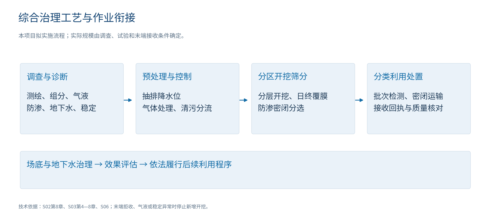
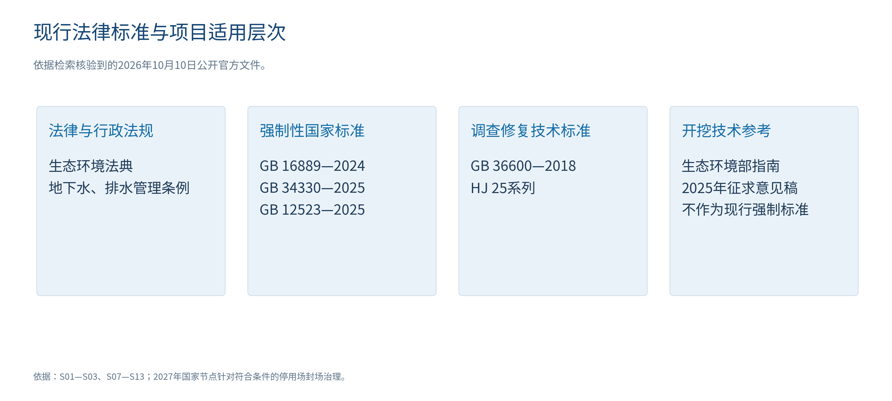
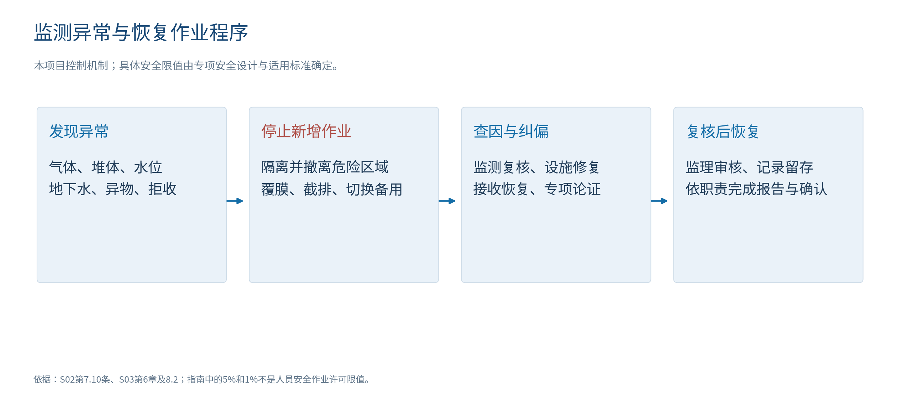
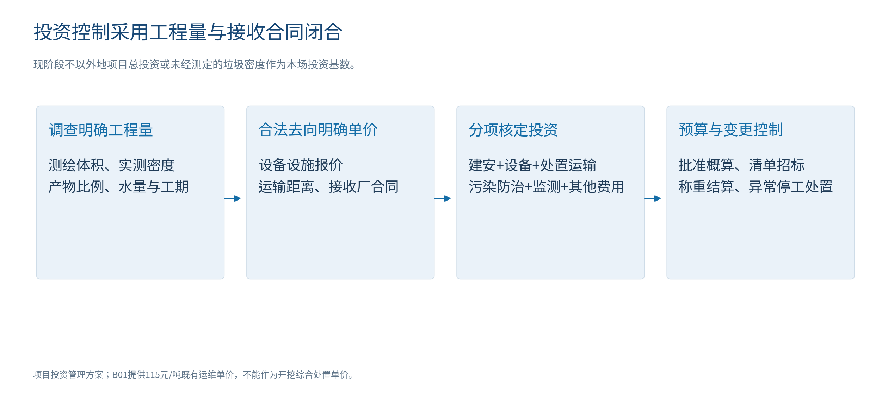
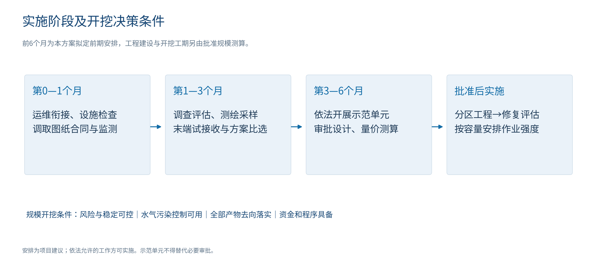
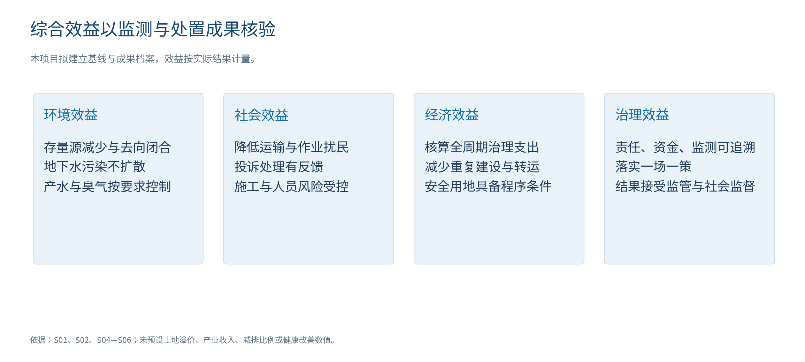

# 大岭山镇旧飞鹅生活垃圾填埋场综合治理方案

官方依据与全国案例论证版

项目主体：大岭山镇旧飞鹅生活垃圾填埋场综合治理项目

编制基准日：2026年10月10日

本项目治理对象包括存量生活垃圾、持续产生的渗滤液与膜浓缩液、填埋气体，以及经调查确认需要治理的场底土壤和地下水。场地范围以权属和测绘成果确定，治理目标为污染源有序削减、环境风险受控、全过程合规处置，并为场地后续安全利用创造条件。

## 项目决策摘要

旧飞鹅填埋场已经实施封场整治，场地工作资料记载2019年通过销号验收。与此同时，资料记载平均渗滤液处理量仍约170吨/日、膜浓缩液外运约20吨/日；现有运维合同至2026年12月31日。本项目首先保障封场设施与处理站持续运行，立即开展污染诊断、存量测绘、稳定性评估和末端接收核实，形成“一场一策”治理方案。[B01；S04（十三）；S05二（四）]

本项目以“维持现有污染控制—调查与分区—依法实施示范单元—按风险和处置能力确定开挖规模—场底与地下水治理—效果评估和后期管理”为实施主线。分区密闭开挖、筛分及合法利用处置列为重点论证路线；现阶段不把全量开挖作为已批准结论。若调查证明局部源区控制即可达到治理目标，采用重点开挖与其余区域维护相结合的方式；若污染源分布广、工程条件可控且所有产物去向落实，再论证全量开挖。

急迫性主要来自仍在持续的液体污染治理负荷、封场后法定维护义务、运维合同衔接，以及国家关于隐患排查和高风险场地综合治理的要求。当前资料未提供完整原始监测、衬层检测及风险评估报告，不能据此认定本场污染超标、已属高风险或即将发生事故，也不能把国家2027年封场治理节点解释为本场必须在该年前全量开挖。[S02第7.9、8.7条；S04；S05]

海南、江西官方现场调研确认开挖筛分实践，北京阿苏卫官方资料确认成套设施配置。本场规模工程须落实风险控制、水气设施、全部产物去向、工程量及资金程序。[C01；C02]

前6个月拟完成运维保障、调查比选及依法允许的示范工作。既有量价折算服务费约713.6万元/年，仅识别运维量级；开挖投资和工期按实测工程量、能力和合法接收报价核定。[B01；本方案计算]

|当前项目安排|具体成果与进入下一阶段的条件|
|---|---|
|立即保障持续运维|处理站、膜浓缩液接收、堆体监测、导排及覆膜维护不中断；完成合同衔接|
|开展统一调查与测绘|确认库区边界、实际存量、液位、组分、衬层、周边敏感点与地下水状况|
|比较三种治理方案|维护强化、重点开挖与全量开挖按同一治理目标和全周期成本比较|
|依法开展示范单元|先具备必要程序和污染控制条件；取得实际组分、接收适应性、产水量与单位作业成本|
|决定规模工程|风险、安全、末端去向、环保设施、投资及程序均满足要求；分区实施并记录全过程|

## 1 场地基本情况与治理边界

### 1.1 既有建设及运行情况

场地位于大岭山镇旧飞鹅村，场地工作资料记载1996年开始使用、2019年7月1日正式封场，封场整治占地106845平方米。项目保留已形成的堆体整形、覆盖、导排、绿化和监测设施，并把其运行状态纳入治理前调查。[B01第1—2页]

图1　场地历史与持续管理责任。资料所引销号验收函尚需调取原件，历史验收不替代现状风险评估。

|基础项目|资料记载及口径|本项目处理方式|
|---|---|---|
|场地封场|2019年7月1日正式封场整治；资料记载2019年12月16日通过销号验收|调取东城综函〔2019〕1688号及竣工图；保留有效封场成果|
|封场占地|106845平方米，折合约10.68公顷、160.27亩|仅为既有整治面积；新增临时用地和最终可利用面积另行核定|
|垃圾存量|B01为250万立方米；B02为170万立方米|两种资料口径未统一；以现状测绘和历史基底恢复确定工程量|
|历史整治投入|B01记载约1261万元，含前期|属于2019年封场整治，不是当前开挖投资基准|
|堆体监测|16个监测点，资料记载每月形成报告|核对布点、位移序列、设备状态和警戒值，按开挖工况补充|
|环境监测|资料记载地下水、地表水、气体季度监测|取得原始报告、采样位置及指标，建立现状基线|
|处理站场地|占地6175平方米，建构筑物面积2100平方米|核查实际设施布局、承载、管线和可改造空间|
|渗滤液设施|常规规模180吨/日，应急规模300吨/日；预处理＋集装箱式两级DTRO|不把两种规模直接相加；以可持续达标能力确定新增负荷|
|现有负荷|平均渗滤液170吨/日；膜浓缩液外运20吨/日|属于工作资料记载负荷；不得作为全年实绩或开挖产率|
|累计处理量|2018年10月至2026年4月30日累计68.81万吨|保留统计截止日，核对计量及结算台账|
|调节池|记载1座约30000立方米，无收集井、环场导排收集|池容不等于存量或可用容量；堆体降液位措施另行设计|
|运维合同|资料记载2024年12月31日至2026年12月31日，处理单价115元/吨|核对合同原件、服务范围、调价和结算条款；及时衔接|

基础数据来源：B01第1—6页，B02存量信息；公顷、亩数按面积换算。上述运行负荷沿用场地资料的吨/日口径，水系统设计时按实测密度、流量和污染负荷核算，不能未经换算直接等同立方米/日。

### 1.2 现阶段必须核实的工程边界

本项目的调查边界覆盖实际垃圾堆体、渗滤液收集和处理设施、历史排水路径、场底及侧向可能受影响区域，以及经水文地质调查识别的地下水下游受体。治理边界根据调查结果确定，不以既有围栏或封场面积机械替代污染边界。土地权属、库区基底、堆体高度、原防渗结构、邻近居民和水体距离等，须以档案及现场成果补齐。[S02第8.8—8.9条；S07第41、45条；S12]

场地资料记载处理产水经尾水专管进入市政污水管网，再进入连马污水处理厂；膜浓缩液由外部单位运输并接收。本项目核查既有环评、排污许可、排水许可、接收合同和接收设施批准范围，新增开挖负荷按现行标准及许可条件办理相应手续。接收单位过去承接过浓缩液，不等于未来已承诺开挖期间全部新增量。[B01第3—6页；S02第9.2条；S08；S09]

## 2 法律、标准和政策依据

### 2.1 2026年现行体系

《中华人民共和国生态环境法典》自2026年8月15日起施行，原环境保护法、环境影响评价法、固体废物污染环境防治法、土壤污染防治法等法律同时废止。项目法律依据采用法典；旧文件中对原法律的引用按其发布背景理解，具体实施服从现行法律、行政法规、标准和许可要求。[S01第1242条]

图2　项目文件适用层次。征求意见稿及外地地方实践用于技术论证，不能替代广东、东莞项目审批要求。

|文件|对本项目的约束或指导|具体适用位置|
|---|---|---|
|生态环境法典|回收物质按规定用途标准使用；处理设施不得擅自关闭、闲置或拆除；监测依法实施|S01第511—513条；建设、排放及修复遵守对应章节|
|GB 16889—2024|封场后继续处理渗滤液和气体；衬层检测、地下水风险评估、异常应急；开发前调查评估|S02第7.8—7.10、8.7—8.9、9.2条|
|地下水管理条例，2026年修订|填埋场防渗漏、地下水监测井、风险评估和修复纳入地下水防治内容|S07第40、41、45条|
|城镇排水与污水处理条例，2026年修订|依法取得适用排水许可、执行水质要求，接受接管监管|S08排水许可及排水管理条款|
|GB 34330—2025|确定固废属性，核查利用产物和膜浓缩液管理条件|S09第6—8章、附录A.3 b）2）|
|GB 12523—2025|施工噪声限值、测点及评价；2026年1月1日替代2011版|S10第4章及表1|
|GB 36600—2018，HJ 25.1—2019至HJ 25.4—2019及HJ 25.5—2018|建设用地土壤调查、风险评估、修复与效果评估；不替代固废属性判断|S11—S13|
|固体废物综合治理行动计划，国发〔2025〕14号|隐患排查、“一场一策”、持续治理、合规资金支持及责任落实|S04（十三）、（二十三）、（二十五）|
|固体废物污染防治“十五五”规划，2026年|建立隐患台账、高风险场地综合治理，处理积存渗滤液、防止地下水扩散或加重|S05二（四）|
|污染地块修复与开发建设衔接指导意见，2026年|分区调查、程序衔接、修复方案与开发参数协调，严格限制重大安全隐患修复方式|S06二至五|
|开挖治理污染防治技术指南，2025年征求意见稿|调查、预处理、开挖、分选、产物去向、监测与应急技术参考|S03第4—8章；检索取得版本为征求意见稿|

HJ 25标准组在本表中分别为HJ 25.1—2019、HJ 25.2—2019、HJ 25.3—2019、HJ 25.4—2019；HJ 25.5为2018版。其他工程设计、恶臭、颗粒物、焚烧和安全标准，在专项设计中按主管部门最新有效文本及相应许可要求落实。征求意见稿中的数值若被本方案采用，均作为拟采用的技术控制参考，不能表述为已生效的国家开挖强制条款。

### 2.2 三项直接影响项目决策的要求

第一，封场后管理存在明确延续条件。GB 16889—2024第8.7条要求继续运行维护渗滤液收集和导排系统，继续处理填埋场产生的渗滤液和气体并定期监测，直到填埋场产生的渗滤液中水污染物浓度连续两年低于表2、表3限值。处理站产水达标不等于未经处理的填埋场渗滤液达到该终止条件，现有资料不足以支持停止后期治理。[S02]

第二，国家2027年节点要求符合条件的停用填埋场完成封场治理。《行动计划》规定，2024年底前停用且无后续使用计划的填埋场，原则上到2027年全部完成封场治理。本场资料已经记载封场验收，当前重点是核实后期维护与隐患治理，不将该政策误读为全量开挖的统一截止日。“十五五”规划要求完成高风险生活垃圾填埋场综合治理，但本场是否属高风险须依据专项调查认定。[S04（十三）；S05二（四）]

第三，垃圾清运、场地环境修复与开发利用是相互关联的不同任务。垃圾挖除以后仍需确认场底土壤和地下水风险；场地后续利用必须履行相应调查、评估、修复、效果评估与规划程序。大面积深基坑方案应特别核查安全风险，不能以尽快开发为由跳过污染诊断和修复效果评估。[S02第8.8条；S06；S12—S13]

## 3 治理必要性与急迫性

### 3.1 治理必要性

场地存量垃圾仍是渗滤液和填埋气体的物质基础，封场覆盖降低雨水入渗并控制暴露，但不等于存量污染源已经清除。资料记载封场后仍有持续渗滤液及浓缩液处置负荷，说明本项目需要从长期运维转向“源区诊断—风险削减—维护优化”的综合治理，比较长期维护和源头削减的全周期成本。[B01；S02第8.7条；S03第4—6章]

场地再利用同样要求独立论证。106845平方米是历史整治面积，不能直接当作已经具备建设条件的土地。工程方案应同时解决污染残留、堆体沉降、残余气体及地下水问题，再确定可利用范围和用途，以免治理设施刚拆除即发生新的环境风险。[S02第8.8条；S06]

### 3.2 当前急迫任务的客观依据

图3　资料记载负荷与名义规模对比。170÷180＝94.4%仅为名义量比，不能替代峰值、故障停机和处理水质条件下的余量评估。

|急迫事项|已掌握事实或文件依据|当前行动|
|---|---|---|
|运维衔接|B01记载合同至2026年12月31日；封场后维护义务仍持续|立即落实下一服务周期、交接清单与备用接收安排，避免处理、导排和监测中断|
|新增排水承载|资料平均170吨/日、常规180吨/日；开挖及预处理可能增加排水|先实测存量、峰值和设备可用率；污染水接收能力不足时不启动新增开挖|
|浓缩液处置|资料记载外运20吨/日；新标准对膜浓缩液及利用处置属性有具体规定|核查固废属性、接收批准范围和合同余量，独立计量与备用渠道|
|衬层与地下水调查|未取得原始衬层检测和连续监测序列；S02第7.9条要求定期检测和评估|核对最近检测时间，按结构可检测性实施检测和污染诊断，修复失效环节|
|国家隐患治理|S04、S05要求台账及一场一策，防止地下水污染扩散或加重|建立问题、责任、措施、时间与复核台账；认定高风险后按要求升级治理|
|封场设施与极端天气|已封场场地仍依赖覆膜、排洪、导排和处理系统|开展雨前检查、积水及调蓄能力核定、备用供电和应急演练|

本项目的急迫性体现为上述保障和调查工作应当立即推进。对开挖规模和施工时点，则以实测风险、气液条件和末端能力控制。如果发现地下水污染加重、渗滤液外溢、异常位移或有毒可燃气体异常，立即启动针对性应急和源区控制，不等待总体工程招标完成。[S02第7.10条；S03第8.2条]

### 3.3 风险分级与治理优先顺序

本项目首先排查人员安全、液体外溢、边坡失稳和地下水异常等需立即处置的问题；其次修复或补齐渗滤液、气体、防渗、监测环节；在此基础上比较局部或全量开挖。现状风险分级以污染诊断、受体识别、稳定性和运行工况的调查评估结果确定。治理优先顺序由调查认定的实际问题确定，既不以历史封场验收替代风险评估，也不以资料缺失等同风险已发生。

## 4 全国官方案例与本项目借鉴

### 4.1 跨地区开挖治理实践

深圳市城市管理和综合执法局2023年5月24日发布的现场调研记录，明确调研组赴海南三亚、海口颜春岭和江西吉安泰和等填埋场，实地考察库区维护、配套设施运营及开挖作业现场，了解开挖筛分处置、工期管理、搬迁和生态修复问题。该记录证明跨地区存在实际开挖和筛分实践，但未公布各项目总投资、工程量、完成率和利润。[C01正文]

|地区与案例|官方资料直接确认的事实|本项目采用的经验|证据适用边界|
|---|---|---|---|
|海南三亚填埋场调研对象|官方记录包括三亚现场开挖、配套设施和筛分处置流程考察|把原场维护、处理设施与开挖同时纳入组织计划|记录未列具体场名、规模和治理完成情况，不扩展为特定未核实项目|
|海南海口颜春岭|官方现场调研明确点名；考察开挖作业及搬迁修复相关问题|开挖前落实接收设施和工期衔接，保留处理能力|未披露投资、工程量和经济回收数据，不作为单价标杆|
|江西吉安泰和|官方调研明确地点，涉及开挖筛分及生态修复问题|按地形、场底和末端条件分区，记录作业问题和纠偏|不据调研记录声称已竣工或达到某种收益|
|北京阿苏卫园区|官方开放资料列陈腐筛分3000吨/日、焚烧3000吨/日、渗滤液850吨/日的设施配置|固体去向与水处理配套，不能只有筛分线而无最终接收能力|数据属于配置规模，不是实际年处理量、垃圾清除完成量或本场处理率|

案例来源：前三项C01，第四项C02。不同设施的设计规模不构成物料收支比例，不能用850÷3000作为本场产水系数。

### 4.2 广东浓缩液技术与地方监管实践

深圳市城管部门2026年3月19日公开信息确认，广东省住建厅科技项目《垃圾填埋场渗滤液膜浓液处理技术研究》于3月12日通过科研验收，组合技术为“高效物化沉淀＋强化生化处理＋PS高级氧化”。本项目可将该技术作为浓缩液处理比选和针对本场水质的中试候选；科研中试验收不等于在本场全规模连续达标、成本确定或可直接替换DTRO。[C03]

深圳2024年鸭湖填埋场地下水检查信息同时开展地方维护、搬迁规范宣贯，确认当地《已封场生活垃圾填埋场维护规范》《生活垃圾填埋场搬迁技术规范》于2024年7月1日生效。这说明封场维护、地下水监测与搬迁监管具有衔接实践。本项目依法执行广东、东莞实际适用文件，不直接将深圳地方规范作为本镇强制性规定。[C04]

## 5 治理目标与方案比选

### 5.1 项目治理目标

本项目以查清存量与污染状况为基础，形成确定的污染控制目标和工程边界。施工期间，污染水全部纳入防渗收集和合法处理系统，气体、恶臭、颗粒物和噪声按适用标准及许可控制，地下水污染不得因施工扩散或加重；各类产物依法分类利用或处置，场底残留和地下水问题按调查结果治理。完工后完成规定的效果评估及后期管理，后续利用履行相应程序。[S01—S03；S06—S13]

### 5.2 三种路线的同目标比较

|路线|实施内容|适用条件|主要限制与费用边界|
|---|---|---|---|
|A：维护强化与风险管控|修复覆盖、导排、防渗；水气持续处理；地下水阻隔或抽提等经论证措施|源区可控、风险目标能达到，现阶段不需大规模清挖|存量源保留，持续运维与后续监测不可省略；场地利用受稳定及风险条件限制|
|B：重点源区开挖＋其余区域维护|对问题源区分区开挖，筛分及合法去向，剩余堆体维护与监测|风险或工程问题集中，局部治理足以达到目标|必须证明边界、剩余区稳定和长期控制有效；不能因少挖而转移污染|
|C：全量分区开挖综合治理|依次挖除存量垃圾，分类处置，场底土壤和地下水治理、效果评估|源区广泛或后续利用需移除堆体，全部去向、风险和资金具备|工程量及处置费用较大，施工暴露和深开挖风险需严控；挖完不等于完成地下水修复|

方案比较采用同一风险目标、时间边界和费用范围，计入建设、运输、末端处置、水气控制、监测、异常处置及后期维护。对于监测不支持高风险、工程量未核定或末端未落实的场地，不凭主观评分提前锁定最昂贵路线。重点论证B、C，A作为持续控制与比选基准。

### 5.3 规模开挖的可行性条件

技术上，分区开挖筛分具有官方记录支持，但本场需验证组分、含水率、热值、气体与稳定工况。空间上，作业面、沥水、筛分、分产物贮存和道路必须有防渗、防雨和安全净距，并核查地基承载；6175平方米为既有处理站占地，不能直接当作分选场可用面积。法律上，需要按实际项目性质落实建设、环评、排污、排水、固废转移及修复程序。经济上，全周期费用必须与资金安排对应，禁止将未批准开发收益当作项目资金来源。[B01；S01—S03；S06；S08—S09；C01—C02]

## 6 治理前调查与示范工程

### 6.1 调查工作与成果

|调查内容|具体工作|形成成果与用途|
|---|---|---|
|档案与权属|调取征地、历次设计竣工图、封场验收、底部防渗、环评许可、运维和接收合同|确定责任及合法边界，识别原设施可保留部分|
|垃圾量及基底|地形测绘；结合历史地形、勘探恢复基底，分区计算体积；测定湿密度|统一170万、250万立方米差异；体积和质量不混用|
|垃圾组分与筛分|按历史填埋分区、深度和差异采样，开展含水、组分、筛分试验及必要污染特征分析|得到各产物质量比例、沥水量和适配工艺；无固定套用比例|
|堆体及结构|复核16个点位和位移序列，查明坝体、侧坡、支护、防渗结构与收集管|不同液位、开挖深度和机械荷载下稳定验算|
|水文地质与污染|识别含水层、流向、上下游和敏感受体；核对监测井和历史水质，开展土壤调查|确定背景与异常变化、污染范围和修复目标|
|气体与稳定化|调查甲烷、硫化氢等及堆体稳定化状态，识别需要预处理的区域|确定气体抽排、好氧预处理、防火与安全方案|
|液体和处理设施|测量堆体及调节池液位、存量、雨天变化；核实实际处理能力、浓缩液产量和外运|形成水量水质平衡和新增设施设计输入|
|末端能力|核对接收厂批复、许可、现有负荷和可承接日量；样品试验与试接收|明确所有产物去向、质量条件、价格和备用渠道|

调查按S02、S03第4章、S07及S12适用要求执行。布点、数量和深度由现场条件和规范设计确定，不以固定少量样品替代代表性调查。涉及井、池或封闭空间的工作执行独立安全程序。

### 6.2 示范单元

本项目在调查明确、依法完成所需程序、处理设施可用和接收条件已落实的区域设置示范单元。示范单元覆盖代表性垃圾层位和不同含水情况，记录“开挖输入—沥水—各产物—外运—库存”的质量收支及完整工作日运行数据，形成量价、能耗、气液负荷和接收适应性成果。

示范单元设备包括适配的筛分、金属分离和必要轻重分选，具体筛孔、流程和能力通过试验确定，不预先认定所有垃圾必须破碎或所有细料可以利用。需破碎时先隔离异常废物并完成气体安全评估，避免含气物料及异常物混入高速设备。[S03第5.3、6.4—6.5条]

|示范记录|用于放大设计的结果|停止或调整条件|
|---|---|---|
|每日各类产物量、含水和质量|实际筛分比例、稳定产能、合法去向与接收率|出现未识别物、超接收条件或大量滞留时调整|
|进出水量及原水特征|处理设施可承载水量和污染负荷，浓缩液独立量|不能达标或合法接收不足时停止新增物料|
|甲烷、硫化氢、温度和臭气|预处理、密闭抽气及安全设计参数|安全报警、局部自热或臭气控制失效时停工查因|
|位移、液位与开挖稳定|层厚、作业面、抽排和边坡条件|位移异常、积水或稳定不足时停止危险区作业|
|计量、人工、设备与转运|工作包实际用量和可核验单价|质量收支不闭合、去向回执缺失时纠偏|

## 7 开挖治理与污染防治方案

### 7.1 总体流程与分区组织

本项目采用分区、分层和小范围暴露的作业方式，按照末端接收能力组织开挖。保留有效覆盖和原有水气控制设施，对正在开挖的单元设置临时截洪、防渗导排、抽气及安全监测；未开挖区维持原覆膜和维护，完成区尽快进入场底调查或覆盖管理。作业道路与临时设施避开未经核查的薄弱坝体和边坡。[S03第6.3.1—6.3.3条]

图4　拟采用治理流程。调查确认稳定化程度后确定是否需要好氧预处理及其工艺，不对全场机械套用统一预处理期限。

### 7.2 渗滤液与浓缩液控制

抽排或预处理之前，本项目查清堆体积存液、调节池积存液、持续产液，以及施工新增沥水和冲洗水。原收集系统资料记载无收集井，环场导排是否能降低内部液位须经调查；必要时设置分区抽提设施，避免仅抽空调节池而堆体高液位仍未下降。[B01；S03第6.1.1条]

开挖前将水位降低至安全工况。参照征求意见稿第6.3.5条，单元渗滤液水位控制在开挖单元底部以下1—2米，并以稳定验算复核抽排和开挖进度。地下水抽提和堆体渗滤液抽排采用可识别的独立系统，防止不同污染程度水体无序混合。[S03；S07]

图5　拟建水系统关系。浓缩液不是已经达标的产水，禁止把其独立去向省略。

|液体环节|本项目措施|核验与运行条件|
|---|---|---|
|清污分流|库区外截洪绕行；作业区降雨、沥水、洗车及设备冲洗水进入污染水收集系统|每日巡查连通、堵塞、围堰及膜破损；雨前复核|
|调节和应急|核定实有液量、可用调蓄及应急余量，设置液位监控、备用泵和供电|不能以30000立方米设计容积直接当作可用应急池容|
|现有DTRO|评价预处理、膜污染、供电、停机、产水水质和浓缩液负荷|180、300吨/日名义规模经实际连续运行核定，避免未经试验扩载|
|新增处理|根据新增污染负荷比选扩建、临时设施及合法外部接收；按本场原水中试|接收厂正常运行和处理效果不得受影响；设施和程序先于新增开挖|
|纳管产水|核对排水许可、污水厂接收条件、合法合同及适用排放限值|按GB 16889第9.2条执行间接排放要求及更严格许可条件；资料中的表2口径不自动替代现行纳管要求|
|膜浓缩液|独立储存、计量、运输和接收回执；核查固废及危险废物属性|GB 34330附录A.3明确列出膜浓缩液；结合第8.1条等适用条件核定管理方式，不一概认定危废|
|处理残渣和污泥|按来源、属性分类，防渗、防雨、规范台账和转移|接收许可覆盖对应类别；禁止混入普通土料和细料|

依据：S02第9.2条；S03第6.1、6.4条；S08；S09。原资料记载过去有浓缩液回灌，本项目不以回灌作为减少外运的默认措施。任何变更均须满足现行标准、许可和污染风险控制要求。

### 7.3 气体、恶臭、颗粒物与安全控制

先调查填埋气体、垃圾稳定化和水位，针对尚不符合开挖条件的区域实施抽气或经验证的好氧预处理。注气前识别自热、火灾和边坡风险；设置温度、气体与系统运行监控，异常时停止注气、隔离并采用专项措施，防止把环境治理变为火灾风险。[S03第5.2、6.2条；本项目风险控制设计]

开挖区采取膜下抽气、缩小作业面、及时覆盖和适配除臭；筛分车间采用密闭、防渗、局部集气及集中处理，物料传输和装卸控制散逸。通风除臭系统同时开展防爆和职业健康评估，不以增加抽风代替人员保护。治理车间按垃圾性质选择除尘和臭气处理工艺，避免高尘负荷、湿气和腐蚀性气体造成设施失效。[S03第6.1.3、6.2.4、6.3.6、6.4.4—6.4.5条]

|技术参数或措施|官方参考内容|本项目适用说明|
|---|---|---|
|预处理气体核验|停止抽注气24小时后检测注气井和抽气井甲烷，预处理要求低于5%|S03第6.2.1条；仅为稿件中的堆体预处理指标，不能作为人员进入或机械安全阈值|
|预处理期限|根据甲烷和含水情况确定，不低于12天|S03第6.2.6条；达到天数不自动具备开挖许可|
|预处理层深|宜分层，深度宜5—6米|S03第6.2.3条；结合场地液位、结构和工艺试验采用|
|作业面气体监测|作业面上2米范围1—3点，至少每日1次，甲烷超过1%加密|S03第7.3条；环境监测最低技术参考，独立安全监测按安全设计连续或更严格执行|
|工艺密闭|沥水、筛分、暂存设施防雨、防渗、集气；输送和装卸防散逸|S03第6.4条；除臭故障、明显散逸时暂停新增物料|

人员作业采用独立的可燃气体、氧气及有毒气体检测报警和安全作业制度，由专项设计明确职业接触限值、报警设定、受限空间许可、机械防爆和应急疏散条件。任何井池进入作业不得用征求意见稿的5%或1%甲烷指标替代安全许可判断。[S03第6.1.6、6.3.6（3）条]

### 7.4 开挖层厚、场底保护与稳定

开挖按从上到下、从高到低、分区分层作业，依据岩土调查和专项验算确定边坡、作业面、机械荷载和层厚。参照征求意见稿第6.3.5条，一般分层厚度不超过5米；本项目不预设整场一次挖到底，深度与地形不明确前不设计大面积深基坑。每次改变液位或开挖形态，复核相邻堆体、坝体和临时支护的稳定。[S03；S06三（五）]

每日结束作业及时覆膜并完善临时截排水。剥离的未污染覆土与垃圾分开暂存；污染覆土不得冒充干净土。对有人工防渗衬层的区域，接近场底1米时加强监控、降低机械破坏风险，垃圾清除后再按方案处理衬层；对无人工衬层的区域，清查明显污染土，并根据调查、风险和修复目标治理。[S03第6.3.3—6.3.4、6.3.8条；S12]

### 7.5 沥水、筛分与固体去向

当含水率大于40%时，参照稿件第6.4.3条先沥水后筛分；沥水全部收集处理。筛分设施设防渗地面、收集沟、防雨和集气，按来源单元批次处理和计量。产物设置明确分区、标识和库存上限，库存上限由可用设施、合法接收日量和经审批的贮存条件核定；末端拒收或库存达到控制值，减少或停止新增开挖，不依赖露天扩大堆场。[S03第6.3.1、6.4条]

图6　拟采用分类去向。GB 36600风险筛选、固废属性和实际使用条件分别核验。

|产物|检测及核验|去向与失败时处理|
|---|---|---|
|轻质可燃物|批次含水、热值及接收设施规定的氯等指标，确认许可和余量|接收厂满足要求后焚烧等合法处置；不满足条件时调整预处理或其他合规路径|
|金属|分离纯度、附着污染及渠道合规|按合规回收渠道利用，合同和计量留痕|
|无机惰性物|粒径、工程性能、污染特征、用途和属性|满足实际工程及管理条件方可利用；否则合法处置|
|筛下细料|按批次评估有机物、污染特征及拟利用性能；核查固废属性和用途标准|不得只凭GB 36600第二类筛选值外运回填；无合法利用出路时按核准路径处置|
|疑似飞灰、医疗残渣或其他异常废物|单独隔离，识别来源并依法鉴别；禁止再混合稀释|依据最终属性与适用要求选择有相应能力、许可的设施，履行转移监管|
|废膜、废管及处理残渣|来源记录、污染和属性判断|相应回收、利用或处置，不混入“清洁覆土”|

依据：S01第511条；S03第6.3.10、6.5条；S09。项目合同预先规定拒收、退运和异常鉴别责任，任何未检验或未获实际去向的物料不得按产品出售。

### 7.6 土壤与地下水治理

地下水调查以水文地质关系和背景值为基础，区分历史污染、施工影响和本地背景。若发现污染或进一步扩散迹象，及时查找渗漏、地下水通道及高液位问题，可经论证采取抽提处理、堆体排水、防渗修补或垂直阻隔等措施，措施须与水量处置能力和地下水流场评估衔接。[S02第7.10条；S03第6.1.5条；S07]

场底污染土按调查及风险评估确定治理范围、目标和修复技术，不把所有场底土直接外运，也不因垃圾已经移走即认定土壤无风险。修复后由规定的效果评估程序验证。地下水恢复可能晚于垃圾清运，项目保留后续监测、抽提或管控预算和责任，按评估结果调整维护期限。[S06；S12—S13]

### 7.7 噪声、运输及天气防护

建筑施工噪声按GB 12523—2025第4章执行，一般场界昼间70、夜间55分贝，夜间最大声级超限幅度不高于15分贝；测点无法在场界测量或需在敏感建筑室内测量时，按相应条款确定位置及修正评价，不机械套用普通场界限值。[S10第4.1—4.4条]

场内运输与外运采用密闭、防遗撒车辆，出入口设底盘车轮冲洗和除臭，冲洗水进入污染水系统。路线核查居民点、学校、交通承载及敏感时段，减少集中排队和夜间扰民；异常投诉、道路遗撒与异味记录联动作业管理。[S03第6.3.6、6.5.4条；本项目运输管理安排]

台风、暴雨前检查截洪、膜锚固、边坡、液位、备用电源及调蓄。天气达到专项方案停工条件时停止开挖和高风险设备作业，保留必要安全运维；雨后复核位移、积水、收集系统和气体再恢复作业。设计降雨与警戒值由专项设计采用实际气象和工程资料确定，不凭经验虚设。

## 8 环境监测、风险与应急管理

### 8.1 分阶段监测

治理前取得连续历史资料与现状基线；施工期间同时监测排放、地下水、气体、位移和液位；完成单元及竣工后按效果评估和后期维护要求开展监测。监测记录与作业单元、开挖量、天气、设施工况对应，使异常变化能够溯源。[S02；S03第7—8章；S12]

|对象|施工期拟采用安排|依据及控制动作|
|---|---|---|
|地下水|利用合格既有井，必要时补井；按稿件至少每周1次，异常加密|S03第7.2条；指标遵守GB 16889；结合背景及流向判别，查因并阻止扩散|
|甲烷及安全气体|环境监测采用稿件1—3点、至少每日1次及超过1%加密；安全报警按专项方案更严格实施|S03第7.3及6.3.6（3）条；安全异常立即停工隔离|
|有组织恶臭及无组织排放|按稿件至少每月1次，敏感点或扰民情况增设在线监测，许可有更严规定的执行更严要求|S03第7.4条；异常暂停相关新增作业并复核除臭|
|处理水与浓缩液|保持既有在线及自行监测，按实际新增工况、许可和接收条件调整；分别计量|S02第9.2条；接收能力、产水指标与库存联动控制|
|位移及水位|维持原监测，开挖变化和暴雨工况加密；频次与警戒按专项设计|S02第7.8条、S03第6.3.2条；异常停止危险单元|
|噪声及运输|按GB 12523—2025规定测点和方法，重点关注敏感时段、投诉和工况变化|S10；采取隔声、维修、错峰和路线调整|

上述稿件频次作为本项目拟采用技术参考，并不意味着该稿件已生效；环境监测不能替代职业健康、安全生产监测。项目按实际许可和主管部门要求确定最终方案。

### 8.2 具体风险点和应对

图7　发现异常后的项目控制程序。恢复作业须满足纠偏、复核和记录要求，不能只凭进度需要恢复。

|风险点与触发迹象|处置措施|责任安排与复核成果|
|---|---|---|
|内部积液或外溢，液位升高、收集堵塞|停止新开挖和新增污染负荷；启用抽排、备用设施和合法应急接收，检修防渗导排|施工及运维单位处置，监理核查；形成液位、水量和去向记录|
|甲烷、有毒气体或低氧报警|停止危险区作业、疏散和隔离；核查通风抽气及气体来源，按专项安全条件复测|安全负责人组织，专业单位复核；保留报警、人员清点和复工记录|
|注气造成自热或火情|停止相关注气和物料作业，实施专项防火处置，防止消防污水外排|施工安全组及应急体系响应；气体温度和污水去向复核|
|边坡位移、局部坍塌或机械超载|撤离危险区，停止坡脚扰动；降液位、卸载、支护或坝体加固经专业论证|岩土技术负责人、监理；稳定复核与重新划定作业区|
|浓缩液渠道中断、储罐液位接近控制值|提前减载，不新增开挖排水；启用已核验备用渠道，核查罐体和转运能力|运维单位与业主协调；合法接收及库存回执|
|末端拒收、筛下物滞留|按未落实去向物料管理，停止新增开挖或对应筛分，重新试验及合同确认|项目处置负责人；真实接收能力和复核质量资料|
|飞灰、医疗残渣、油桶等异常物|隔离单独贮存，禁止混料和稀释；依法鉴别并转移至适配设施|施工、环保管理人员；鉴别报告、许可证和转移记录|
|地下水指标异常或污染加重|核查采样和背景，同时查漏；实施防渗修补、抽提或阻隔等论证措施|环保技术负责人及业主；趋势、流场和措施有效性核验|
|恶臭投诉或处理系统失效|缩小并覆盖作业面、停止新增物料，修复集气除臭；敏感点加密监测与反馈|施工及环保组；投诉闭合和复测结果|
|台风暴雨、停电或交通中断|按预案停工，保障覆膜排洪、抽排和备用供电，预留合法转运条件|业主应急协调、施工运维响应；雨后巡查和安全复核|
|工程量与价格明显偏离|核查测绘、称重、组分、合同边界和变更；保留原始记录，依程序调整|业主、监理、造价审核；避免无依据追加费用|

本项目业主统筹突发环境事件和安全应急衔接，施工单位负责作业面处置，运维单位负责水气设施，监理核查控制条件。严重事件按法定职责及时报告并启动相应预案。[S03第8.2条；S02第7.10条]

## 9 投资、运行费用与资金安排

### 9.1 可核算的既有运行费用

场地工作资料提供平均处理170吨/日和既有服务单价115元/吨。若仅以该负荷和单价作365天折算，则年度处理量62050吨、金额7135750元，即约713.6万元/年。平均膜浓缩液20吨/日对应7300吨/年的量级折算。上述计算用于识别现有运维压力，不代表年度实际处理量、既有合同最终结算或未来开挖新增费用。浓缩液、维护、监测等是否包含在服务单价内，以合同原件为准，未核实前不另行重复计费。[B01第3页；本方案算术折算]

|项目|计算或资料口径|用途和限制|
|---|---|---|
|渗滤液处理量折算|170×365＝62050吨/年|仅按资料平均负荷折算；真实年度量以计量台账为准|
|对应服务费折算|62050×115＝7135750元/年|非年度决算；不能作为开挖综合单价|
|膜浓缩液量折算|20×365＝7300吨/年|浓缩液独立量级；不可与渗滤液进水量相加当作新增产水|
|历史封场费用|约1261万元，资料记载含前期|历史封场建设口径；不能替代存量开挖投资|

### 9.2 开挖治理投资工作包

本项目按调查确认的工程量及合法末端价格编制投资，不套用未经核实的外地每立方米或每吨成本。170万与250万立方米未统一，湿密度、各产物比例、原水负荷、接收日量和价格均尚未取得符合本工程边界的资料，现阶段没有可核定的项目总投资或财务净收益。

图8　投资核定流程。分项费用覆盖开挖及后续治理，不以土地出让或产业利润抵减尚未落实的工程支出。

|投资工作包|工程量或计价依据|询价、合同及控制要求|
|---|---|---|
|前期调查评估|测绘、勘探采样、试验、风险评估与专项设计成果|按明确工作内容和检测指标报价，避免重复采购|
|示范单元|代表性垃圾量、运行天数、检测和试接收|分列设施、处置和监测费；形成放大参数|
|开挖及场内转运|经核定分区体积、实测湿密度、机械和道路工况|体积与质量口径分别列示；计量、变更和异常物处理明确|
|密闭分选及暂存|实际日处理量、分选配置、承载、防渗、集气及防雨设施|设备利用率与开挖时序匹配；拆迁和租赁比较|
|气体和预处理|需处理区域、气井、抽注设备及气体处理负荷|按试验验证的方案计价，包含防火安全监控|
|渗滤液及浓缩液|存量、新增水量及污染负荷、设施和接收费用|分别计量；严防服务范围重复计费及合法接收不足|
|外运与末端处置|各产物实际质量×合法接收单价；路线和运输距离|接收质量条件、承诺日量、拒收和备用条款写入合同|
|土壤及地下水治理|调查评估确定的修复范围、措施及后期维护期限|不得把垃圾挖除自动视为此项为零|
|监测、效果评估及管理|实施期与后期监测、评估、监理和管理工作量|独立成果、完整记录、验收与付款条件对应|
|其他费用与预备费|按项目适用编制依据及实际风险确定|依法核定比例与费用，不凭经验虚设固定收益或储备规模|

总投资由工程建设费用、工程建设其他费用及依法核定的预备费等组成，运行及长期维护费用单列。末端费用按产物实际质量计，不以垃圾体积直接乘吨单价。投资编制覆盖税费、运输距离、处理服务边界与停工纠偏要求；建设期利息仅在实际融资安排确定后计列。

### 9.3 资金与经济可行性

前期调查和连续运维按财政及实际管理责任落实资金，规模工程采用与公益治理性质和现金流相匹配的资金安排。符合条件时可研究中央预算内投资等政策工具，但《行动计划》政策支持不等于本项目已获补助、贷款或资金额度，申报与融资不得替代年度支付能力。[S04（二十三）]

项目经济比选采用全周期支出：治理建设、运行、末端处置、后期维护和异常风险费用均纳入。收入只计已经具备质量、用途和接收合同的真实回收交易；无合同的金属回收收入、土地溢价、产业产值和碳收益不计入资金平衡。开挖可能减少存量源与未来治理负荷，但节省额须以实际治理后的产液和维护要求测算，现阶段不将713.6万元折算支出全部认定为可节省收益。

## 10 实施周期与治理前后具体安排

### 10.1 前期与施工安排

图9　前期拟定安排。6个月是本项目组织计划，不能理解为依据案例推定的竣工工期。

|阶段|本方案拟定安排|具体成果与进入条件|
|---|---|---|
|连续运维保障|第0—1个月启动并贯穿全程|合同衔接、设施清单、备用供电和合法接收确认；不得因前期研究暂停治理|
|调查评估与比选|第1—3个月；按调查需要滚动补充|统一工程量、风险与稳定报告、原水和浓缩液条件、末端试验及比选|
|示范和工程前期|第3—6个月，所需程序先行完成|示范量质和成本成果，环保安全专项、设计、概算及接收合同；未具备程序不得提前开挖|
|规模施工|批准后按核定工程量和有效能力确定|临建与污染控制先建可用；分区开挖、称重、检测、外运、场底治理同步|
|效果评估及后期管理|按实际治理成果和标准要求安排|完成土壤地下水评估、设施移交、持续运维责任和后续利用程序|

运维合同据资料至2026年12月31日，当前应提前衔接；本方案阶段计时不改变该合同衔接实际时间。调查、设计和必要审批可依法有序交叉，不能以“示范”为名规避审批。

### 10.2 规模开挖工期的确定方法

垃圾质量M＝测绘体积V×分区实测湿密度ρ。对产物i，其产率fᵢ由示范取得，末端承诺可接收日量为Rᵢ。可持续垃圾处理能力Q不得高于开挖、筛分、合法接收和水气系统中任何一个瓶颈；在同一质量口径下，末端约束可表示为Q≤min（Rᵢ÷fᵢ）。水处理则用示范产水量及污染负荷单独核算，不将水与固体吨数混算。

有效作业日D至少满足D≥M÷Q，日历工期还需考虑合法作业时段、天气、检修、接收厂计划停机、分区预处理、场底修复和效果评估。项目不采用北京阿苏卫3000吨/日设计规模推定旧飞鹅工期。实际工程量和合同接收量确定后，在批准设计中形成工期、备用路线及季度里程碑。

### 10.3 治理前、中、后的闭合措施

|阶段|工程和管理措施|可交付核验成果|
|---|---|---|
|治理前|保护既有封场系统，完成风险与稳定调查、水气设施、末端合同、人员安全和应急准备|现状基线、总图、分区作业方案、污染水平衡、接收许可与合同、审批资料|
|治理中|小范围分区开挖、降液位、覆膜、密闭筛分；所有产物计量、检验、运输和回执；异常停工纠偏|逐日量质台账、监测报告、库存和去向闭合、稳定复核及纠偏记录|
|治理后|场底土壤与地下水治理、效果评估、必要的持续处理和监测；依程序衔接安全利用|清挖边界和高程、修复评估、残余风险和限制、运维移交、后续用地程序资料|

## 11 环境、社会、经济及公共治理效益

图10　效益机制与结果核验。所有结果以基线、施工记录和效果评估确认。

### 11.1 环境效益

综合治理通过污染水收集处理、衬层修补或源区开挖减少持续排放和渗漏风险，采取防扩散措施改善地下水风险控制；分区密闭施工降低暴露造成的臭气与飞散。达到何种污染削减量、地下水恢复程度及维护负荷变化，须以治理前后同口径监测和实际处置量确认。拟核验指标包括合法处置垃圾质量、未处理污染水外逸事件、地下水趋势、处理产水符合许可情况、异常整改结果。[S02—S03；S05]

### 11.2 社会效益

以明确作业边界、密闭转运、噪声和臭气控制、投诉反馈降低邻近社区施工影响；将工人气体、边坡和车辆风险纳入安全专项。公共设施后期维护、治理过程和结果依法公开，使周边居民能够了解项目影响和异常处置。没有健康调查数据时，不量化疾病减少或健康收益。[S01第513条；S03；S10]

### 11.3 经济效益

通过源区治理与维护路线比较，优化财政长期支出；统一工程量和真实去向降低重复设计、盲目扩容和拒收退运成本。合规材料回收收入以真实交易确认，后续土地利用价值以权属、规划、污染与工程安全条件满足后的实际安排确认，不能作为本阶段既得收益。工程招标和合同结算围绕质量、环境与计量成果设支付条件，降低治理投入失效风险。

### 11.4 公共治理和政策落实效益

“一场一策”把业主、施工、运维、接收、监理与监管责任对应到具体台账和成果，落实国家填埋场隐患治理部署与公共环境设施持续运行责任。治理资金、开挖量、去向和监测可追溯，支持财政审计、依法监管和社会监督。政治与治理效益体现为依法履责、风险问题实际解决和公共服务可靠，不能用无依据的荣誉、排名或政绩数字代替。[S01；S04—S05]

|效益维度|项目核验指标|证据来源|
|---|---|---|
|污染源削减|分区清除质量、合规去向及场底残留|测绘、称重、接收回执、效果评估|
|环境风险控制|地下水趋势、水气处理符合情况、异常闭合|监测、设施工况、修复及纠偏记录|
|群众与人员保障|投诉反馈、运输遗撒整改、安全报警及处置|投诉台账、巡查、安全和应急记录|
|财政与工程效率|批准预算执行、实物量结算、变更及后期费用|合同、造价审核、支付和运维台账|
|后续利用条件|调查评估合规、用途及安全限制明确|评审及管理文件、规划和工程成果|

## 12 项目组织、验收与近期工作清单

### 12.1 组织责任

由项目业主统筹调查、设计、资金、审批和合同管理，建立城管、生态环境、自然资源、住建及排水等部门按职责协同的工作机制。专业调查设计单位负责风险与工程边界，施工单位负责现场水气、开挖和运输控制，运维单位负责既有与新增处理设施，接收单位负责按批准范围和合同质量接收，监理核查工程质量、控制条件和计量。第三方检测及效果评估按相应技术规定独立形成成果。

### 12.2 验收与后期移交

工程完成时核验测绘边界及高程、各类产物累计计量与去向、土壤地下水措施、设施运行和监测结果，不以“垃圾已经运走”或“场地已经平整”作为唯一验收条件。修复效果评估、建设项目适用环保程序和土地利用程序分别履行；需保留的处理、地下水管控和监测设施形成清单、维护资金、责任主体和继续运行条件。[S02第8.7—8.9条；S06；S13]

|近期工作|责任及成果|推进时序|
|---|---|---|
|核对并衔接运维和接收合同|业主、运维与接收单位；合同原件、服务边界、备用渠道、交接|即刻启动，衔接2026年12月31日合同节点|
|调取封场、防渗、环评及监测档案|业主、档案及专业单位；图纸、批复、许可、连续监测|与持续维护并行|
|统一测绘和存量口径|调查设计单位；现状地形、分区体积与实测密度|作为预算和工期前置输入|
|完成污染、液位及稳定诊断|专业单位；风险及安全条件、水量水质基线|先识别应急事项，再确定示范与总体治理范围|
|核对末端并试验|业主、施工及接收单位；许可、质量条件、承诺量和实报价|所有产物均落实去向后方可放大作业|
|形成比选、专项设计与投资|设计、造价、业主；同目标比选、工作包概算及资金安排|按成果办理适用审批，再决定规模工程|
|依法实施示范和规模治理|施工、运维、监理；量质、环境、安全和费用成果|每个阶段满足控制条件后进入下一阶段|

本项目近期将保障持续运维、统一调查、落实末端和形成可批准的工程方案作为先行任务。对经调查确认的高风险问题及时专项治理，对规模开挖按条件批准实施，确保投入、作业强度与实际环境改善相对应。

## 附录A 官方文件与案例来源

文内编号对应以下官方原文或场地基础资料。公开文件均检索于2026年10月10日；发布日期与施行日期分开列示。官方链接仅支持其公开内容，未公开的成本、成效及工程量不据此推定。

### [B01] 《旧飞鹅垃圾填埋场场地整治情况》

发布或提供主体：用户提供场地工作资料。时间：数据截至2026-04-30。

定位与适用内容：附件第1—6页；历史封场、处理站规模、运维负荷与合同期限。

文件状态或案例边界：场地基础资料，原始合同、批复和监测报告待核对。

### [B02] 《大岭山旧飞鹅垃圾填埋场背景资料》

发布或提供主体：用户提供场地背景资料。时间：附件未明确统一数据基准日。

定位与适用内容：存量垃圾170万m³，与B01的250万m³口径存在差异。

文件状态或案例边界：仅用于识别场地基础数据差异。

### [S01] 中华人民共和国生态环境法典

发布或提供主体：全国人民代表大会。时间：2026-03-12通过；2026-08-15施行。

定位与适用内容：第511—513条、第1242条；环境影响评价、土壤污染风险管控和修复相关章节。

文件状态或案例边界：现行法律。

官方原文：[点击查看](https://www.mee.gov.cn/ywgz/fgbz/fl/202603/t20260313_1146496.shtml)。

### [S02] 生活垃圾填埋场污染控制标准（GB 16889—2024）

发布或提供主体：生态环境部、国家市场监督管理总局。时间：2024-09-01实施。

定位与适用内容：7.8—7.10、8.7—8.9、9.2。

文件状态或案例边界：现行强制性国家标准。

官方原文：[点击查看](https://www.mee.gov.cn/ywgz/fgbz/bz/bzwb/gthw/gtfwwrkzbz/202408/t20240809_1083681.shtml)。

### [S03] 生活垃圾填埋场开挖治理污染防治技术指南（征求意见稿）及编制说明

发布或提供主体：生态环境部。时间：2025-12-26公开征求意见。

定位与适用内容：4—8章；6.2.1、6.2.6、6.3.1、6.3.5、6.4.3、7.2—7.4。

文件状态或案例边界：检索取得版本为征求意见稿，作为技术参考。

官方原文：[点击查看](https://www.mee.gov.cn/xxgk2018/xxgk/xxgk06/202512/t20251226_1139029.html)。

### [S04] 国务院关于印发《固体废物综合治理行动计划》的通知（国发〔2025〕14号）

发布或提供主体：国务院。时间：2025-12-27印发。

定位与适用内容：（十三）、（二十三）、（二十五）；一场一策与停用填埋场封场治理。

文件状态或案例边界：国家政策文件；2027年节点不等于全量开挖要求。

官方原文：[点击查看](https://www.mee.gov.cn/zcwj/gwywj/202601/t20260105_1139840.shtml)。

### [S05] 固体废物污染防治“十五五”规划

发布或提供主体：生态环境部等六部门。时间：2026-07-08印发。

定位与适用内容：二（四）；生活垃圾填埋场隐患台账、高风险综合治理、积存渗滤液与渗漏治理。

文件状态或案例边界：国家专项规划。

官方原文：[点击查看](https://www.mee.gov.cn/xxgk2018/xxgk/xxgk03/202607/t20260714_1161736.html)。

### [S06] 关于做好污染地块环境修复与开发建设衔接的指导意见

发布或提供主体：生态环境部、自然资源部、住房城乡建设部。时间：2026-01-16印发。

定位与适用内容：二（一）（二）、三（四）（五）、四（六）（七）。

文件状态或案例边界：环境修复与开发建设程序衔接指导文件。

官方原文：[点击查看](https://www.mee.gov.cn/xxgk2018/xxgk/xxgk03/202601/t20260121_1142344.html)。

### [S07] 地下水管理条例（2026年修订）

发布或提供主体：国务院。时间：2026-08-08修订；2026-10-09官网发布。

定位与适用内容：第40、41、45条；防渗漏、监测井与风险评估。

文件状态或案例边界：现行行政法规。

官方原文：[点击查看](https://www.mee.gov.cn/zcwj/gwywj/202610/t20261009_1175922.shtml)。

### [S08] 城镇排水与污水处理条例（2026年修订）

发布或提供主体：国务院。时间：2026-08-08修订；2026-10-09官网发布。

定位与适用内容：排水许可、排水水质及接管监管相关条款。

文件状态或案例边界：现行行政法规。

官方原文：[点击查看](https://www.mee.gov.cn/zcwj/gwywj/202610/t20261009_1175944.shtml)。

### [S09] 固体废物鉴别标准 通则（GB 34330—2025）

发布或提供主体：生态环境部、国家市场监督管理总局。时间：2026-03-01实施。

定位与适用内容：第6、7章、8.1、8.4；附录A.3 b）2）；膜浓缩液及利用产物鉴别。

文件状态或案例边界：现行强制性国家标准；替代2017版。

官方原文：[点击查看](https://www.mee.gov.cn/ywgz/fgbz/bz/bzwb/gthw/gtfwwrkzbz/202512/t20251212_1137618.shtml)。

### [S10] 建筑施工噪声排放标准（GB 12523—2025）

发布或提供主体：生态环境部、国家市场监督管理总局。时间：2026-01-01实施。

定位与适用内容：4.1—4.4、表1；昼70、夜55 dB(A)，特殊测点评价按条款。

文件状态或案例边界：现行强制性国家标准；替代2011版。

官方原文：[点击查看](https://www.mee.gov.cn/ywgz/fgbz/bz/bzwb/wlhj/hjzspfbz/202512/t20251211_1137517.shtml)。

### [S11] 土壤环境质量 建设用地土壤污染风险管控标准（试行）（GB 36600—2018）

发布或提供主体：生态环境部、国家市场监督管理总局。时间：2018-08-01实施。

定位与适用内容：建设用地土壤风险筛选与管制；不等同固废产品合规判定。

文件状态或案例边界：建设用地土壤风险管控国家标准。

官方原文：[点击查看](https://www.mee.gov.cn/ywgz/fgbz/bz/bzwb/trhj/201807/t20180703_446027.shtml)。

### [S12] 关于发布《建设用地土壤污染状况调查技术导则》等5项国家环境保护标准的公告

发布或提供主体：生态环境部。时间：2019-12-05发布实施。

定位与适用内容：HJ 25.1—2019、HJ 25.2—2019、HJ 25.3—2019、HJ 25.4—2019；公告另含HJ 682—2019。

文件状态或案例边界：调查、风险评估、修复及监测技术标准。

官方原文：[点击查看](https://www.mee.gov.cn/xxgk2018/xxgk/xxgk01/201912/t20191209_748356.html)。

### [S13] 污染地块风险管控与土壤修复效果评估技术导则（HJ 25.5—2018）

发布或提供主体：生态环境部。时间：2018-12-29实施。

定位与适用内容：适用范围；污染地块风险管控与修复效果评估。

文件状态或案例边界：技术标准。

官方原文：[点击查看](https://www.mee.gov.cn/ywgz/fgbz/bz/bzwb/trhj/201901/t20190107_688646.shtml)。

### [C01] 深圳市下坪环境园调研组赴海南、江西已封场简易填埋场调研学习

发布或提供主体：深圳市城市管理和综合执法局。时间：2023-05-24发布。

定位与适用内容：三亚、海口颜春岭、江西吉安泰和；实地考察开挖作业现场、筛分处置流程和工期管理。

文件状态或案例边界：官方现场调研记录；未公布投资、工程量、完成率或收益。

官方原文：[点击查看](https://cgj.sz.gov.cn/zwgk/gzdt/content/post_10610768.html)。

### [C02] 北京华源惠众环保科技有限公司（环保设施向公众开放资料）

发布或提供主体：生态环境部公开平台。时间：2021-03-09发布。

定位与适用内容：阿苏卫园区陈腐垃圾筛分3000 t/d、焚烧3000 t/d、渗滤液850 t/d。

文件状态或案例边界：设施设计配置；不代表实际处理量或完成量。

官方原文：[点击查看](https://www.mee.gov.cn/home/ztbd/rdzl/sskf/kfss/bjs/dsipbj/202103/t20210309_823930.shtml)。

### [C03] 广东省住房和城乡建设厅科技创新计划项目《垃圾填埋场渗滤液膜浓液处理技术研究》顺利通过验收

发布或提供主体：深圳市城市管理和综合执法局。时间：2026-03-19发布。

定位与适用内容：2026-03-12科研验收；高效物化沉淀+强化生化处理+PS高级氧化组合中试。

文件状态或案例边界：科研中试通过验收；不是全规模工程绩效或报价。

官方原文：[点击查看](https://cgj.sz.gov.cn/zwgk/gzdt/content/post_12691232.html)。

### [C04] 开展鸭湖填埋场地下水监测检查及地方规范宣贯的工作信息

发布或提供主体：深圳市城市管理和综合执法局。时间：2024-07-29发布。

定位与适用内容：深圳《已封场生活垃圾填埋场维护规范》《生活垃圾填埋场搬迁技术规范》2024-07-01生效。

文件状态或案例边界：用于说明地方监管实践；未引用未取得全文的具体参数。

官方原文：[点击查看](https://cgj.sz.gov.cn/zwgk/gzdt/content/post_11472014.html)。

## 附录B 项目量质与去向台账字段

|台账|必须关联的字段|核验关系|
|---|---|---|
|开挖与筛分|日期、单元、深度、体积、称重、含水、批次、筛分参数|输入质量与各产物、沥水和库存按同口径核对|
|产物运输|物料类别、批次检测、车牌、出场重量、接收单位及回执|出场与接收量、合法用途及拒收记录闭合|
|渗滤液及膜浓缩液|液位、抽排量、原水和产水质量、浓缩液量、设施工况、转运回执|独立统计产水与浓缩液，核查存量变化及合同余量|
|环境与安全|采样点、指标、时间、天气、作业量、报警与整改|异常与单元工况对应，复测后形成纠偏闭合|
|投资与支付|工作包、清单单价、实际量、服务边界、变更、审核及支付|实物成果、环保合规及金额三者对应|

按征求意见稿第8.1条建立完整作业和污染控制记录，并依现行档案与项目合同要求保存。表内字段为本项目管理安排，不等同另行增加的国家标准条款。
